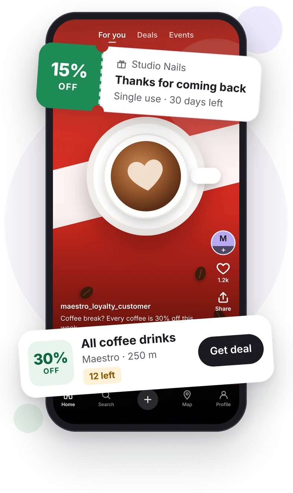

# Website · landing page pictures

The pictures of the MVP landing page (`LP1`, `LP2`, spec in `docs/22-landing-page.md`). **Use these files as they are**; do not rebuild the phone picture in HTML or CSS.

| File | Size (px) | Weight | Use |
|---|---|---|---|
| `hero-desktop.webp` | 750 × 800 | 56 KB | LP1, at left 690, top 100 of the 1440 × 900 page |
| `hero-desktop@2x.webp` | 1500 × 1600 | 109 KB | the same on 2× screens |
| `hero-phone.webp` | 393 × 660 | 42 KB | LP2, full width under the store buttons |
| `hero-phone@2x.webp` · `hero-phone@3x.webp` | 786 × 1320 · 1179 × 1980 | 98 KB · 140 KB | the same on 2× / 3× screens |
| `og-image.jpg` | 1200 × 630 | 70 KB | link previews: `og:image`, Twitter `summary_large_image` |

Rules:
- The hero pictures are WebP (quality 88) with a **transparent** background; they sit on the white page. The link preview is an opaque JPEG.
- Markup:
  ```html
  
  
  ```
  Always set `width` and `height` (no layout shift). No lazy loading: it is the main picture.
- Alt text (EN): "The Merg app on a phone: a short video from Maestro with a 30% off deal on all coffee drinks, and a 15% reward from Studio Nails for coming back". Translate it with the page.
- Serve with a long cache and a content hash in the file name.
- What they show:
  - the app's feed screen (the Maestro deal post, its offer card and the bottom nav);
  - the offer card popping out in white;
  - a reward ticket (as in MA6).

  The places are sample content.
- Source: `../../screens/reference/landing-hero.html` (the same parts as the app screens). The text inside the pictures is set in **Inter**, because Roboto could not be loaded where they were made. To change the content or match Roboto exactly, edit the source, render each block on a transparent background at 2× (hero-desktop) or 3× (hero-phone), and save as WebP.
