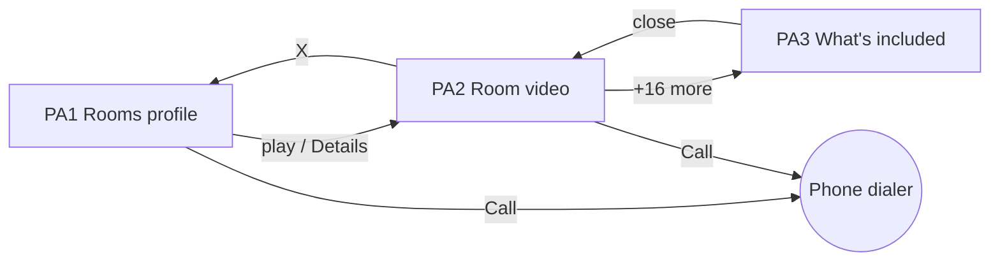
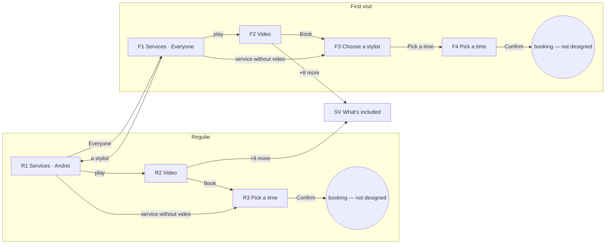
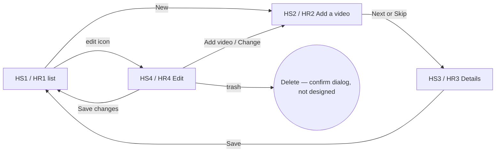
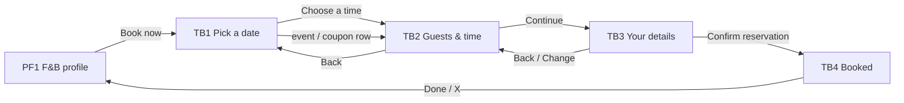
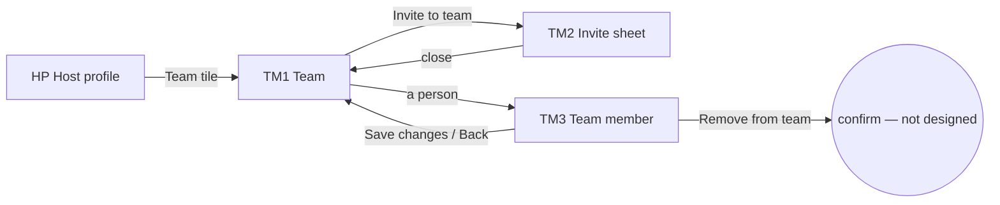
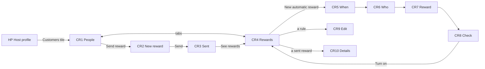
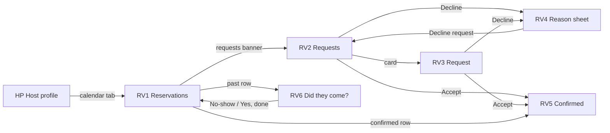
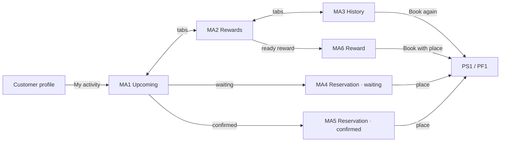

# 05 · Flows and navigation rules

The clickable prototype in `../screens/medium/*.html` follows these flows. `../screens.json` lists every link per screen (`links_to`).

## A. Accommodation (call only)

Rules: accommodations have **no in-app booking**. The only action is **Call** (profile header and video side rail).

## B. Services booking — the Team filter decides the path

| Team filter on the services list | Path | Taps to book |
|---|---|---|
| A stylist (e.g. Andrei) — "regular customer" | R1 → R2 → R3 → Confirm | 3 (play, Book, Confirm) |
| Everyone — "first visit" | F1 → F2 → F3 → F4 → Confirm | 4–5 (adds Choose a stylist) |

Rules:
1. The **side-rail Book** is the only way to book from a video. The info bar on the video is not tappable.
2. **Regular**: R3 opens with the picked stylist highlighted and the **earliest free slot preselected**. The people who can replace that stylist for this service are shown under "Can replace <name>" with their next free time; tapping one switches the calendar to them.
3. **First visit**: F3 must be passed (Anyone or a stylist) before the calendar. F4 = R3 layout **plus Choose an offer** (Any time / coupon / event), which switches F4 ↔ F4C ↔ F4E in place.
4. "Anyone" = the earliest free time among everyone who does this service; the summary must then name the assigned stylist.
5. Services without a video skip the video step (go straight to R3/F3).
6. Back navigation returns to the previous screen (video → list, calendar → video or stylist step, sheet → video).
7. A future improvement (not designed): a signed-in returning customer could be treated as "regular" with their last stylist preselected.

## C. Host — add / edit a service or room

Rules: video first (Skip is allowed; the item then shows "No video yet"). Everything entered in Details is what customers see on the video (caption, chips, info bar, What's included sheet).

## D. Coupons & Events tab
Filter tiles (All / Events / Coupons) filter the grid in place. Tapping a ticket opens its video — **not designed** (proposed: same video overlay with **Get coupon** / **Get ticket** on the side rail).

## E. Public profile CTA by business type
| Category | Header CTA | Video side rail |
|---|---|---|
| Accommodation | Call → dialer | Call |
| Services | Book now (target not designed) | Book |
| Food & Beverage | Book now → **TB1 table booking** | — |

## F. Table booking (Food & Beverage)

Rules (details in `11-table-booking.md` §1):
1. Date first (month calendar, months ahead), then guests + offer + time on **one** screen, then details, then the confirmation.
2. The chosen offer (Any time, a coupon or an event) decides which times are shown and is carried to TB3 (summary strip) and the booking request.
3. Back and Change never lose a pick. A row in TB1's list opens TB2 with that day and offer chosen.

## G. Host — team

Rules (details in `12-team.md` §1): invites wait under **Invites** until accepted; **Paused** people are hidden from booking (R1, F3, "Can replace", "Anyone") but keep their bookings; TM3 services = "Who does it" on each service; the owner cannot be paused or removed.

## H. Host — customers & rewards

Rules (details in `13-customers-rewards.md` §1): only people who booked in the app; rewards are single use (one booking); automatic rewards are monthly, Who is decided at each send from visits in the month before; switching off stops future sends only; Stop reward removes it for people who have not used it.

## I. Host — reservations

Rules (details in `14-reservations.md` §1): every booking made in the app is a request (**Waiting for you**) until the host answers; oldest first; no answer in 24 hours → declined automatically; Decline needs one of two reasons (Fully booked, Closed that day) and has no message; after the end time a reservation is **Done** unless the host marks **No-show** (done by itself the next day); only done reservations count as visits for customers & rewards (§H). The same screens serve services, tables and events.

Bookings that arrive here come from F4 / R3 (services) and TB3 (tables and events): after **Confirm** / **Confirm reservation** the customer's booking is a request, not yet confirmed (see `10-open-questions.md` #36).

## J. Customer — my activity

Rules (details in `15-my-activity.md` §1): Upcoming = WAITING + CONFIRMED; History = DONE, DECLINED (with the reason), CANCELLED; the host's Accept / Decline (§I) moves a row from Waiting to Confirmed or to History; rewards ready to use end soonest first and are used at the last booking step with that place; Rate only on unrated done visits; Book again on declined / cancelled.

