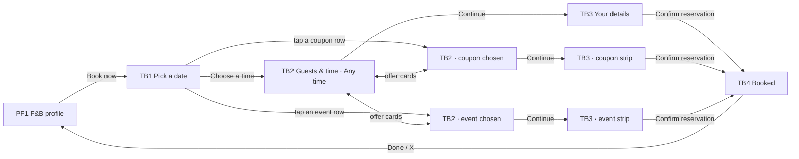

# 11 · Table booking (Food & Beverage) and offers in booking

The full spec of the **Public · Table booking** page in the design canvas, plus the offers section that the salon calendar (F4) now shares with it. Read `01`–`07` first; this file only adds what is specific to these screens.

References for every screen at three sizes:
`../screenshots/{small,medium,large}/<id>.png` (what it must look like) and `../screens/{small,medium,large}/<id>.html` (exact values, clickable).

| Step | Screen ids | Canvas board |
|---|---|---|
| 1 · Pick a date | `TB1-pick-date` | 1 · Pick a date |
| 2 · Guests & time | `TB2-guests-time-any`, `TB2C-guests-time-coupon`, `TB2E-guests-time-event` | 2 · Guests & time · Any time / 20% OFF (coupon) / Wine tasting (event) |
| 3 · Your details | `TB3-details-any`, `TB3C-details-coupon`, `TB3E-details-event` | 3 · Your details · Any time / 20% OFF / Wine tasting |
| 4 · Booked | `TB4-booked` | 4 · Reserved |
| Salon F4 with offers | `F4-pick-time`, `F4C-pick-time-coupon`, `F4E-pick-time-event` | F4 · Pick a time · Any time / 15% OFF (coupon) / Late cuts (event) |

The `C`/`E` screens are **states of the same screen**, not separate screens: build one Guests & time screen and one Your details screen whose content follows the chosen offer.

---

## 1. Flow

Rules:
1. **Date first.** The month calendar comes first because people book weeks or months ahead (events 1–2 months, some reservations 6+ months).
2. **One screen for guests, offer and time.** Picking a different offer never leaves the screen. Only the times section and the bottom bar change.
3. **The chosen offer travels with the booking.** It stays visible in the bottom bar (sticker), in the Your details summary (strip) and in the booking request.
4. **Back keeps the picks.** Back on TB2 goes to TB1. Back or **Change** on TB3 goes to TB2 with the same day, guests, offer and time.
5. Changing the day on TB2 (week strip) reloads that day's offers and times. Guests stay. The offer stays if that day still has it, otherwise **Any time** is chosen.
6. Tapping a row in TB1's list selects that row's first upcoming day and opens TB2 with that offer chosen.

---

## 2. TB1 · Pick a date

Top to bottom (medium values):

| Part | Spec |
|---|---|
| Top bar | 64 tall: back (→ PF1) · "Book a table" 18/500 · "Maestro Bistro · free to book" 12.5 `text.secondary` |
| Month header | 44 tall, margin-top 14: "October 2026" 16/600 · previous / next month (44 buttons, chevron 20). Previous is disabled (`#B9B4C2`) on the current month. Next is disabled on the last bookable month (booking horizon). |
| Weekday row | 7 columns, gap 4, 11.5/500 `text.secondary`, Mon → Sun (follow the locale's first day of week) |
| Day grid | 7 columns, gap 4, cells **48 tall, radius 10**, date 15/600. States below. **No icons or dots in the cells**: events and coupons live in the list. |
| Legend | 11.5 `text.secondary`, 10 × 10 swatches radius 3: Free · Few left · Full / closed |
| List | "Events & coupons in October" 14/600, then one row per upcoming event or coupon of the visible month |
| Bottom bar | "Your date" 12.5 secondary / "Mon, 26 Oct" 17/700 · **Choose a time** (ink, 48, radius 16) |

Day cell states:

| State | Look | Tappable |
|---|---|---|
| Past | transparent, `#C4BFCC` 14/500 | no |
| Free | `calendar.freeBg` `#E7F4EC`, ink | yes |
| Few left | `calendar.fewBg` `#FDF1D8`, ink | yes |
| Full or closed | `bg.soft`, `text.disabled`, line-through | no |
| Today | its availability tint + inset 1.5 ink ring | as availability |
| Selected | ink bg, white | — |

List row (min-height 52, separators `line.rowSeparator`, gap 12):
- **Date badge** 46 × 40, radius 9, `bg.soft`. Weekday 9/700 uppercase `text.secondary`, day 15/800. A multi-day offer shows the range ("MON–FRI" / "26–30", 13/800). Rows that include the selected day use an ink badge with white text.
- **Title** 14/600, 1 line with ellipsis. **Sub** 12.5 secondary, for example "Mon, 26 Oct · from 19:00" or "Mon 26 – Fri 30 Oct · 12:00 – 15:00".
- **Offer badge** 28 on the right (section 6).

## 3. TB2 · Guests & time

| Part | Spec |
|---|---|
| Top bar | as TB1, back → TB1 |
| **When** | Same component as the salon calendar (C14): "When · October 2026" 15/600 + previous/next **week** (44). Week strip: 7 day buttons, gap 6, **62 tall, radius 14**, weekday 11 (first day shows "Today"), date 17/600, 5 px dot. Dot: free `status.success`, few left `status.warning`, selected = ink button + `status.successOnDark` dot. Full or closed: `bg.soft`, `text.disabled`, line-through, no dot, disabled. |
| **Guests** | Card margin-top 16, white, radius 16, 1px `line.card`, padding `8 4 8 12`. Left: "Guests" 15/600 + "Location maximum capacity · 40" 12 secondary. Right: − (44 circle, 1px `line.outline`) · value 18/700 (32 wide) · +. Min 1, max = the location's capacity: − is disabled at 1 and + at the capacity. |
| **Choose an offer** | Heading 15/600 (margin `20 4 10`). Radio cards, gap 8 (section 5). |
| **Times** | Depends on the chosen offer (below). |
| Note | 12 `text.tertiary`, one line of help per offer (copy in section 9) |
| Bottom bar | "Mon, 26 Oct · 2 guests" 12.5 secondary / time range 17/700 + offer sticker (coupon or event) · **Continue** (ink 48, radius 16) |

Times by offer:

| Offer | Times section |
|---|---|
| **Any time** | Groups **Lunch / Dinner** (12.5/500 secondary). Slots in 4 columns, gap 8, 44 tall, radius 12: free = white + 1px `line.outline` 14/500, selected = ink 600, taken = `bg.soft` `text.disabled` line-through (disabled). |
| **Coupon** | One group per **time window** on that day. Header = the window ("12:00 – 14:00") on the left + green sticker on the right. Only the slots inside that window. |
| **Event** | "Sittings · 1 h 30 min", then a 2-column grid (gap 8) of **sitting buttons**: 60 tall, radius 14, `brand.tintBg` bg, `brand.tintIcon` text. Group icon 16 + "19:00 – 20:30" 14.5/600, with "12 seats left" 12 `offer.eventSubText` below. Selected sitting: ink bg, white text, icon `offer.eventOnDark`, sub `rgba(255,255,255,.75)`. **Hide sittings with fewer seats than the guests.** |

Continue is enabled only when a time or sitting is picked. The references show one already picked.

## 4. TB3 · Your details

**Summary card** (white, radius 18, 1px `line.card`):
- Row (padding `12 6 12 14`, gap 12):
  - **Day tile** 52 × 60, radius 14, ink: weekday 11 / day 17/600 / month 11 (white .8). It is the selected day button from the When strip, so both steps look alike.
  - Time range 17/700, then a facts row 13 secondary: `users` 14 "2 guests" · `clock` 14 "1 h 30 min".
  - **Change** 14/500 (44 target) → TB2 with the same picks.
- **Offer strip** (coupon or event only), full width at the bottom of the card, padding `12 14`. Its 30 badge is centred in a 52 column so it lines up with the day tile:

| Offer | Strip bg / text | Title | Sub |
|---|---|---|---|
| Coupon | `offer.couponTint` `#E7F4EC` / `status.successText` | "20% OFF your bill" 14.5/700 | "Valid 12:00 – 14:00 · applied at the restaurant" 12.5 |
| Event | `brand.tintBg` / `brand.tintIcon` | "Wine tasting" 14.5/700 | "Sitting 19:00 – 20:30 · 2 seats held for you" 12.5 |

**Your details** (15/600), then a form card (white, radius 18, rows min 56, separators `line.rowSeparator`, icons 20 `text.secondary`, inputs 15, placeholder `text.placeholder`):

| Row | Content |
|---|---|
| Name | `user` icon · **First name** · 1 × 28 divider `line.divider` · **Last name**. Two equal fields on **one row** (autofill `given-name` / `family-name`). Never a single "Full name" field. |
| Phone | `phone` icon · country button "RO +40 ▾" (32 tall, radius 10, `bg.soft`, 13.5/500) · phone field (`tel`) |
| Email | `mail` icon · email field |
| Special requests | `message-square` icon · textarea (58 tall, max 1000) · counter "0 / 1000" 11 tertiary, bottom-right |

- Only **Special requests** is optional ("(optional)" in its placeholder). Error states are not designed (see `10-open-questions.md`).
- Note with `info` 16: "Free to book. The restaurant may call you to confirm." (Any time and coupon) · "Free to book. Seats are held for the whole sitting, so please arrive on time." (event).
- Bottom bar: **Confirm reservation**, full width, ink, 52 tall, radius 16, padding `12 16 28`.

## 5. Offer cards ("Choose an offer")

Shared by TB2 and salon F4.

- Card: min-height 60, padding `10 12`, radius 16, white, 1px `line.card`, gap 12.
- **Badge** 30 circle + icon 16:

| Offer | Badge | Icon |
|---|---|---|
| Any time | `bg.soft`, ink icon | `clock` |
| Coupon | `status.success`, white icon | `percent` |
| Event | `brand.accent`, white icon | **group of three people** (exact path in `screens/medium/tb2-guests-time-any.html`; close to Lucide `users`, but use the designed 3-person path) |

- **Title** 14.5, weight 700 when selected and 600 otherwise. **Sub** 12.5 secondary: the offer's windows that day, joined by " · ", e.g. "12:00 – 14:00 · 17:30 – 18:30". Any time shows the opening services ("Lunch 12:00 – 16:00 · Dinner 17:30 – 23:00"; salon: "All times · 13:00 – 20:00"). The sub may wrap to 2 lines on small phones; the card grows.
- **Radio** 22: selected = ink circle with an 8 px white dot; unselected = 2px `line.strong` ring.
- **Selected card**: selection ring (`0 0 0 2px bg.page, 0 0 0 4px ink`). The other cards are greyed to 0.4 but stay tappable (principle 5).
- Order: Any time first, then the day's coupons and events in order of their first window. Show only offers valid for that day **and** the guest count.

## 6. Offer marks (icons, stickers, colours)

The same two marks are used everywhere. They are general: they never show the kind of event or what the coupon is for.

| Mark | Coupon | Event |
|---|---|---|
| Badge (lists, cards) | green `status.success` circle, white `percent` | purple `brand.accent` circle, white group icon |
| Sticker (time headers, bottom bar) | 20 tall, radius 6, `status.success`, white 11.5/700, `percent` 12 + "20% OFF" / "10 RON OFF" | 20 tall, radius 6, `brand.accent`, white 11.5/700, group icon 12 + event name |
| Tinted surface (summary strip) | `offer.couponTint` + `status.successText` | `brand.tintBg` + `brand.tintIcon` |

Never put both marks in calendar day cells: they only appear in the list.

## 7. TB4 · Booked

- Header 56 with **X** (→ PF1).
- Success circle 76, `status.successBg` + `check` 38 `status.successText` (stroke 2.6).
- Title 22/700, then "Maestro Bistro is expecting you." 14 secondary. The canvas title reads "Succesfully Booked"; confirm the final copy (see open questions).
- Summary card, rows 52:
  - `calendar` + "Mon, 26 Oct · 20:00 – 21:30" (600)
  - `users` + "2 guests"
  - `map-pin` + address + **copy** (44)
  - `phone` + "Call the restaurant" + chevron → dialer
- Bottom: 2 columns, gap 10:
  - **Add to calendar**: `bg.soft`, 52, `calendar-plus` 18. Adds a system calendar event.
  - **Done**: ink, 52 → PF1.

## 8. Salon F4 with offers

F4 (first-visit calendar) adds **Choose an offer** between **When** and the times, using the same offer cards (section 5):
- **Any time** (`F4-pick-time`): Afternoon / Evening slots as before.
- **Coupon "15% OFF"** (`F4C-pick-time-coupon`): groups per window (14:00 – 16:00, 18:00 – 19:00) with the green sticker. The bottom bar adds the sticker.
- **Event "Late cuts"** (`F4E-pick-time-event`): "Spots · 60 min" and spot buttons (same look as table sittings): "19:00 – 20:00 · 1 spot left", "20:00 – 21:00 · 2 spots left". The bottom bar adds the purple sticker.
- Who and When are unchanged. The F4 content now scrolls under the pinned bottom bar.
- R3 does **not** have offers yet (open question).

## 9. Copy (EN)

| Where | Copy |
|---|---|
| Titles | "Book a table" · "Maestro Bistro · free to book" |
| TB1 | "October 2026" · Mon…Sun · "Free" · "Few left" · "Full / closed" · "Events & coupons in October" · "Your date" · **Choose a time** |
| TB2 | "When · October 2026" · "Today" · "Guests" · "Location maximum capacity · 40" · "Choose an offer" · "Any time" · "Lunch" · "Dinner" · "Sittings · 1 h 30 min" · "12 seats left" · **Continue** |
| TB2 notes | Any time: "Tables are held for 1 h 30 min." · Coupon: "The discount is applied at the restaurant. It depends on the time, date and number of guests." · Event: "Seats are held for the whole sitting. A sitting is hidden when it has fewer seats than your guests." |
| TB3 | "Your details" · "First name" · "Last name" · "Phone number" · "Email" · "Special requests (optional)" · "0 / 1000" · "20% OFF your bill" · "Valid HH:MM – HH:MM · applied at the restaurant" · "Sitting HH:MM – HH:MM · N seats held for you" · **Confirm reservation** · **Change** |
| TB4 | title (to confirm) · "Maestro Bistro is expecting you." · "Call the restaurant" · **Add to calendar** · **Done** |
| F4 | "Choose an offer" · "All times · 13:00 – 20:00" · "Spots · 60 min" · "1 spot left" · "The discount is applied at the salon when you pay." · "Your spot is held for the whole hour." |

Plurals ("1 seat left" / "12 seats left", "1 spot left" / "2 spots left", "1 guest" / "2 guests") go through the localisation system. Times use the user's locale (24 h in the references).

## 10. Small / large phones

- **Small (360 × 640)**: every step scrolls under the pinned bottom bar. The bottom-bar button padding drops to 16 (TB) / 18 (F4 Confirm) so "time + sticker + button" fit on one row. On the Guests card the gap drops to 6 and the value width to 26, so "Location maximum capacity · 40" stays on one line. Offer subtitles may wrap to 2 lines. The name row keeps both fields on one line.
- **Large (430 × 932)**: same layout with more air. No extra columns.
- Column counts never change: 7 (day grid and week strip), 4 (time slots), 2 (sittings, spots).

## 11. Data

See `06-data-model.md` → *Restaurant booking*, *Offer windows and sittings*, *Booking request*.

## 12. Definition of done for this page

- [ ] TB1 to TB4 and F4/F4C/F4E match their screenshots at small, medium and large. Overlay at 50 % shows no shifted or resized elements.
- [ ] Day cells show availability only. Events and coupons appear only in the list, each with its badge.
- [ ] TB2 is one screen: switching offers changes only the times section, the note and the bottom bar.
- [ ] Guests stepper is limited to 1…capacity; sittings with fewer seats than the guests are hidden.
- [ ] The chosen offer is visible in the bottom bar sticker on TB2 and in the summary strip on TB3. TB3 always shows the day tile.
- [ ] First and last name are separate fields on one row with a divider; Special requests is the only optional field.
- [ ] Back and Change keep every pick (day, guests, offer, time).
- [ ] Book now on PF1 opens TB1 at every size.
