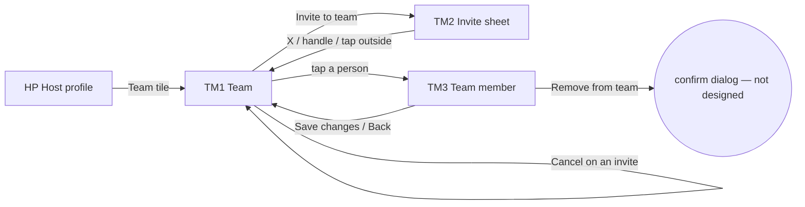

# 12 · Team (host)

The full spec of the **Host · Team** page in the design canvas: the host manages the people who work with them, invites new people by username, pauses someone, and chooses which services each person does. Read `01`–`07` first; this file only adds what is specific to these screens.

References for every screen at three sizes:
`../screenshots/{small,medium,large}/<id>.png` (what it must look like) and `../screens/{small,medium,large}/<id>.html` (exact values, clickable).

| Step | Screen id | Canvas board |
|---|---|---|
| 1 · Team | `TM1-team-list` | 1 · Team (list, one Invite button) |
| 2 · Invite | `TM2-invite` | 2 · Invite to team (sheet) |
| 3 · Team member | `TM3-team-member` | 3 · Team member (status, services) |

This replaces the screen built so far (username field + one card with "Services" / "Pause" text buttons). Those two actions now live on the member screen (TM3), and inviting is one primary button.

---

## 1. Flow

Rules:
1. **One way forward**: the list has one primary action (**Invite to team**). Everything about a person (status, services, remove) is on their screen.
2. **Invite = request**: tapping **Invite** in TM2 sends a request; the person shows under **Invites** until they accept. They join the team (Active) only after accepting.
3. **Paused** people stay in the team but are **hidden from booking** (R1 team filter, F3 options, "Can replace", "Anyone"). Bookings already made stay.
4. **Services** on TM3 are the same data as **Who does it** on each service (HS3/HS4): ticking a service here ticks this person there, and the other way round.
5. The **owner** is always first, always Active, and cannot be paused or removed (see open questions).

## 2. TM1 · Team

| Part | Spec |
|---|---|
| Top bar | 64 tall: back (→ HP) · "Team" 18/500 · "Maestro Host · 4 people" 12.5 `text.secondary` (business name · people in the team, invites not counted) |
| Sections | **Active · N**, **Paused · N**, **Invites · N** — heading 13/600 `text.secondary` (margin `14 4 8`, first `6 4 8`). A section with no rows is hidden. |
| Section card | white, radius 18, 1px `line.card`, rows separated by `line.rowSeparator` |
| Note | `info` 16 + "Paused people are hidden from booking. Their bookings stay." 12.5 secondary |
| Bottom bar | pinned, white, top border, padding `12 16 28`: **Invite to team** — ink, 52, radius 16, `user-plus` 20 + 16/500 → TM2 |

**Member row** (whole row is one tap target → TM3), min-height 76, padding `12 8 12 14`, gap 12:
- **Avatar** 48 (initial 16/600 white on the person's avatar colour, or photo) with a **status dot** 14 at the bottom-right (2.5 white border): Active `status.success`, Paused `status.warning`.
- Line 1: **name** 15/600 (1 line, ellipsis) + **Owner** chip for the owner (22 tall, radius 11, `brand.tintBg` / `brand.tintIcon`, 11.5/600).
- Line 2: "@username · Role" 12.5 secondary — the owner's row says "@username · You".
- Line 3: status word 12.5/600 (**Active** `status.successText`, **Paused** `status.warningText`) · 1 × 11 divider `line.outline` · `scissors` 13 + "N services" secondary (localised plural).
- `chevron-right` 18 `text.tertiary` on the right.

**Invite row**, min-height 72, padding `12 6 12 14`:
- Dashed avatar 48 (1.5 dashed `line.strong`, `user` 24 `text.tertiary`) · "@username" 15/600 · "Invited · waiting for an answer" 12.5 `text.tertiary` · **Cancel** text button 14/500 secondary (44 tall) — cancels the invite.

Order: owner first; then by name. Invites newest first.

## 3. TM2 · Invite to team (bottom sheet over TM1)

- Dim `rgba(0,0,0,.45)` over TM1; sheet white, radius 24 top, padding `0 16 28`, shadow `sheet`, handle 36 × 4 `line.strong`. Height = content, **max = screen − 64**.
- Title **Invite to team** 19/600 + **X** (44) · helper "Search by username. They join your team after they accept." 13 secondary.
- **Search field** 52 tall, radius 14, 1.5 border (`text.primary` when focused, `line.outline` otherwise): `at-sign` 20 secondary · input 16 · clear `x` 18 tertiary (44). Opens with the keyboard up.
- Result count "N people" 12.5/500 secondary, then result rows (min 60, separators): avatar 40 (no dot) · name 15/600 · "@username" 12.5 secondary · action:
  - **Invite** — ink, 36 tall, radius 12, padding `0 16`, 14/500.
  - After tapping: "✓ **Invited**" — `check` 16 + 14/600 `status.successText` (not tappable). The person also appears under **Invites** on TM1.
- People already in the team are not listed (proposal, see open questions).
- Close by X, dragging the handle down, or tapping the dim area.

## 4. TM3 · Team member

| Part | Spec |
|---|---|
| Top bar | 56: back (→ TM1) · "Team member" 18/500 |
| Profile card | white, radius 18, 1px `line.card`, padding 14, gap 14: avatar 64 with status dot · name 19/600 · "@username" 13 secondary · chips: status (**Active** `status.successBg` / `status.successText`; **Paused** `status.warningBg` / `status.warningText`) + "Joined Mar 2025" (`bg.soft` / secondary) |
| **Status** | heading 15/600 (margin `20 4 10`) + two radio cards (same as C20 offer cards): **Active** — badge 30 `status.success` with filled `play` 14 white — "Customers can book <name>"; **Paused** — badge `status.warning` with filled `pause` — "Hidden from booking. Bookings already made stay." Selected card has the selection ring; the other is greyed 0.4 (tappable). |
| **Services · N of M** | heading 15/600 + right "Same as "Who does it"" 12 secondary. Card with one row per service of the business (min 60, padding `0 14`): name 15/500 · "60 min · 120 RON" 12.5 secondary · check 26 — on: `status.success` circle + white `check` 15; off: 2px `line.strong` ring. Rows are checkboxes (`role=checkbox`). |
| **Remove from team** | white button 52, radius 16, 1px `line.card`, `trash-2` 18 + 15/500 `action.danger` → confirmation (not designed) |
| Bottom bar | **Save changes** — ink, 52, radius 16, full width, padding `12 16 28` → TM1 |

- Status and services are edited together and saved with **Save changes** (same as host edit screens).
- Owner's own screen: no Paused card and no Remove button (proposal).

## 5. Copy (EN)

| Where | Copy |
|---|---|
| TM1 | "Team" · "<Business> · N people" · "Active · N" · "Paused · N" · "Invites · N" · "Owner" · "You" · "Active" · "Paused" · "N services" · "Invited · waiting for an answer" · **Cancel** · "Paused people are hidden from booking. Their bookings stay." · **Invite to team** |
| TM2 | **Invite to team** · "Search by username. They join your team after they accept." · "N people" · **Invite** · "Invited" |
| TM3 | "Team member" · "Joined <Mon YYYY>" · "Status" · "Active" · "Customers can book <name>" · "Paused" · "Hidden from booking. Bookings already made stay." · "Services · N of M" · "Same as "Who does it"" · **Remove from team** · **Save changes** |

Plurals ("1 service" / "3 services", "1 person" / "4 people") go through the localisation system.

## 6. Small / large phones

- **Small (360 × 640)**: TM1 and TM3 scroll under their pinned bottom button; the TM2 sheet fits without scrolling (it scrolls inside if results are long). Nothing changes size.
- **Large (430 × 932)**: same layout with more air.
- Back from TM1 goes to the host profile of the same size (HP small / large).

## 7. Data

See `06-data-model.md` → *Team member* and *Team invite*.

## 8. Definition of done for this page

- [ ] TM1–TM3 match their screenshots at small, medium and large (overlay at 50 %: no shifted or resized elements).
- [ ] TM1 groups people by status with counts; empty sections are hidden; the owner row has the Owner chip and "You"; each row opens TM3.
- [ ] The only primary action on TM1 is the pinned **Invite to team**; there is no username field on TM1.
- [ ] TM2 searches by username; Invite turns into "✓ Invited" and the person appears under Invites on TM1; Cancel removes an invite.
- [ ] TM3 status uses the two radio cards (selected ring, other 0.4); Paused people disappear from R1/F3/"Can replace"/"Anyone" but keep their bookings.
- [ ] Ticking a service on TM3 is the same as ticking the person in "Who does it" on that service, both ways.
- [ ] The owner cannot be paused or removed.
