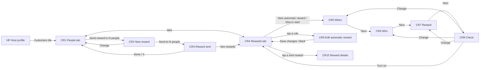

# 13 · Customers & rewards (host)

The full spec of the **Host · Customers & rewards** page in the design canvas. The host thanks people who booked with them in the app with a **single-use reward** (a discount for one booking). They do it either by hand (pick people → send) or **automatically** with a monthly rule. Read `01`–`07` first; this file only adds what is specific to these screens.

References for every screen at three sizes:
`../screenshots/{small,medium,large}/<id>.png` (what it must look like) and `../screens/{small,medium,large}/<id>.html` (exact values, clickable).

| Step | Screen id | Canvas board |
|---|---|---|
| Customers · People tab | `CR1-customers` | 1 · Customers · People tab (pick people) |
| New reward (by hand) | `CR2-new-reward` | 2 · New reward |
| Reward sent | `CR3-reward-sent` | 3 · Reward sent |
| Customers · Rewards tab | `CR4-rewards-tab` | 4 · Customers · Rewards tab (automatic + sent) |
| New automatic reward · When | `CR5-auto-when` | 5 · New automatic reward · When |
| New automatic reward · Who | `CR6-auto-who` | 6 · New automatic reward · Who |
| New automatic reward · Reward | `CR7-auto-reward` | 7 · New automatic reward · Reward |
| New automatic reward · Check | `CR8-auto-check` | 8 · New automatic reward · Check and turn on |
| Edit automatic reward | `CR9-auto-edit` | 9 · Edit automatic reward |
| Reward details | `CR10-reward-details` | 10 · Reward details (who used it) |

This replaces the screens built so far: a customer list with phone/email and a "Reward" button per row, a separate "Select" mode, and a long "Send Loyalty Reward" form with a title, a 10-character-minimum description, a value and two date pickers.

---

## 1. Flow

Rules:
1. **Who is a customer**: someone who booked with this business in the app. Nobody else is listed or can receive a reward. A **visit** is a reservation marked **done** (`14-reservations.md`, RV6); no-shows, declined and cancelled reservations do not count.
2. **A reward is single use**: a % or RON discount for **one booking**, valid from the day it is sent for the chosen length. It shows in the customer's "My activity" until used or ended.
3. **By hand** (CR1 → CR3): pick people (filter by group, Select all), compose, send.
4. **Automatic** (CR5 → CR8) is **monthly only**: it sends on the same day every month, starting from the first send. A month without that day (29–31) sends on its last day.
5. **Who gets an automatic reward** is decided at every send from **visits in the month before the send** (for a send on 15 Nov: 15 Oct – 14 Nov): **exactly N** or **N or more** visits (N = 1–5). "A person can get it" **Only once** (ever, for this rule) or **Every month** (each month they match). **Skip people with an unused reward** (on by default) skips anyone who still has an unused reward from this rule.
6. **Turning a rule off** stops future sends; rewards already sent stay valid. **Edits** apply from the next send.
7. **Stop reward** (CR10) removes it for the people who have not used it yet.
8. **Used by** counts people who booked with the reward.

## 2. CR1 · Customers · People tab

| Part | Spec |
|---|---|
| Top bar | 64: back (→ HP) · "Customers" 18/500 · "Maestro Host · 24 people" 12.5 secondary |
| **Tabs** | **People** (`users`) · **Rewards** (`gift`) — equal columns, 56 tall, icon 20 + label 12.5; selected `text.primary` 500 + 2px underline; others `text.secondary`; 1px `line.divider` track; margin `0 16` |
| **Group tiles** | 4 equal tiles, gap 8, **72 tall, radius 14**, white: icon 20 + name 12.5 + count 12 secondary. Selected = selection ring + name 700; others greyed 0.4 (tappable). **All** (`users`) · **Regulars** (`repeat`, 3+ visits) · **New** (`user-plus`, 1 visit) · **Away** (`clock`, no visit in 60 days). |
| Group header | "Regulars · 3+ visits · 2 selected" 13/600 secondary · **Select all** 14/500 on the right |
| List card | white, radius 18, rows separated by `line.rowSeparator` |
| Note | `info` 16 + "Only people who booked with you in the app are listed." |
| Bottom bar | **Send reward to N people** — ink, 52, radius 16, `gift` 20 → CR2. Disabled while nobody is selected. |

**Customer row** (C29), min-height 68, padding `10 14`, gap 12 — the whole row toggles selection:
- Avatar 44 (initial 16/600 white on the person's colour, or photo).
- **Name** 15/600 (1 line, ellipsis) · "6 visits · last 12 Oct" 12.5 secondary.
- If they hold an unused reward: chip 22 tall, radius 11, `offer.couponTint` / `status.successText`, `gift` 12 + "10 RON OFF · not used".
- **Check** 26: selected = ink circle + white `check` 15; not selected = 2px `line.strong` ring.
- Phone and email are **not** shown in the list.

## 3. CR2 · New reward (by hand)

| Part | Spec |
|---|---|
| Top bar | 56: back (→ CR1) · "New reward" 18/500 |
| **To** card | white, radius 16: up to 3 stacked avatars 36 (overlap −10, 2px white border) · "Elena and Mihai" 15/600 (3+ people: "Elena, Mihai and 6 more") · "2 people · Regulars" 12.5 · **Change** (→ CR1) |
| **What they get** | heading 15/600 + "Live preview" 12 secondary → **C28 reward ticket**, updates as the host edits |
| **Discount** | heading + **% / RON** pills on the right (30 tall, radius 15; selected ink) · 5 chips, 44 tall, radius 12: **10% · 15% · 20% · 25% · Other** (RON values: proposal in open questions) |
| **Message** | field 52, radius 14, white, 15; prefilled "Thanks for coming back"; **max 40 characters** with counter "22 / 40" 11 tertiary |
| **Valid for** | heading + end date on the right ("Until Sun, 22 Nov") · **C31 duration chips**: **1 week · 2 weeks · 3 weeks · 1 month** |
| Note | "Single use. It shows in their "My activity" and works for one booking until it ends." |
| Bottom bar | **Send to N people** — ink, 52, `gift` 20 → CR3 |

## 4. CR3 · Reward sent

Header 56 with **X** (→ CR1) · success circle 76 (`status.successBg` + `check` 38 `status.successText`) · "Reward sent" 22/700 · "Elena and Mihai can use it for one booking until Sun, 22 Nov." 14 secondary, centred · the ticket · bottom, 2 columns gap 10: **See rewards** (`bg.soft`, `gift` 18 → CR4) and **Done** (ink → CR1).

## 5. CR4 · Customers · Rewards tab

| Part | Spec |
|---|---|
| Top bar + tabs | as CR1, **Rewards** selected |
| **Automatic · N on** | heading 13/600 secondary, then one **C33 rule card** per rule (gap 10) |
| **Idea to start** | dashed card (1.5 `line.strong`, radius 18): `heart` 18 on `brand.tintBg` 36 · "Idea to start" 12/600 `brand.tintIcon` · title 15/600 ("VIP thank you") · "20 RON OFF · 5 or more visits in the month before" 12.5 · **+ Add** (`bg.soft`, 36, radius 12) → CR5 prefilled |
| **Sent · this month** | sent-reward cards (gap 10): discount square 56 (radius 12, `offer.coupon`, white value 17/800 + unit 9.5/700) · title 15/600 + tag (**Auto**: `brand.tintBg` / `brand.tintIcon` + `zap` 12; **By you**: `bg.soft` / secondary) · "Used by **4 of 9** · ended 20 Oct" 12.5 · progress bar 6 tall (track `bg.soft`, fill `status.success`) · chevron → CR10 |
| Bottom bar | **New automatic reward** — ink, 52, `zap` 20 → CR5 |

**C33 rule card**: white, radius 18, padding `12 6 12 14`, gap 8:
- Row: `calendar` 18 on a 36 `bg.soft` circle · name 15/600 + "Every month on the 15th" 12.5 (tap → CR9) · **C30 switch** on the right.
- Facts (indent 48): sticker "10% OFF" (20 tall, radius 6, `offer.coupon`) · "valid 5 days" · "Exactly 1 visit in the month before" 12.5 secondary (wraps).
- Status (indent 48): 12.5/600 `status.successText`: "Next: Sun, 15 Nov · 10 people". Off: "Off" in `text.secondary`.

## 6. CR5–CR8 · New automatic reward (4 steps)

Shared layout: top bar 56 (back → previous step; CR5 → CR4) · "New automatic reward" · **C32 progress bar** under the header (4 segments, 4 tall, gap 4, radius 2; done and current `text.primary`, rest `line.divider`; **no "Step x of 4" text**) · question 22/700 + helper 13.5 secondary · one primary button pinned at the bottom.

| Step | Content | Button |
|---|---|---|
| **CR5 · When should it send?** | Helper "It sends every month on the same day. Pick the first one." · "First send · November 2026" 15/600 + previous/next **week** (44) · **week strip** = the C14 day buttons (7 columns, gap 6, 62 tall, radius 14, weekday 11 + date 17/600, selected ink) **without availability dots**; past days disabled · "Then every month on the **15th**." 14 · "Next sends" + 3 chips (32 tall, radius 16, `calendar` 14): Sun, 15 Nov · Tue, 15 Dec · Fri, 15 Jan · note "Months with fewer days send on their last day." | **Next** |
| **CR6 · Who gets it?** | Helper "We count each person's visits in the month before the send. For the first send: 15 Oct – 14 Nov." (dates follow the chosen day) · card: "Visits in that month" + **Exactly / Or more** pills · chips **1 · 2 · 3 · 4 · 5** · "A person can get it": **Only once · Every month** · switch row "Skip people with an unused reward" / "They get the next one after they use it" · **match box** (`offer.couponTint`, `status.successText`): 3 avatars 30 + "10 people match today" 15/700 + "Cristina, Dan, Ioana and 7 more" · note "Example: someone with 2 visits in that month does not get it, because the rule is exactly 1 visit." (wording follows the choice) | **Next** |
| **CR7 · What do they get?** | Helper "This is the reward they see in "My activity"." · ticket · message field (label "Message" left, value right) **max 40** + "Short and clear: up to 40 characters" / "14 / 40" 12 tertiary · Discount (% / RON + 5%·10%·15%·20%·Other) · Valid for ("Counted from the day it is sent") **C31**: **3 days · 5 days · 1 week · 1 month** · single-use note | **Next** |
| **CR8 · Check and turn on** | Helper "You can change or stop it at any time." · **summary card** (`brand.tintBg`, `zap` 20 `brand.tintIcon`): the rule as one sentence 15/600 — "On the 15th of every month, people with exactly 1 visit in the month before get 10% OFF, valid for 5 days." — + "First send: Sun, 15 Nov · 10 people" 12.5 · rows **When / Who / Reward** (label 12 secondary, value 15/500, detail 12.5) each with **Change** (→ CR5 / CR6 / CR7) · small ticket | **Turn on** (`zap`) → CR4 |

## 7. CR9 · Edit automatic reward

- Top bar 56: back (→ CR4) · "Edit automatic reward" · red `trash-2` 22 (44 target) → delete confirmation (not designed).
- Status card: name 16/600 + "On · next send Sun, 15 Nov · 10 people" 12.5/600 `status.successText` + **C30 switch**.
- **C34 stat tiles** (3, gap 8, white radius 14, value 22/700, label 12 secondary): **3** Times sent · **27** People · **11** Used (`status.successText`).
- "What they get" + ticket.
- "Rule" + "Tap to change": rows (min 60, icon 20, label 12 secondary, value 15/500, optional detail 12.5, chevron) — **When** "Every month on the 15th" · **Who** "Exactly 1 visit in the month before" / "Can get it every month · skips unused rewards" · **Discount** "10% OFF" · **Valid for** "5 days" · **Message** "Come back soon". Tapping a row opens the matching step (CR5 / CR6 / CR7) filled with the current values (proposal).
- Note "Changes apply from the next send. Rewards already sent stay as they are." · **Save changes** pinned.

## 8. CR10 · Reward details

Top bar (back → CR4, "Reward") · ticket · C34 stats: **8** Sent · **3** Used (`status.successText`) · **5** Not used yet · "People · 8" + "Used first" · card rows (min 60): avatar 36 · name 15/500 · "✓ Used · 14 Oct" 13/600 `status.successText` or "Not used yet" 13 `text.tertiary` · "Show all 8" row · **Stop reward** (white 52, radius 16, `ban` 18, `action.danger`) + note "Stopping a reward removes it for the people who have not used it yet."

## 9. New components

| # | Component | Spec |
|---|---|---|
| C28 | **Reward ticket** (wide coupon ticket) | 108 tall (92 small variant), radius 16, white, 1px `line.card`. Left stub 104 wide `offer.coupon`: value 28/800 ("15%", "10") + unit 12/700 ("OFF", "RON OFF"). Tear line: dashed 1.5 `rgba(255,255,255,.7)` at the stub edge + two 16 px notches (page-bg circles, 1px border) top and bottom. Right: `gift` 14 + business name 12 secondary · **title 16/600, max 2 lines** (it is the message) · "Single use · until Sun, 22 Nov" 12.5 secondary. |
| C29 | Customer row (pick) | §2 |
| C30 | **Switch** | track 48 × 28, radius 14: on `status.success`, off `line.strong`; knob 22 white with `0 1px 3px rgba(0,0,0,.3)`; 44 hit area; `role=switch`. Use the native switch on each platform with these colours. |
| C31 | **Duration chips** | 4 equal chips, gap 8, **56 tall**, radius 12: number 17/700 on top, unit 12/500 below (`text.secondary`, white .8 when selected); selected ink; unit never wraps (ellipsis). Built so translations fit 4 per row on 360: "1 săptămână · 2 săptămâni · 3 săptămâni · 1 lună", "Woche · Wochen · Monat · Tage". |
| C32 | **Step progress bar** | §6 |
| C33 | **Automatic rule card** | §5 |
| C34 | **Stat tiles** | §7 |

Group tiles on CR1/CR4 reuse the filter-tile rule (C6 / CE1): selected ring + bold, others 0.4.

## 10. Copy (EN)

| Where | Copy |
|---|---|
| CR1 | "Customers" · "<Business> · N people" · "People" · "Rewards" · "All" · "Regulars" · "New" · "Away" · "<Group> · <rule> · N selected" · **Select all** · "N visits · last <date>" · "<discount> · not used" · "Only people who booked with you in the app are listed." · **Send reward to N people** |
| CR2 | "New reward" · "<names>" · "N people · <group>" · **Change** · "What they get" · "Live preview" · "Discount" · "Other" · "Message" · "Valid for" · "Until <date>" · "1 week" · "2 weeks" · "3 weeks" · "1 month" · single-use note · **Send to N people** |
| CR3 | "Reward sent" · "<names> can use it for one booking until <date>." · **See rewards** · **Done** |
| CR4 | "Automatic · N on" · "Every month on the <Nth>" · "valid <length>" · "Next: <date> · N people" · "Idea to start" · **Add** · "Sent · this month" · "Auto" · "By you" · "Used by U of N" · "until <date>" / "ended <date>" · **New automatic reward** |
| CR5–CR8 | "New automatic reward" · "When should it send?" · "First send · <Month YYYY>" · "Then every month on the <Nth>." · "Next sends" · "Who gets it?" · "Visits in that month" · "Exactly" · "Or more" · "A person can get it" · "Only once" · "Every month" · "Skip people with an unused reward" · "N people match today" · "What do they get?" · "Short and clear: up to 40 characters" · "Counted from the day it is sent" · "3 days" · "5 days" · "Check and turn on" · **Next** · **Turn on** |
| CR9–CR10 | "Edit automatic reward" · "On · next send <date> · N people" · "Times sent" · "People" · "Used" · "Rule" · "Tap to change" · "Changes apply from the next send. Rewards already sent stay as they are." · **Save changes** · "Reward" · "Sent" · "Not used yet" · "Used · <date>" · "Show all N" · **Stop reward** |

Plurals ("1 visit" / "6 visits", "1 person" / "2 people", "1 week" / "2 weeks") and ordinals ("15th") go through the localisation system. The message is the host's own text (max 40 characters); it is not translated.

## 11. Small / large phones

- **Small (360 × 640)**: CR1, CR2, CR4 and CR6–CR10 scroll under their pinned bottom button; CR3 and CR5 fit. Nothing changes size. Four group tiles, five discount chips and four duration chips stay on one row (tested with Romanian and German units).
- **Large (430 × 932)**: same layout with more air.
- Back from CR1 / CR4 goes to the host profile of the same size.

## 12. Data

See `06-data-model.md` → *Customer*, *Reward*, *Automatic reward rule*.

## 13. Definition of done for this page

- [ ] CR1–CR10 match their screenshots at small, medium and large (overlay at 50 %: no shifted or resized elements).
- [ ] Customers has two tabs (People, Rewards); the list shows no phone or email; rows toggle selection; Send reward is disabled with nobody selected.
- [ ] The ticket preview updates live; the message is capped at 40 characters and the ticket shows it on at most 2 lines.
- [ ] Valid for uses the stacked duration chips; RO and DE units fit 4 per row at 360.
- [ ] Automatic rewards are monthly only; CR5 uses the F4 week strip; the next three send dates follow the chosen day.
- [ ] Who counts visits in the month before each send; Exactly / Or more; Only once / Every month; Skip unused; the match count is live.
- [ ] CR8 shows the rule as one sentence and each part can be changed; Turn on adds the rule (On) to CR4.
- [ ] Switching a rule off stops future sends only; Stop reward removes it for people who have not used it; Used by counts bookings made with it.
