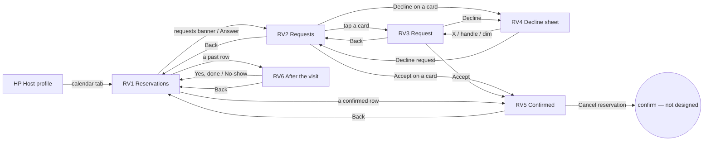
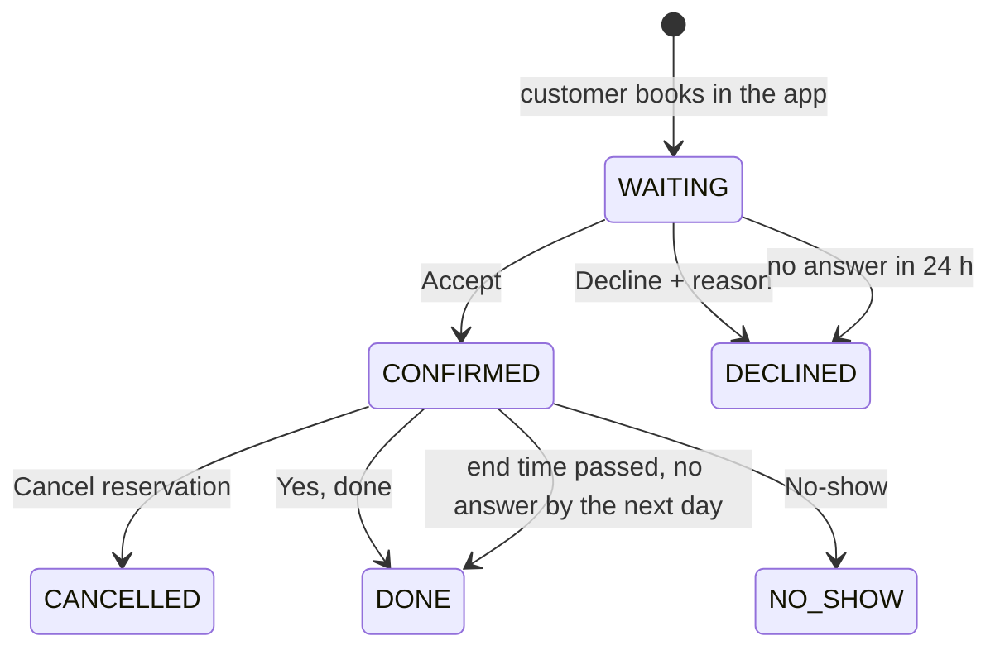

# 14 · Reservations (host)

The full spec of the **Host · Reservations** page in the design canvas. Every booking a customer makes in the app arrives as a **request**. The host answers it (**Accept** / **Decline**), then runs the day, and after each visit says whether the person came. Read `01`–`07` first; this file only adds what is specific to these screens.

**One page for every category.** The same screens serve services (a haircut, a massage), tables (a restaurant) and events (a wine tasting). Nothing on them is salon-specific. A reservation shows **what** (the service name, "Table" or the event title), **how many people**, and, only when the business assigns one, **the team member** ("With Andrei"). Accommodation is call-only and has no requests.

References for every screen at three sizes:
`../screenshots/{small,medium,large}/<id>.png` (what it must look like) and `../screens/{small,medium,large}/<id>.html` (exact values, clickable).

| Step | Screen id | Canvas board |
|---|---|---|
| Reservations tab | `RV1-reservations` | 1 · Reservations tab (requests on top, today and tomorrow below) |
| Requests to answer | `RV2-requests` | 2 · Requests to answer (accept / decline in the list) |
| Reservation request | `RV3-request` | 3 · Reservation request (all the details) |
| Decline | `RV4-decline` | 4 · Decline (reason sheet) |
| Confirmed | `RV5-confirmed` | 5 · Accepted / confirmed reservation |
| After the visit | `RV6-after-visit` | 6 · After the visit: did they come? |

This replaces the current Reservations tab. The tab has **no calendar or week strip**: requests come first, then today and tomorrow. Lists never show phone or email; contact details live on the reservation screens (RV3, RV5).

---

## 1. Flow

### Reservation states

Rules:
1. **Every booking is a request.** It is **Waiting for you** until the host answers. The customer is told when it is accepted, declined or cancelled. How they are told is not designed (see open questions).
2. **Oldest first.** RV2 lists waiting requests from the oldest. The host must answer within **24 hours**; after that the request is **declined automatically** and the customer is told.
3. **Accept** confirms it as it is (time, people, offer). The customer gets a confirmation.
4. **Decline needs one reason**, **Fully booked** or **Closed that day**. There is no free-text message. The customer sees the reason and can book another time.
5. **Cancel reservation** on a confirmed one tells the customer right away. The confirmation dialog is not designed.
6. **After the end time** the reservation shows **Done** in the day list. On RV6 the host can still say **No-show** or confirm **Yes, done**. With no answer, it stays done from the next day on.
7. **Only done visits count.** "N visits", "last <date>", the customer groups and the automatic rewards (`13-customers-rewards.md`) count DONE reservations only. No-shows, declined and cancelled ones are not visits.
8. **The badge** on the host profile's calendar tab is the number of waiting requests (amber). It is hidden at 0.

## 2. RV1 · Reservations tab

This is the third icon tab of the host's own profile (HP), with the calendar icon. The host sees it below the profile header, in the same place as Videos and Reviews. The board shows only the tab area: icon tabs → content → C9 nav.

| Part | Spec |
|---|---|
| Icon tabs | the HP tabs (Videos · Reviews · Reservations), margin `0 16`, 8 above. Calendar tab selected: `text.primary` icon + 22 × 2 underline; others `text.tertiary`. Accessibility label "Reservations, N requests". |
| **Badge** (C35) | on the calendar icon: min 18 × 18, padding `0 5`, radius 9, 2px `bg.page` border, `status.warning` fill, `text.primary` 10.5/700, top 2, left 50 % + 6. Number of waiting requests; hidden at 0. |
| Content | scrolls, padding `0 16 20` |
| **Requests banner** (C36) | margin-top 14, padding `12 10 12 14`, radius 18, `status.warningBg`, gap 12: circle 40 `status.warning` + `clock` 20 ink · "2 requests to answer" 16/700 · "Oldest: 2 h ago" 12.5 `status.warningText` · **Answer** pill (ink, 36 tall, radius 12, padding `0 12`, 14/500). The whole banner is one tap target → RV2. Hidden when there is nothing to answer. |
| Day heading | "Today · Fri, 23 Oct" 15/600 + right "3 reservations · 1 done" 12 secondary (margin `18 4 8`). Second day: "Tomorrow · Sat, 24 Oct" + "2 reservations". |
| Day card | white, radius 18, 1px `line.card`; rows separated by `line.rowSeparator` |
| Bottom | C9 host nav (Profile active) |

**Reservation row** (C38), one tap target, min-height 68, padding `10 8 10 14`, gap 12:
- Time column 50 wide: start 16/700, end 12 `text.tertiary` under it.
- Bar 3 wide, radius 2, full row height: **Confirmed** `status.success`, **Done** `line.strong`.
- Name 15/600 (1 line, ellipsis) with the **status chip** (C37) on the right of the same line.
- "what · people" 12.5 secondary: the item (ellipsis if long) · `users` 13 + "N people". The people part never truncates.
- `chevron-right` 18 `text.tertiary`.
- Tap: confirmed → RV5; past (Done) → RV6.

The day lists show **confirmed** and **past** reservations only. Waiting requests are counted in the banner and live in RV2. Order: by start time.

## 3. RV2 · Requests to answer

| Part | Spec |
|---|---|
| Top bar | 56: back 44 (→ RV1) · "Requests · 2" 18/500 |
| Note | `info` 16 + "Oldest first. Answer within 24 hours, or the request is declined for you." 12.5 secondary |
| Cards | gap 10, 12 below the note |

**Request card** (C39), white, radius 18, 1px `line.card`, padding 12, column gap 10:
- **Head** (tap → RV3), gap 12: **date tile** 52 × 60, radius 14, `bg.soft` (weekday 11 secondary · day 17/600 · month 11 secondary) · time range 17/700 with "2 h ago" 12 `text.tertiary` on the right · name 15/600 · "what · people" (as in the row).
- **Chips** (wrap, gap 6):
  - **offer sticker** when the booking uses one: 20 tall, radius 6, padding `0 7 0 5`, `offer.coupon` fill, white 11.5/700, `percent` 12. Text = discount ("15% OFF"); for an event, the event title in event colours (same rule as C20).
  - **visits chip** "6 visits" (`bg.soft` / secondary), or **New customer** with `sparkles` 12 (`brand.tintBg` / `brand.tintIcon`) when they have no done visit yet.
  - All chips are 22 tall, radius 11, 11.5/600.
- **Note** (only when there are special requests): `message-square` 15 `text.tertiary` + “quote” 13 `text.body`, **1 line, ellipsis** (full text on RV3).
- **Actions**: two equal buttons, 44 tall, radius 12, gap 8, 14.5/500: **Decline** (`action.secondary`, `x` 18) → RV4 · **Accept** (ink, `check` 18) → RV5.

## 4. RV3 · Reservation request

| Part | Spec |
|---|---|
| Top bar | 56: back (→ RV2) · "Reservation request" 18/500 |
| **Summary card** (C40) | white, radius 18, 1px `line.card`, clips its strip. Top part padding `12 12 12 14`, gap 12: date tile (light) · time 17/700 + status chip **Waiting for you** · item 14/500 · facts 12.5 secondary (wrap, gap `4 10`): `users` 13 "1 person" · `clock` 13 "60 min" · "120 RON" · `user` 13 "With Andrei". Duration, price and team member show only when the booking has them (a table has none of the three). |
| Offer strip | only when an offer is used. Padding `12 14`, `offer.couponTint` / `offer.couponText`; 52-wide column with a 30 circle `offer.coupon` + white `percent` 16; "15% OFF coupon" 14.5/700 · "Pays 102 RON instead of 120 RON" 12.5. An event uses the TB3E strip (event colours, "Wine tasting · Sitting 19:00 – 20:30"). |
| **Customer** | heading 15/600 (margin `18 4 8`) + **customer card** (C41): white, radius 18. Head padding `12 14`: avatar 44 (initial 16/600 on the person's colour, or photo) · name 15/600 · "6 visits · last 12 Oct" 12.5 secondary (or "New customer · first visit"). Two contact rows, min 52, padding `4 4 4 14`, top border `line.rowSeparator`: icon 18 secondary · value 15 (1 line, ellipsis) · 44 action. Phone → **Call** (`phone`, opens the dialer); email → **Copy** (`copy`, clipboard + toast "Email copied"). |
| **Special requests** | heading + card (padding `12 14`, radius 18): `message-square` 18 tertiary + the full text 15 / 1.45. Hidden when empty. |
| Note | `info` + "Requested in the app today at 12:31. Elena is waiting for your answer." |
| Bottom bar | pinned, white, top border `line.card`, padding `12 16 28`, gap 10: **Decline** (`action.secondary`, 52, radius 16, `x` 18, 16/500) → RV4 · **Accept** (ink, `check` 18) → RV5 |

## 5. RV4 · Decline (bottom sheet over RV3)

- Dim `rgba(0,0,0,.45)` over RV3; sheet white, radius 24 top, padding `0 16 28`, shadow `0 -6 20 rgba(0,0,0,.25)`, handle 36 × 4 `line.strong` (8 from the top).
- Title "Decline Elena’s request?" 19/600 + **X** 44 (`x` 22).
- Line 13 secondary: "Mon, 26 Oct · 14:30 · Haircut. Pick a reason. We let them know so they can book another time."
- **Reasons** (C42), `role=radiogroup`, gap 8. Exactly two: **Fully booked** (selected by default) and **Closed that day**. Each is a radio card, min 52, radius 14, padding `0 12 0 14`, 15, with a radio 22 on the right:
  - selected: selection ring `0 0 0 2px #FFF, 0 0 0 4px text.primary`, 600 weight, filled ink radio with an 8 px white dot;
  - other: 1px `line.card`, opacity 0.4, 500 weight, 2px `line.strong` ring.
- **Decline request**: `action.danger` fill, white 16/500, 52, radius 16, margin-top 16 → back to RV2 with the request removed.
- **No message field** and no other reasons.
- Close by X, dragging the handle or tapping the dim area → RV3 (nothing is sent).

## 6. RV5 · Confirmed

| Part | Spec |
|---|---|
| Top bar | 56: back (→ RV1) · "Reservation" 18/500 |
| Success banner | only right after Accept: padding `12 14`, radius 16, `status.successBg` / `status.successText`, `check` 20 + "Accepted. Elena got a confirmation." 14.5/600, 12 below |
| Summary card | C40 with the **dark date tile** (`dark.card`, white text) and the **Confirmed** chip; offer strip as on RV3 |
| Customer · Special requests | as RV3 |
| **Cancel reservation** | white 52, radius 16, 1px `line.card`, `x` 18 + 15/500 `action.danger`, margin-top 16 → confirmation (not designed) |
| Note | `info` + "If you cancel, Elena gets a message right away." |

Opening a confirmed reservation from RV1 shows the same screen without the banner. There is no bottom bar.

## 7. RV6 · After the visit

| Part | Spec |
|---|---|
| Top bar | "Reservation", back → RV1 |
| Summary card | dark date tile ("Today · 23 · Oct") · "11:00 – 12:00" 17/700 · item 14/500 · facts (people, duration, price). No status chip. |
| Customer card | margin-top 12: avatar 44 · name · "4 visits · last 9 Oct" (no contact rows) |
| **Visit check card** (C43) | margin-top 20, white, radius 18, padding `18 16`, centred, gap 6: circle 52 `bg.soft` with `calendar-check` 24 · "Did Mihai come?" 20/700 · "Only visits you mark as done count for visits and rewards." 13.5 / 1.45 secondary (max-width 280) · two buttons 52 (gap 10, margin-top 12): **No-show** (`action.secondary`, `user-x` 18) · **Yes, done** (ink, `check` 18). Either answer → RV1. |
| Note | `info` + "If you do not answer, it is marked as done the next day." |

## 8. Where things come from

| Shown | From |
|---|---|
| "what" | service name · "Table" for a table booking · the event title |
| "N people" | the people / guests on the booking (localised plural) |
| "With <name>" | the team member on a services booking; hidden for tables, events and businesses without a team |
| "60 min" · "120 RON" | the service's duration and price; hidden when the booking has none |
| Offer sticker / strip | the coupon or event the customer chose (TB2, F4). "Pays X instead of Y" = price − discount |
| "N visits · last <date>" | DONE reservations of this customer with this business |
| "New customer" | no DONE reservation yet |
| "2 h ago" | now − requestedAt: < 60 min "N min ago", else "N h ago" |
| "Oldest: …" | the oldest waiting request |

## 9. New components

| # | Component | Spec |
|---|---|---|
| C35 | **Tab badge** | §2: amber count on an icon tab, 2px page-bg border; hidden at 0 |
| C36 | **Requests banner** | §2: amber card, clock circle, count + oldest, Answer pill; whole card taps |
| C37 | **Reservation status chip** | 22 tall, radius 11, padding `0 8`, 11.5/600, never wraps: **Waiting for you** `status.warningText` / `status.warningBg` · **Confirmed** `status.successText` / `status.successBg` · **Done** `text.secondary` / `bg.soft` |
| C38 | **Reservation row** | §2: time column, status bar, name + chip, what · people, chevron |
| C39 | **Request card** | §3: date tile head, chips, 1-line note, inline Decline / Accept |
| C40 | **Reservation summary card** | §4: date tile (light while waiting, dark once confirmed), time + chip, item, facts, optional offer strip |
| C41 | **Customer contact card** | §4: avatar, name, visits, then Call / Copy rows |
| C42 | **Reason sheet** | §5: C13 sheet visuals + radio cards (ring when selected, others 0.4) + one danger button |
| C43 | **Visit check card** | §7: icon, question, rule line, No-show / Yes, done |

The date tile (52 × 60, radius 14) is the TB3 / F4 day tile; the radio cards follow the C20 / TM3 selection rule.

## 10. Copy (EN)

| Where | Copy |
|---|---|
| RV1 | "N requests to answer" · "Oldest: <ago>" · **Answer** · "Today · <Ddd, d Mon>" · "Tomorrow · <Ddd, d Mon>" · "N reservations · N done" · "Confirmed" · "Done" · "N people" |
| RV2 | "Requests · N" · "Oldest first. Answer within 24 hours, or the request is declined for you." · "N h ago" / "N min ago" · "N visits" · "New customer" · **Decline** · **Accept** |
| RV3 | "Reservation request" · "Waiting for you" · "With <name>" · "<discount> coupon" · "Pays <new> instead of <old>" · "Customer" · "N visits · last <d Mon>" · "New customer · first visit" · "Special requests" · "Requested in the app <when>. <First name> is waiting for your answer." · **Decline** · **Accept** |
| RV4 | "Decline <First name>’s request?" · "<date> · <time> · <what>. Pick a reason. We let them know so they can book another time." · "Fully booked" · "Closed that day" · **Decline request** |
| RV5 | "Reservation" · "Accepted. <First name> got a confirmation." · "Confirmed" · **Cancel reservation** · "If you cancel, <First name> gets a message right away." |
| RV6 | "Did <First name> come?" · "Only visits you mark as done count for visits and rewards." · **No-show** · **Yes, done** · "If you do not answer, it is marked as done the next day." |

- **Never use he / she / his / her for customers.** The app does not know their gender: use their first name or "they" ("We let them know").
- Plurals ("1 person" / "4 people", "1 visit" / "6 visits", "1 reservation" / "3 reservations") and the possessive ("Elena’s") go through the localisation system.

## 11. Small / large phones

- **Small (360 × 640)**:
  - RV1 scrolls under the nav.
  - RV3 scrolls under its pinned Decline / Accept bar.
  - RV5 scrolls.
  - RV2 (two cards), RV4 (the sheet) and RV6 fit.
  - Nothing changes size. Names and items ellipsize before the status chip or "N people" would.
- **Large (430 × 932)**: same layout with more air.
- Back from RV1 is the profile itself (it is a tab); other backs go to the screen of the same size.

## 12. Data

See `06-data-model.md` → *Reservation* (states, decline reasons, answer deadline) and *Customer* (visits = done reservations).

## 13. Definition of done for this page

- [ ] RV1–RV6 match their screenshots at small, medium and large (overlay at 50 %: no shifted or resized elements).
- [ ] RV1 is the calendar tab of the host profile: amber badge with the number of waiting requests; requests banner on top (hidden at 0); Today and Tomorrow lists; **no calendar or week strip**.
- [ ] Rows and cards show only category-neutral facts (what · people, optional team member, duration and price when they exist). The same screens work for a service, a table and an event.
- [ ] RV2 is oldest first; Decline / Accept work from the card; a tap on the card head opens RV3.
- [ ] Phone and email appear only on RV3 / RV5, with Call (dialer) and Copy (clipboard + toast).
- [ ] RV4 has exactly two reasons (Fully booked preselected, Closed that day), no message field, and a red Decline request; closing it sends nothing.
- [ ] States follow §1: WAITING → CONFIRMED / DECLINED (also after 24 h), CONFIRMED → CANCELLED / DONE / NO_SHOW; done by itself the next day.
- [ ] Only DONE reservations count as visits (CR1 groups, "N visits", automatic rewards).
- [ ] No gendered pronouns in any reservation copy.
