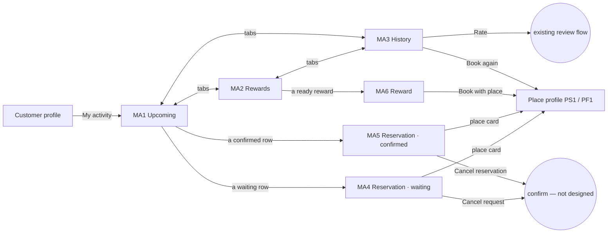

# 15 · My activity (customer)

The full spec of the **Customer · My activity** page in the design canvas. A customer sees, in one place and across every business they booked with:
- what is coming up, including requests still **waiting** for an answer;
- the **rewards** they can use;
- their **history**: rate a visit, or book again after a decline or a cancel.

It is the customer side of `14-reservations.md` (requests, accept / decline) and `13-customers-rewards.md` (rewards). Read `01`–`07` first; this file only adds what is specific to these screens.

**One page for every category.** The same screens serve services, tables and events: what · people, plus the team member only when the booking has one.

References for every screen at three sizes:
`../screenshots/{small,medium,large}/<id>.png` (what it must look like) and `../screens/{small,medium,large}/<id>.html` (exact values, clickable).

| Step | Screen id | Canvas board |
|---|---|---|
| Upcoming tab | `MA1-upcoming` | 1 · Upcoming tab |
| Rewards tab | `MA2-rewards` | 2 · Rewards tab (ready to use, used or ended) |
| History tab | `MA3-history` | 3 · History tab (rate, book again) |
| Reservation · waiting | `MA4-reservation-waiting` | 4 · Reservation · waiting for an answer |
| Reservation · confirmed | `MA5-reservation-confirmed` | 5 · Reservation · confirmed |
| Reward | `MA6-reward` | 6 · Reward (how to use it) |

**This replaces the current My Activity screen:**
- The **Total / Completed / Upcoming** counters are gone. Counts live in the tab labels.
- The tabs become **Upcoming · Rewards · History**.
- Rewards get their own tab.
- The **Completed** pill and **Leave review** button on history cards become **Rate** / **★ N**.

Decisions, so they are not added back:
- **No Add to calendar.** The feature is not developed, so it was removed from MA5.
- **No review sheet.** **Rate** opens the app's existing review flow (see open questions).
- **No Directions button** (principle 10). The address is copy-to-clipboard.

---

## 1. Flow

Rules:
1. **Only this customer's own activity**, across all businesses.
2. **Upcoming** = reservations in state **WAITING** or **CONFIRMED** from now on, grouped by day, earliest first.
3. **History** = everything else, grouped by month, newest first:
   - **DONE** visits;
   - **DECLINED** (with the reason: "Fully booked", "Closed that day", or "No answer" when it was declined after 24 h);
   - **CANCELLED** ("By you" or "By the place").
4. **A request is not a booking yet.** While WAITING it shows the amber **Waiting** chip, and MA4 says the place answers within 24 hours. When it is answered:
   - accepted → it turns **Confirmed** (MA5);
   - declined → it moves to History with the reason.
   
   The customer gets a message either way (how is not designed).
5. **Cancel request / Cancel reservation** tells the place right away and moves the reservation to History as "Cancelled · By you". The confirmation is not designed.
6. **Rewards — Ready to use** are this customer's reward grants that are NOT_USED and not past `validUntil`. The one that **ends soonest comes first**.
   - **Used or ended** shows USED ("Used · <date>"), ENDED and STOPPED ("Ended · <date>"), newest first.
7. **A reward works once, at the place that sent it.** The customer picks it at the last step of booking with that place. That step is not designed yet (see open questions).
8. **Rate** shows only on DONE visits the customer has not rated. After rating, the row shows **★ N** (not tappable).
   - **Book again** shows on DECLINED and CANCELLED rows and opens that place's booking start.
9. **Tab counts.** "Upcoming · N" counts upcoming reservations and "Rewards · N" counts rewards ready to use. History has no count. A count of 0 is not shown ("Upcoming").

## 2. Shared: top bar and tabs (MA1–MA3)

| Part | Spec |
|---|---|
| Top bar | 56: back 44 (→ the screen that opened My activity, the customer's profile) · "My activity" 18/500 |
| **Tabs** | the Customers tabs (CR1): margin `0 16`, three equal columns, 56 tall, icon 20 + label 12.5 (never wraps), 4 between; selected `text.primary` 500 with a 2px `text.primary` underline; others `text.secondary` 400; 1px `line.divider` track. **Upcoming** `calendar` · **Rewards** `gift` · **History** `history`. `role=tablist` / `tab`. |
| Content | scrolls under the tabs, padding `0 16 20`; first heading 14 from the tabs |

## 3. MA1 · Upcoming

| Part | Spec |
|---|---|
| Day heading | 15/600, margin `14 4 8` (first) / `18 4 8`: "Today · Fri, 23 Oct", "Tomorrow · Sat, 24 Oct", then "Mon, 26 Oct" |
| Day card | white, radius 18, 1px `line.card`; rows separated by `line.rowSeparator` |
| Note | `info` 16 + "Waiting: the place answers within 24 hours. You get a message either way." 12.5 secondary (shown when a WAITING row is listed) |

**Upcoming row** (C44: the C38 row with the place instead of the customer), one tap target, min 68, padding `10 8 10 14`, gap 12:
- time column 50: start 16/700 · end 12 `text.tertiary`;
- bar 3 wide, radius 2: **Confirmed** `status.success`, **Waiting** `status.warning`;
- place name 15/600 (1 line, ellipsis) + status chip (C37 customer labels: **Confirmed**, **Waiting**) on the right;
- "what · `users` N people" 12.5 secondary;
- optional third line: the offer sticker ("15% OFF", or the event title in event colours);
- `chevron-right` 18 `text.tertiary` → MA4 (waiting) or MA5 (confirmed).

## 4. MA2 · Rewards

| Part | Spec |
|---|---|
| **Ready to use · N** | heading 15/600 (`14 4 8`); C28 reward tickets (108 tall), gap 10. The business name sits in the head line (`gift` 14 + name 12 secondary); title = the place's message (max 2 lines); "Single use · until <Ddd, d Mon>" 12.5. A `chevron-right` 18 tertiary (margin-right 8) inside the ticket; the whole ticket opens MA6. |
| Note | `info` + "Each reward works for one booking at that place. Pick it at the last step when you book." |
| **Used or ended · N** | heading (margin `22 4 8`); **faded tickets** (C49): stub `line.strong` with `text.secondary` value, title `text.secondary`, last line "Used · 12 Oct" / "Ended · 30 Sep". Not tappable, no chevron. |

## 5. MA3 · History

| Part | Spec |
|---|---|
| Month heading | "October", "September" 15/600 (`14 4 8` first, `18 4 8`) |
| Month card | as the day card |

**History row** (C45), min 68, padding `10 10 10 14`, gap 12. The row itself is not tappable; only its action is.
- **Date column** 50: "20 Oct" 15/700 (no wrap) · time 12 `text.tertiary`.
- **Place** 15/600 (1 line, ellipsis).
- **Line 2**:
  - a done visit: "what · `users` N people";
  - declined or cancelled: a status chip + the reason 12.5 secondary. **Declined** `action.danger` on `bg.soft`; **Cancelled** `text.secondary` on `bg.soft`. The reason wraps under the chip when the row is narrow (small phones, long translations); it is never cut.
- **Action** on the right, one per row:
  - **Rate**: outline pill 36, radius 12, 1px `line.outline`, white, filled `star` 16 `status.warning` + 14/500 → the existing review flow;
  - **★ N** (already rated): filled star 16 `status.warning` + 14/600, not tappable, label "You rated N of 5";
  - **Book again**: pill 36, radius 12, `action.secondary`, `repeat` 16 + 14/500 → the place's booking start (services → PS1 Book now; food & beverage → PF1 → TB1).

## 6. MA4 · Reservation · waiting

| Part | Spec |
|---|---|
| Top bar | 56: back (→ MA1) · "Reservation" 18/500 |
| **Status banner** (C46) | margin-bottom 12, padding `12 14`, radius 16, `status.warningBg`, gap 12: circle 36 `status.warning` + `hourglass` 18 (ink) · "Waiting for Maestro Host" 15/700 `text.primary` · "They answer within 24 hours. You get a message either way." 12.5 / 1.35 `status.warningText` |
| Summary card | C40 with the light date tile and the **Waiting** chip; item 14/500; facts (people, duration, price, "With <team member>"; each only when the booking has it); coupon strip "15% OFF coupon · You pay 102 RON instead of 120 RON" (customer wording) or the TB3E event strip |
| **Place** | heading 15/600 (`18 4 8`) + **place card** (C47): white, radius 18. Head (one tap target → the place's profile): avatar 44 (logo, or initial on the place's colour) · name 15/600 · type 12.5 secondary ("Barber & salon", "Restaurant") · `chevron-right`. Then two rows like C41: `map-pin` + address + **Copy** (`copy`, clipboard + toast "Address copied") · `phone` + number + **Call** (dialer). |
| **Your special requests** | heading + card (padding `12 14`, radius 18, `message-square` 18 tertiary + full text 15 / 1.45). Hidden when empty. |
| **Cancel request** | destructive page button (C17): white 52, radius 16, 1px `line.card`, `x` 18 + 15/500 `action.danger`, margin-top 16 → confirmation (not designed) |
| Note | `info` + "Maestro Host is told right away." (top 10) |

## 7. MA5 · Reservation · confirmed

As MA4 with:
- **Status banner** in green: `status.successBg`, circle 36 `status.success` + white `check` 18, "Confirmed" 15/700 + "Maestro Bistro is expecting you." `status.successText`.
- The summary card has the **dark date tile** (`dark.card`) and the **Confirmed** chip. The table example has no price, duration only, and no team member.
- Special requests appear only when the booking has them (none in the table example).
- **Cancel reservation** + "Maestro Bistro is told right away."
- **No bottom bar** (Add to calendar was removed).

## 8. MA6 · Reward

| Part | Spec |
|---|---|
| Top bar | 56: back (→ MA2) · "Reward" 18/500 |
| Ticket | C28 (108), 8 below the top bar |
| Facts card (C48) | 14 below, white, radius 18; rows min 60, padding `10 14`, gap 12, separators `line.rowSeparator`: circle 36 `bg.soft` + icon 18 · title 15/600 · line 12.5 secondary. **From Maestro Host** / "Barber & salon · Brașov" (`gift`) · **30 days left** / "Until Sun, 22 Nov" (`hourglass`, red with the Time left rule at Today / 1 day) · **Single use** / "For one booking at Maestro Host" (`ticket`) |
| Note | `info` + "Book with Maestro Host. At the last step, pick this reward and it comes off the price." |
| Bottom bar | pinned, white, top border, padding `12 16 28`: **Book with <place>** — ink 52, radius 16, `calendar` 18 + 16/500 → the place's booking start |

## 9. New components

| # | Component | Spec |
|---|---|---|
| C44 | **Upcoming row** | §3 — C38 with the place name, Confirmed / Waiting bar and chip, optional offer sticker line |
| C45 | **History row** | §5 — date column, place, what · people or chip + reason (wraps), one action: Rate / ★ N / Book again |
| C46 | **Status banner** | §6 — amber (waiting, `hourglass`) or green (confirmed, `check`): circle 36, title 15/700, line 12.5 |
| C47 | **Place card** | §6 — avatar, name, type, chevron to the profile, then Copy address and Call rows |
| C48 | **Reward facts** | §8 — icon-circle rows: from, days left, single use |
| C49 | **Faded reward ticket** | §4 — C28 with a `line.strong` stub and secondary text; not tappable |

Reused as they are:
- C28 reward ticket;
- C37 status chip, with the customer labels **Waiting**, **Confirmed**, **Declined**, **Cancelled**;
- C40 summary card;
- the CR1 tabs;
- C17 destructive page button.

## 10. Copy (EN)

| Where | Copy |
|---|---|
| Tabs | "My activity" · "Upcoming · N" · "Rewards · N" · "History" |
| MA1 | "Today · <Ddd, d Mon>" · "Tomorrow · <Ddd, d Mon>" · "<Ddd, d Mon>" · "Confirmed" · "Waiting" · "N people" · "Waiting: the place answers within 24 hours. You get a message either way." |
| MA2 | "Ready to use · N" · "Single use · until <Ddd, d Mon>" · "Each reward works for one booking at that place. Pick it at the last step when you book." · "Used or ended · N" · "Used · <d Mon>" · "Ended · <d Mon>" |
| MA3 | "<Month>" · "<d Mon>" · "Declined" · "Fully booked" / "Closed that day" / "No answer" · "Cancelled" · "By you" / "By the place" · **Rate** · **Book again** |
| MA4 / MA5 | "Reservation" · "Waiting for <place>" · "They answer within 24 hours. You get a message either way." · "Confirmed" · "<place> is expecting you." · "<discount> coupon" · "You pay <new> instead of <old>" · "Place" · "Your special requests" · **Cancel request** · **Cancel reservation** · "<place> is told right away." |
| MA6 | "Reward" · "From <place>" · "<type> · <city>" · "N days left" · "Until <Ddd, d Mon>" · "Single use" · "For one booking at <place>" · "Book with <place>. At the last step, pick this reward and it comes off the price." · **Book with <place>** |

Plurals ("1 person" / "2 people", "1 day left" / "30 days left") and month names go through the localisation system. The reward title is the place's own text and is not translated. Talk about a place with "they" (no gendered pronouns).

## 11. Small / large phones

- **Small (360 × 640)**:
  - MA2, MA3 and MA4 scroll under the tabs or top bar; MA1, MA5 and MA6 fit.
  - On MA3 the "Declined · Fully booked" reason wraps under its chip.
  - Reward titles may take 2 lines.
  - Nothing changes size.
- **Large (430 × 932)**: same layout with more air.
- Back from the tabs goes to the customer's profile of the same size. In the canvas prototype it goes to the profile board (HP), because the customer profile is not designed.

## 12. Data

See `06-data-model.md`:
- *Reservation*: the customer side adds `place`, `cancelledBy` and `myRating`;
- *Reward*: grant states;
- *My activity*: how the three lists are built.

## 13. Definition of done for this page

- [ ] MA1–MA6 match their screenshots at small, medium and large (overlay at 50 %: no shifted or resized elements).
- [ ] Three tabs (Upcoming · Rewards · History) with counts in the labels. There are no Total / Completed / Upcoming counters.
- [ ] Upcoming lists WAITING and CONFIRMED by day, with the amber or green bar and chip. A waiting row opens MA4; a confirmed row opens MA5.
- [ ] A declined request moves to History with its reason; a cancelled one moves with "By you" / "By the place".
- [ ] Rewards: ready to use first, ending soonest at the top, each opening MA6. Used or ended tickets are faded and not tappable.
- [ ] History: Rate only on unrated done visits; ★ N after rating; Book again on declined / cancelled rows opens the place's booking start. The reason is never cut, and wraps on small phones.
- [ ] MA4 / MA5: status banner, summary (facts only when present), place card with Copy address and Call, Cancel in danger red. No Add to calendar and no Directions.
- [ ] MA6: ticket, from / days left / single use, pinned **Book with <place>**.
- [ ] The same screens work for a service, a table and an event; no gendered pronouns.
