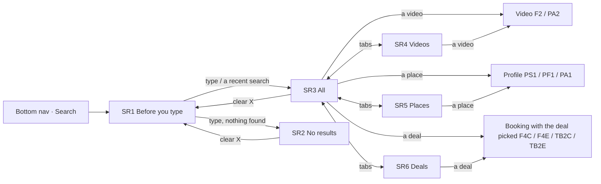

# 16 · Search (public)

The full spec of the **Public · Search** page in the design canvas. Anyone using the app can find, from one field:
- **places** (businesses of every category);
- **videos** (services and rooms);
- **deals** (coupons and events).

It opens from the **Search** tab of the bottom navigation. Read `01`–`07` first; this file only adds what is specific to these screens.

**One page for every category.** Services, food & beverage and accommodation show up in the same lists; only the place's status line and the screen a result opens differ.

References for every screen at three sizes:
`../screenshots/{small,medium,large}/<id>.png` (what it must look like) and `../screens/{small,medium,large}/<id>.html` (exact values, clickable).

| Step | Screen id | Canvas board |
|---|---|---|
| Before you type | `SR1-start` | 1 · Before you type: recent searches |
| No results | `SR2-no-results` | 2 · No results |
| All | `SR3-all` | 3 · All (one mixed feed: places, videos, deals; keeps loading) |
| Videos tab | `SR4-videos` | 4 · Videos tab |
| Places tab | `SR5-places` | 5 · Places tab |
| Deals tab | `SR6-deals` | 6 · Deals tab (coupons and events) |

**This replaces the current Search mock.** Decisions, so they are not added back:
- **No result counts** anywhere: not in the tabs, not in the filter tiles, not above a list.
- **No "See all"** links. All is one feed that keeps loading; the tabs are the way to see one type only.
- **No Browse / categories** on the start screen or on No results.
- **No icons in place rows** (no category pin next to the type): initial, name, verified, type · city, status.
- **Deals are cards with their video**, 2 per row like the videos, never plain text rows.

---

## 1. Flow

Rules:
1. **One field for everything.** The query matches place names, place types and cities, video titles, and deal titles. Ranking and matching are open (`10` #51, #60).
2. **Results while typing.** The results replace the start screen as the person types; the clear **X** empties the field and goes back to SR1. When to send the request (after how many characters, debounce) is open (`10` #50).
3. **Tabs: All · Videos · Places · Deals.** All is selected first. A tab changes only the list under it; the query stays. Each tab keeps its own scroll position and its own paging.
4. **All is one mixed feed**, best match first. Places, videos and deals are mixed in the order the backend ranks them:
   - a place is one block (one row in a card);
   - videos come in rows of two;
   - deals come in rows of two.

   There are no section headings in All.
5. **Every list keeps loading** (infinite scroll): All, Videos, Places and Deals. **Loading more** sits at the end of the list while the next page loads.
6. **Deals = coupons and events** that are still valid and bookable, **ending soonest first**. The All / Events / Coupons tiles filter the Deals list in place.
7. **A deal opens its booking with the deal already picked**:
   - coupon at a services place → `F4C` (Pick a time, coupon chosen);
   - event at a services place → `F4E`;
   - coupon at a food & beverage place → `TB2C` (Guests & time, coupon chosen);
   - event at a food & beverage place → `TB2E`.

   The booking opens on the first day the deal applies. Which service F4C / F4E open on when a deal applies to several services is open (`10` #61).
8. **A place opens its profile** by category: services → `PS1`, food & beverage → `PF1`, accommodation → `PA1`.
9. **A video opens the item's video**: a service → `F2` (no team member picked, so Book goes through Choose a stylist, flow B in `05`); a room → `PA2`.
10. **Recent searches** (SR1) are this person's last searches, newest first. Tapping one runs it again (SR3). **X** removes one; **Clear all** removes them all. A search is saved when its results are shown.
11. **No results** (SR2) shows when nothing matches in any tab. No tabs are shown on SR2. One empty tab while others have results is open (`10` #56).

Not designed yet, do not invent: `10-open-questions.md` #50–#61 (when to search, ranking, location, paging, where recent searches are kept, empty states, matching, which service a deal opens on).

## 2. Shared: search field, tabs, bottom nav

| Part | Spec |
|---|---|
| **Search field** (C50) | margin `10 16 0`; 52 tall, radius 14, white, padding `0 2 0 14`, gap 10. `search` 20 `text.secondary` · input 16 (16 so iOS does not zoom), placeholder "Search places, videos, coupons…" `text.placeholder` · **clear** `x` 18 `text.tertiary` in a 44 target (only when there is text). Border 1.5: `line.outline` when empty, `text.primary` when it has text. Keyboard action: **Search**. No top bar above it (Search is a root tab). |
| **Tabs** (C51) | margin `8 16 0`, four equal columns, 56 tall, icon 20 + label 12.5 (never wraps), 4 between, 1px `line.divider` track. Selected: `text.primary` 500 with a 2px `text.primary` underline. **The others are greyed: the same `text.primary` at opacity 0.4**, weight 400. Icons: **All** `layout-grid` · **Videos** `square-play` · **Places** `store` · **Deals** `ticket-percent`. **No counts.** `role=tablist` / `tab`. |
| Content | scrolls under the tabs (or under the field on SR1 / SR2), padding `0 16 20`; the first block 14 below the tabs |
| Bottom nav | the app's dark bottom navigation (as on HP) with **Search** selected (white, 500); stays pinned |

## 3. SR1 · Before you type

| Part | Spec |
|---|---|
| Field | empty (outline border, placeholder) |
| Heading | "Recent" 15/600, margin `18 4 8` + **Clear all** on the right: text button 13/500 `brand.tintIcon`, 44 tall hit area |
| Recent card | white, radius 18, 1px `line.card`; rows separated by `line.rowSeparator` |
| **Recent row** (C52) | min 52, padding `4 4 4 14`, gap 12: `clock` 18 `text.tertiary` · the query 15 `text.primary` (1 line, ellipsis; tap → runs it) · remove `x` 16 `text.tertiary` in a 44 target (label "Remove <query>") |

When there are no recent searches, the heading and card are hidden (the empty start screen is open: `10` #55).

## 4. SR2 · No results

| Part | Spec |
|---|---|
| Field | the query, ink border, clear X |
| **No results card** (C53) | margin-top 18, white, radius 18, 1px `line.card`, padding `20 16`, centred, gap 6: circle 52 `bg.soft` + `search` 24 · "No results for “<query>”" 18/700 (margin-top 6) · "Check the spelling or try fewer words." 13.5 / 1.45 `text.secondary`, max width 280 |
| No tabs | there is nothing to switch to |

## 5. SR3 · All

| Part | Spec |
|---|---|
| Feed | 14 below the tabs; blocks in ranked order, **12** between blocks |
| Place block | one C54 place row inside a white card (radius 18, 1px `line.card`) |
| Video row | 2-column grid, gap 12, two C7 video cards with the place name (§6) |
| Deal row | 2-column grid, gap 12, two C55 deal cards (§8) |
| End | C56 **Loading more** while the next page loads |

The reference board is drawn taller than the phone (1831 at medium) to show a whole page of the feed; in the app it scrolls under the tabs, and the bottom nav stays pinned.

## 6. SR4 · Videos

- 2-column grid, gap 12, 14 below the tabs, then **Loading more**.
- **Video card** = C7 (public video card, 290 at medium) with **the place's name** under the title: 12.5, white .88, text-shadow, 1 line with ellipsis, margin-top 2. It takes the place of the avatar stack. Then the price pill (8 below), play 44 centred, and the bottom pill (people · duration, or people · Details for rooms), exactly as C7.
- Tap play or the bottom pill → the item's video (rule 9).

## 7. SR5 · Places

- One white card (radius 18, 1px `line.card`) holding the place rows, separated by `line.rowSeparator`, then **Loading more**. More rows join the same card as pages load.
- **Place row** (C54), one tap target (→ profile, rule 8), min 76, padding `12 8 12 14`, gap 12:
  - avatar 48: the place's logo, or its initial 17/600 white on the place's colour;
  - name 15/600 (1 line, ellipsis) + **verified** badge 16 (`brand.verified` circle with a white check) when the place is verified;
  - "<type> · <city>" 12.5 `text.secondary` (1 line, ellipsis), **no icon**;
  - status line 12.5 (1 line, ellipsis): the status word 600 in its colour + " · <time>" `text.secondary`:
    - services and food & beverage use the Opening status rule (`06`): **Open now** `status.successText` · "Closes 20:00"; **Closes soon** `status.warningText` · "Until 22:30"; **Closed** `status.danger` · "Opens 09:00";
    - accommodation: **Check-in 14:00** `text.secondary` · "Check-out 11:00";
  - `chevron-right` 18 `text.tertiary`.

## 8. SR6 · Deals

| Part | Spec |
|---|---|
| **Filter tiles** | margin-top 14, three tiles filling the row (flex 1), gap 9, 60 tall, radius 13, padding 9: icon 18 top-left, label 12.5/600 bottom-left (1 line, ellipsis). **All** `layout-grid` · **Events** (the event "group" icon, `11` §5) · **Coupons** `percent`. Selected: `text.primary` fill, white content, ring `0 0 0 2px bg.page, 0 0 0 4px text.primary`. Others: white, 1px `line.card`, opacity 0.4. **No counts.** `aria-pressed`. |
| Grid | 14 below the tiles; 2 columns, gap 12; ending soonest first |
| Note | `info` line 12.5 / 1.4 `text.secondary` (margin `14 4 0`): "Tap a deal to book with it: the coupon or event is already picked." |
| End | **Loading more** |

**Deal card** (C55) = the C16 ticket at 2 per row, as tall as a video card:
- 290 tall at medium, radius 18, white, 1px `line.card`; the whole card is one link (label "Coupon: <title>, <place>" / "Event: <title>, <place>").
- **Media** = card − 76 (214): the deal's video thumbnail (or its colour), play 40 centred (white 1.5 ring, `rgba(0,0,0,.5)`).
- **Discount sticker** (coupons only): bottom-left of the media (left 9, bottom 8), as C16 ("15% OFF", "10 RON OFF").
- **Tear line** at the media bottom: the two 14 notches + dashed 1.5 `line.outline`, inset 10 (as C16).
- **Stub** 76, padding `0 12`, centred, gap 3:
  - title 14.5/600, 1 line, ellipsis (the coupon's item, "Haircut", or the event's title, "Wine tasting");
  - the place's name 12 `text.secondary`, 1 line, ellipsis;
  - facts 12/500 `text.secondary`: `hourglass` 13 + time left (**red** at Today / 1 day, the Time left rule) · 1×12 `line.outline` divider · `ticket` 13 + quantity left.

The same card is used in the All feed.

## 9. Loading more (C56)

`role=status`, margin-top 16, 44 tall, centred, gap 8: a 22 ring (track `line.divider`, a quarter arc `text.primary`, spinning) + "Loading more" 12.5 `text.secondary`. It shows while a page is loading; the next page is asked for before the person reaches the end (proposal: one screen before). What shows after the last page, and a failed load, are open (`10` #53).

## 10. New components

| # | Component | Spec |
|---|---|---|
| C50 | **Search field** | §2 — 52, radius 14, `search` 20, input 16, clear X 44; outline border when empty, ink when typing |
| C51 | **Tabs, greyed variant** | §2 — the CR1 / MA tabs with four columns; unselected tabs at opacity 0.4, no counts |
| C52 | **Recent search row** | §3 — `clock`, query (tap to run), remove X 44 |
| C53 | **No results card** | §4 — icon circle 52, "No results for “<query>”", one hint line |
| C54 | **Place result row** | §7 — avatar 48, name + verified, type · city (no icon), status line, chevron |
| C55 | **Deal card (2 per row)** | §8 — C16 ticket at video-card height: media = card − 76, stub 76 with title, place, time left · quantity left |
| C56 | **Loading more** | §9 — spinner 22 + "Loading more", end of every infinite list |

Reused as they are:
- C7 public video card (with the place's name in place of the avatar stack);
- C16 discount sticker and tear line;
- C6 filter tiles, as plain icon tiles without counts;
- the bottom navigation from HP.

## 11. Copy (EN)

| Where | Copy |
|---|---|
| Field | "Search places, videos, coupons…" (placeholder) · "Search" (field label) · "Clear search" (clear X label) |
| SR1 | "Recent" · **Clear all** · "Remove <query>" (label) |
| SR2 | "No results for “<query>”" · "Check the spelling or try fewer words." |
| Tabs | "All" · "Videos" · "Places" · "Deals" |
| Places | "<type> · <city>" · "Open now" · "Closes <HH:MM>" · "Closes soon" · "Until <HH:MM>" · "Closed" · "Opens <HH:MM>" · "Check-in <HH:MM>" · "Check-out <HH:MM>" · "Verified" (badge label) |
| Videos | as C7 ("from", "/ night", "N min", **Details**) |
| Deals | "All" · "Events" · "Coupons" · "<N>% OFF" / "<N> RON OFF" · "Today" / "1 day" / "N days" · "Tap a deal to book with it: the coupon or event is already picked." |
| End | "Loading more" |

The query is shown as typed, in curly quotes. Place, video and deal titles are the businesses' own text and are not translated. Talk about a place with "they" (no gendered pronouns).

## 12. Small / large phones

- **Small (360 × 640)**:
  - Video and deal cards scale with the column width: **265** tall (deal media 189, stub stays 76).
  - Video bottom pills use the small compaction from `07` (font 12, gap 6, padding `0 8 0 10`); price pills gap 4.
  - Tabs, field, tiles and place rows do not change size; names and status lines ellipsize.
  - SR3 to SR6 scroll under the tabs; SR1 and SR2 fit.
- **Large (430 × 932)**: cards **324** tall (deal media 248), more air; same layout.
- SR3's reference board is 1731 (small), 1831 (medium), 1967 (large) tall to show one page of the feed.

## 13. Data

See `06-data-model.md` → *Search*: the query, the result types (place, video, deal), the All feed blocks, paging and recent searches.

## 14. Definition of done for this page

- [ ] SR1–SR6 match their screenshots at small, medium and large (overlay at 50 %: no shifted or resized elements).
- [ ] One search field: outline border when empty, ink border with a clear X when it has text; X goes back to SR1.
- [ ] SR1: recent searches newest first; tap runs it, X removes one, Clear all removes all. No Browse / categories.
- [ ] Four tabs All · Videos · Places · Deals, icon + label, **no counts**; the unselected tabs are greyed at 0.4. The query stays when switching tabs.
- [ ] All is one mixed feed, best match first: place blocks, video rows of two, deal rows of two; no headings and no "See all".
- [ ] Every list keeps loading with **Loading more** at the end.
- [ ] Place rows: initial or logo, name + verified, type · city without an icon, status line with the right colour; tap opens PS1 / PF1 / PA1.
- [ ] Videos are C7 cards with the place's name; tap opens F2 (service) or PA2 (room).
- [ ] Deals: 2 per row, ending soonest first, All / Events / Coupons tiles without counts; a tap opens F4C / F4E / TB2C / TB2E with the deal picked.
- [ ] SR2 when nothing matches: the query in quotes, one hint, no tabs, no Browse.
- [ ] Cards scale to 265 / 290 / 324; the deal stub stays 76.
