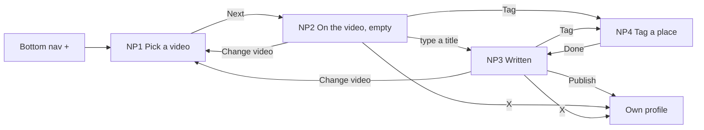

# 17 · New post (profile)

The full spec of the **Profile · New post** page in the design canvas. Anyone using the app posts a video on **their own profile**, the way they know from Instagram or TikTok:
- pick a video;
- write a title and a description **on the video, where people will read them**;
- optionally tag a **place**, a **service** or a **room**, so people can open it from the video;
- Publish.

It opens from the **+** in the bottom navigation. Read `01`–`07` first; this file only adds what is specific to these screens.

**A post is general**, not a service or a room: the host's video-first service and room flows (HS1–HR4) stay as they are.

References for every screen at three sizes:
`../screenshots/{small,medium,large}/<id>.png` (what it must look like) and `../screens/{small,medium,large}/<id>.html` (exact values, clickable).

| Step | Screen id | Canvas board |
|---|---|---|
| Pick a video | `NP1-pick-video` | 1 · The + button: pick a video |
| On the video, empty | `NP2-empty` | 2 · On the video: title and description still empty |
| Written and tagged | `NP3-written` | 3 · Written at the caps (title 30, description 100) and tagged |
| Tag a place (sheet) | `NP4-tag-place` | 4 · Tag a place (sheet): from your visits or search |

Decisions, so they are not added back:
- **No #hashtags**, **no people tags or @mentions**, **no Location**. The post is on the person's own profile; a place tag already says where it was filmed.
- **No Cancel button**: the X closes. **No empty "Upload video" box**: the + opens the gallery (video first).
- **No tag pill on the video.** A tag shows only as the **Tag** icon on the side rail (white with a count badge).
- **No extra screens** for searching a place or picking its service: both happen inside the Tag sheet.

---

## 1. Flow

Rules:
1. **Video first.** NP1 is the gallery (C10): one clip, **up to 100 MB**. No Skip: a post needs a video. **Change video** goes back to NP1 and keeps the text and the tag.
2. **Title: required, max 30 characters.** **Description: optional, max 100 characters.** Typing stops at the cap (no error message). The counters show "n / 30" and "n / 100".
3. **The fields grow with the text.** At the caps, the 30-character title fits on one line and the 100-character description on three, at every size (see NP3).
4. **Publish** is greyed (0.4, not tappable) with the hint "Add a title to publish" until the title has at least one character that is not a space. Then the hint becomes "This is how people see it".
5. **A tag is one of:**
   - a place;
   - a **service** at a services place;
   - a **room** at an accommodation.

   Food & beverage places are tagged as the place only.
6. **From your visits** (NP4) lists this person's done visits, newest first: one row per place, with what was booked and the date. Tapping a row tags the place **and** what was booked there (a table tags the place). Tapping it again removes the tag.
7. **Search places** filters inside the same sheet: places, then their services or rooms as rows. Tap one to tag it. The results list is not drawn (`10` #64).
8. **The Tag icon** on the side rail:
   - dark when nothing is tagged;
   - white with a green count badge once something is tagged ("1").

   Tapping it opens NP4.
9. **What people see.** The published post shows the title, the description, and the **Tag** icon on the side rail. Tapping it opens the tagged service or room video (F2 / PA2) or the place's profile (PS1 / PF1 / PA1). Without a tag, there is no Tag icon. This screen is not drawn (`10` #65).
10. **The + opens NP1** from every screen that shows the bottom navigation. In the canvas prototype it is wired on the profile (HP).
11. **X** closes and goes back to the profile. A discard confirmation when there is text is not designed (`10` #67).

Not designed yet, do not invent: `10-open-questions.md` #62–#70 (how many tags, tagging places never booked, search results in the sheet, what people see, video limits, discard, after Publish, edit / delete, the tagged business).

## 2. NP1 · Pick a video

The C10 video picker exactly as HS2, with:
- the title "New post";
- the hint "Pick one clip · up to 100 MB";
- **no Skip**;
- **Next** → NP2.

Tiles keep the 3-column grid: 159 / 172 / 190 tall (small / medium / large).

## 3. NP2 / NP3 · On the video (C57)

The whole screen is the picked video, as people will see it.

| Part | Spec |
|---|---|
| Video | full bleed, top scrim 140 (`0.55 → 0`), bottom scrim 460 (`0 → 0.35 → 0.8`) |
| Close | X 24 in a 44 target, top 40, left 8, drop shadow → the profile |
| **Change video** | top 40, right 8, 44 tall: pill 34, radius 17, `rgba(0,0,0,0.4)`, `refresh-cw` 15 + "Change video" 13/500 white → NP1 |
| Poster | above the panel (gap 10, margin-left 4): avatar 36 (photo, or initial on the person's colour) · name 14/600 · "@username" 12 white .8 |
| **Caption panel** (C58) | left 12, right 80, bottom 112; padding `10 12`, radius 16, 1px `rgba(255,255,255,0.22)`, frosted `rgba(20,18,24,0.55)` + blur 12 |
| Title field | 16/600, line 1.3, white; placeholder "Add a title" white .7; grows to 2 lines if needed |
| Divider + title counter | margin `4 0`, gap 8: 1px `rgba(255,255,255,0.22)` line (flex) + "n / 30" 11.5 white .65 |
| Description field | 14, line 1.4, white .9; placeholder "Add a description"; grows with the text |
| Description counter | "n / 100" 11.5 white .65, right aligned, 2 below |
| **Tag tool** (C59) | side rail right 8, bottom 116, 60 wide (§4) |
| Bottom row | left / right 16, bottom 28, gap 12: hint 13 white .8 (text-shadow) · **Publish** white pill 52, radius 26, padding `0 24 0 20`, `upload` 20 + 16/500 ink; disabled at 0.4 |

**NP2** shows the placeholders, "0 / 30" and "0 / 100", the dark Tag tool and the greyed Publish.

**NP3** shows both fields at their caps: "Fresh cut for a sunny weekend!" (30) and a 100-character description. It also shows "30 / 30", "100 / 100", the white Tag tool with "1", and Publish.

## 4. Tag tool (C59)

- Circle 44: `rgba(0,0,0,0.4)` with a white `store` 21 (nothing tagged), or white with an ink `store` (tagged).
- Badge (tagged only): 18 tall, min-width 18, radius 9, `status.success`, white 11/700 count, top −3, right 5.
- Label "Tag" 12/500 white, text-shadow.
- One tap target (60 × ~70) → NP4. Label for screen readers: "Tag a place" / "Tagged: <place>, <item>".

## 5. NP4 · Tag a place (C60)

A C13 bottom sheet over the dimmed editor (`rgba(0,0,0,0.45)`; tap → close).

| Part | Spec |
|---|---|
| Sheet | white, radius `24 24 0 0`, padding `0 16 28`, handle 36 × 4 `line.strong` |
| Head | "Tag a place" 19/600 + X 22 (44 target) |
| Line | "A place, a service or a room. People open it from the Tag on your video." 13 / 1.4 `text.secondary` |
| Search | 14 below: field 52, radius 14, 1.5 `line.outline`, `search` 20 `text.secondary`, placeholder "Search places" 16 |
| From your visits | heading 13/600 (`16 4 4`); rows full width of the sheet |
| **Visit row** | min 64, padding `8 12 8 14`, gap 12, separators `line.rowSeparator`: avatar 40 (logo, or initial on the place's colour) · name 15/600 (1 line, ellipsis) + verified 16 · `calendar` 13 + "<what> · <d Mon>" 12.5 `text.secondary` · check 26 (on: `status.success` circle with a white check; off: 2px `line.strong` ring). `role=checkbox`. |
| Done | 14 below: ink 52, radius 16, 16/500 → back to the editor |

The sheet fits without scrolling at every size (3 visits). With more visits the list scrolls inside the sheet (max height = screen − 64).

## 6. New components

| # | Component | Spec |
|---|---|---|
| C57 | **Post editor on the video** | §3 — full-bleed video, scrims, X, Change video, poster, caption panel, Tag tool, Publish row |
| C58 | **Caption panel** | §3 — frosted panel; title (30) and description (100) fields that grow; divider with the title counter; description counter |
| C59 | **Tag tool** | §4 — rail button 44 with `store`, dark or white, count badge, label "Tag" |
| C60 | **Tag sheet** | §5 — C13 sheet: search field, From your visits rows with a check, Done |

Reused as they are:
- C10 video picker;
- C13 bottom sheet;
- the verified badge;
- the poster avatar from the video overlays (R2).

## 7. Copy (EN)

| Where | Copy |
|---|---|
| NP1 | "New post" · "Recents" · "Pick one clip · up to 100 MB" · "1 video · <m:ss>" · **Next** |
| NP2 / NP3 | **Change video** · "Add a title" · "Add a description" · "<n> / 30" · "<n> / 100" · "Tag" · "Add a title to publish" · "This is how people see it" · **Publish** |
| NP4 | "Tag a place" · "A place, a service or a room. People open it from the Tag on your video." · "Search places" · "From your visits" · "<what> · <d Mon>" · **Done** |
| Labels | "Close" · "Change video" · "Title, up to 30 characters" · "Description, up to 100 characters" · "Tag a place" / "Tagged: <place>, <item>" · "Verified" |

The title and description are the person's own text and are not translated. The caps count characters as the person sees them (an emoji counts as one).

## 8. Small / large phones

- Everything is placed from the edges. The caption panel is the screen width − 92, so the fields wrap earlier on small phones.
- **Small (360 × 640)**: the 30-character title still fits on one line and the 100-character description on three. The panel and poster sit higher; nothing changes size. The NP4 sheet fits.
- **Large (430 × 932)**: same layout with more video above the caption.
- NP1 tiles scale with the column width (159 / 172 / 190).

## 9. Data

See `06-data-model.md` → *Post*: the post with its title, description, video and optional tag, the create request, and the visits that feed **From your visits**.

## 10. Definition of done for this page

- [ ] NP1–NP4 match their screenshots at small, medium and large (overlay at 50 %: no shifted or resized elements).
- [ ] The + in the bottom navigation opens NP1. One clip, up to 100 MB, no Skip; Next → NP2.
- [ ] The editor is the whole video: X, Change video, poster, frosted caption panel, Tag on the side rail, Publish bottom right.
- [ ] Title max 30, description max 100: typing stops at the cap, counters "n / 30" (on the divider) and "n / 100". At the caps the title is one line and the description three, at every size.
- [ ] Publish is greyed with "Add a title to publish" until there is a title.
- [ ] Tag icon: dark without a tag; white with the green count badge with one; tap opens NP4.
- [ ] NP4: search field, From your visits (newest first, with what was booked and the date), check to tag, Done. A visit tags the place and what was booked there; restaurants tag the place only.
- [ ] No hashtags, no people tags, no location, no tag pill on the video, no Cancel button.
