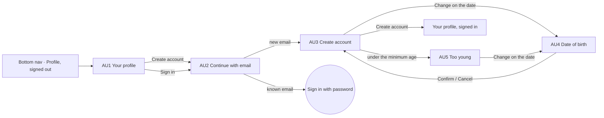

# 18 · Account: create or sign in

The full spec of the **Account · Create or sign in** page in the design canvas. Anyone can use the app without an account: they watch and search freely. The **Profile tab** is where they create an account or sign in:
- with an email;
- a new email creates an account, with an **age check** from the date of birth;
- a known email signs in.

Read `01`–`07` first; this file only adds what is specific to these screens.

References for every screen at three sizes:
`../screenshots/{small,medium,large}/<id>.png` (what it must look like) and `../screens/{small,medium,large}/<id>.html` (exact values, clickable).

| Step | Screen id | Canvas board |
|---|---|---|
| Profile tab, signed out | `AU1-profile-signed-out` | 1 · Profile tab, signed out (the main display) |
| Continue with email | `AU2-email` | 2 · Continue with email |
| Create account | `AU3-create-account` | 3 · New email: create account (date of birth checks the age) |
| Date of birth (dialog) | `AU4-date-of-birth` | 4 · Date of birth (dialog): Day · Month · Year wheels, Cancel / Confirm |
| Under the minimum age | `AU5-too-young` | 5 · Age check: under the minimum age, Create account disabled |

**This replaces the current welcome screen.** Decisions, so they are not added back:
- **No tagline or feature rows** ("Create & Share", "Connect", "Grow"): no marketing copy in the UI (principle 1).
- **No welcome wall.** The app opens on its content; the Profile tab shows AU1 until the person signs in. **Skip for now** is gone: there is nothing to skip.
- **No "By continuing, you agree…" line.**
- **Email only.** No Continue with Apple / Google, and no sign-in sheets over other screens.
- **Privacy & data** is a small link at the bottom of AU1, not a card.

---

## 1. Flow

Rules:
1. **AU1 is the Profile tab while signed out.** The bottom nav stays, with Profile selected. **Create account** and **Sign in** both open AU2.
2. **One email field (AU2).** **Continue** checks the email:
   - a new one goes to AU3;
   - a known one goes to sign in with the password.

   The sign-in screen (password, Forgot password) is not designed yet (`10` #63).
3. **Create account (AU3)** needs all of:
   - **first name** and **last name**: two fields on one row, never "Full name";
   - a **username** that is free ("✓ Available", checked while typing);
   - a **date of birth**;
   - a **password** of at least 8 characters, with a show / hide eye.

   The email is shown on top with **Change** (→ AU2).
4. **Date of birth opens a dialog (AU4).** The row shows the date and a **Change** pill with a calendar icon ("Pick date" while empty); tapping the pill or the row opens AU4. The wheels:
   - open on 1 Jan 2000 when no date is picked yet, never on today;
   - show months as names ("Mar"), never as numbers.

   **Confirm** writes the date into the row; **Cancel** or a tap outside changes nothing.
5. **Age check.** The person must be at least the **minimum age (16, to confirm: `10` #62)** on the day they sign up. When younger (AU5):
   - the date turns `action.danger`;
   - the line "You need to be 16 or older to create an account." appears in `action.danger` with a `circle-alert` icon;
   - **Create account** is disabled (0.4).

   Picking an old-enough date clears it. The date of birth is never shown on the profile.
6. **Create account** is enabled when every field is valid and the age is old enough. It creates the account, signs the person in and opens their profile.
7. **Privacy & data** (AU1) opens the app's privacy screen: the policies and what this device shares. That screen is not designed yet (`10` #64).
8. **Actions that need an account** while signed out (the +, Book, Like) take the person to AU1 (proposal, `10` #66).

Not designed yet, do not invent: `10-open-questions.md` #62–#66 (minimum age, sign in with a known email, the Privacy & data screen, email verification, actions that need an account).

## 2. AU1 · Profile tab, signed out (C63)

| Part | Spec |
|---|---|
| Top | 56 empty (no back: it is a tab) |
| Avatar placeholder | 20 below: circle 96, white, 2px dashed `line.strong`, `user` 40 `text.tertiary` (stroke 1.6) |
| Title | "Your profile" 22/600, centred, 14 below |
| Line | "Sign in to post videos, book and keep your rewards." 14 / 1.45 `text.secondary`, centred, max width 300 |
| **Create account** | 28 below: ink 52, radius 16, white 16/500 → AU2 |
| **Sign in** | 10 below: white 52, radius 16, 1.5px `text.primary` border, 16/500 → AU2 |
| **Privacy & data** | at the bottom of the content, above the nav: `shield` 16 + 13.5/500 `text.primary`, centred, 44 tall |
| Bottom nav | C9 with **Profile** selected |

## 3. AU2 · Continue with email

| Part | Spec |
|---|---|
| Top bar | 56: back (→ AU1) · "Continue with email" 18/500 |
| Email field | C50 build with `mail` 20: 52, radius 14, white, 1.5px `text.primary` border while focused, input 16 (`type=email`, `autocomplete=email`), clear X 44 |
| Note | `info` + "New email: you create an account. Known email: you sign in with your password." 12.5 `text.secondary` |
| Bottom bar | pinned, white, top border: **Continue** ink 52, radius 16 |

## 4. AU3 · Create account (C64, C65)

| Part | Spec |
|---|---|
| Top bar | 56: back (→ AU2) · "Create account" 18/500 |
| Email | `bg.soft` row 52, radius 14: `mail` 18 · the email 15 (ellipsis) · **Change** 14/500 → AU2 |
| **Form card** (C64) | the TB3 "Your details" card: white, radius 18, 1px `line.card`, rows min 56, padding `0 6 0 14`, icon 20 `text.secondary`, inputs 15, separators `line.rowSeparator` |
| Row · name | `user` · First name \| Last name (1px × 28 divider), `autocomplete` given-name / family-name |
| Row · username | `at-sign` · username (`autocapitalize=off`) · "✓ Available" 13/600 `status.successText` when free |
| Row · date of birth | `cake` · the date 15 ("12 Mar 1998") · **Change pill** (C65): 32 tall, radius 16, `bg.soft`, `calendar` 16 + "Change" 13.5/500 (empty: "Pick date"). The whole row opens AU4. |
| Row · password | `lock` · password (`autocomplete=new-password`) · eye 20 in a 44 target (Show / Hide password) |
| Notes | `info` + "Date of birth checks you are 16 or older. It is not shown on your profile." · `info` + "Password: at least 8 characters. Your username is how people find you." |
| Bottom bar | pinned: **Create account** ink 52 → the person's profile |

## 5. AU4 · Date of birth (C66)

A centred dialog over the dimmed AU3 (`rgba(0,0,0,0.45)`; tap outside = Cancel).

| Part | Spec |
|---|---|
| Dialog | left / right 20, vertically centred, white, radius 24, padding `20 20 14`, shadow `0 10 30 rgba(0,0,0,.25)`, `role=dialog` |
| Title | "Date of birth" 19/600, 14 below it the wheel headers |
| Headers | "Day" · "Month" · "Year" 12.5/500 `text.secondary`, centred over their wheel |
| **Wheels** | three columns, gap 10, widths 1 : 1.25 : 1.25; each `text.primary` (ink), radius 16, 5 rows of 44 (220 tall); the middle row is the value, on a band `rgba(255,255,255,0.12)`. Text white, tabular numbers: picked 20/600; ±1 row 17/400 at 0.5; ±2 rows 15/400 at 0.25. Each wheel is a `listbox` (Day, Month, Year) with the picked `option` selected. |
| Actions | 14 below, right aligned, gap 8: **Cancel** text 15/500 `text.secondary` (44) · **Confirm** ink 44, radius 14, padding `0 22`, white 15/500 |

Days follow the month and year (no 31 Feb). Years go back 100 years from now.

## 6. AU5 · Under the minimum age

AU3 with:
- the date in `action.danger`;
- instead of the date note, the alert line: `circle-alert` 16 + "You need to be 16 or older to create an account." 13/500 `action.danger` (`role=alert`);
- **Create account** disabled at 0.4.

## 7. New components

| # | Component | Spec |
|---|---|---|
| C63 | **Signed-out profile** | §2 — dashed avatar 96, "Your profile", one line, Create account (ink) / Sign in (outline), Privacy & data link at the bottom |
| C64 | **Account form card** | §4 — the TB3 details card with name, username (+ Available), date of birth, password (+ eye) rows |
| C65 | **Change pill** | §4 — `bg.soft` pill 32, `calendar` 16 + "Change" / "Pick date"; tells the person a picker opens |
| C66 | **Date of birth dialog** | §5 — centred dialog, three ink wheels Day · Month · Year with the picked band, Cancel / Confirm |

Reused as they are:
- C9 bottom nav;
- C50 field build (the email);
- C17 buttons;
- the TB3 details rows and the `info` note.

## 8. Copy (EN)

| Where | Copy |
|---|---|
| AU1 | "Your profile" · "Sign in to post videos, book and keep your rewards." · **Create account** · **Sign in** · "Privacy & data" |
| AU2 | "Continue with email" · "New email: you create an account. Known email: you sign in with your password." · **Continue** |
| AU3 | "Create account" · **Change** · "First name" · "Last name" · "Username" · "Available" · "Date of birth" · **Change** / **Pick date** · "Password" · "Show password" / "Hide password" · "Date of birth checks you are 16 or older. It is not shown on your profile." · "Password: at least 8 characters. Your username is how people find you." · **Create account** |
| AU4 | "Date of birth" · "Day" · "Month" · "Year" · month names ("Jan" … "Dec") · **Cancel** · **Confirm** |
| AU5 | "You need to be 16 or older to create an account." |

Month names, the date order in the row ("12 Mar 1998") and the age number go through the localisation system. Use "they" or the first name for people (no gendered pronouns).

## 9. Small / large phones

- **Small (360 × 640)**:
  - every screen fits without scrolling;
  - on AU1, Privacy & data sits right above the nav;
  - AU3 / AU5 show the whole form, both notes and the pinned button;
  - the AU4 dialog keeps its three wheels and both buttons.
- **Large (430 × 932)**: same layout with more space.
- Nothing changes size; the dialog and the form are the screen width − 40 / − 32.

## 10. Data

See `06-data-model.md` → *Account*:
- the email check;
- the username check;
- the sign-up request with the date of birth;
- the minimum-age rule.

## 11. Definition of done for this page

- [ ] AU1–AU5 match their screenshots at small, medium and large (overlay at 50 %: no shifted or resized elements).
- [ ] Signed out, the Profile tab shows AU1 with the bottom nav. There is no welcome wall, no tagline, no feature rows, no terms line and no Skip.
- [ ] Create account and Sign in both open AU2; the email decides create (AU3) or sign in.
- [ ] AU3: email with Change, First name | Last name, username with "✓ Available", date of birth with the calendar **Change** pill, password with show / hide, Create account pinned.
- [ ] AU4: dialog with three ink wheels (months as names), opens on 1 Jan 2000 when empty, Cancel / Confirm.
- [ ] AU5: under the minimum age the date and the alert line are red and Create account is disabled; an old-enough date clears it. The date of birth is never shown on the profile.
- [ ] Privacy & data sits at the bottom of AU1.
