# 20 · Coupons & events: create a coupon or an event (host)

The full spec of the **Host · Coupons & events** page in the design canvas. A host creates a coupon or an event the same way people post a video (`17-new-post.md`):
- pick a **video promo**;
- write the **title** and the **description** on the video;
- set the rest from the side rail, one sheet per setting.

A **checklist** on the video shows what is left. **Create Coupon** / **Create Event** turns on only when the checklist is done.

Read `01`–`07` first; this file only adds what is specific to these screens.

References for every screen at three sizes:
`../screenshots/{small,medium,large}/<id>.png` (what it must look like) and `../screens/{small,medium,large}/<id>.html` (exact values, clickable).

| Step | Screen id | Canvas board |
|---|---|---|
| Upload Video Promo | `OF1-pick-video` | 1 · Upload Video Promo: pick one clip (15-30s works best) |
| Coupon, empty | `OF2-coupon-empty` | 2 · On the video, empty: the checklist shows what is left before Create Coupon |
| Value (sheet) | `OF3-value` | 3 · Value (sheet): % or RON, shown as the sticker |
| Usage Limit (sheet) | `OF4-usage-limit` | 4 · Usage Limit (sheet): unlimited or a number |
| Active Schedule (sheet), coupon | `OF5-coupon-schedule` | 5 · Active Schedule (sheet): dates and times in one sentence |
| Coupon, all set | `OF6-coupon-ready` | 6 · Coupon, all set: checklist done, Create Coupon on |
| Check your coupon (sheet) | `OF7-coupon-check` | 7 · Check your coupon (sheet), then Create Coupon |
| Event, empty | `OF8-event-empty` | 8 · Event, empty: the checklist shows what is left before Create Event |
| Capacity (sheet) | `OF9-capacity` | 9 · Capacity (sheet): unlimited or a number |
| Booking channel (sheet) | `OF10-booking-channel` | 10 · Booking channel (sheet): in-app or phone, explained |
| Active Schedule (sheet), event | `OF11-event-schedule` | 11 · Active Schedule (sheet): the event day and times |
| Event, all set | `OF12-event-ready` | 12 · Event, all set: checklist done, Create Event on |
| Check your event (sheet) | `OF13-event-check` | 13 · Check your event (sheet), then Create Event |

**Every element of the host's sketch is kept, with its name:**
- the **Coupon | Event** switch;
- **Upload Video Promo** ("Short clips perform best (15-30s)");
- **Title** ("e.g., Happy Hour Special", n / 100);
- **Description** ("Describe the details of your offer...", "Minimum 10 characters required", n / 500);
- for a coupon, **Value** (20, % | RON) and **Usage Limit** (∞ claims);
- for an event, **Capacity** (∞) and **Booking channel** (In-app | Phone);
- **Active Schedule**: Start Date, End Date, Start Time, End Time;
- **Create Coupon** / **Create Event**.

Decisions, so they are not undone:
- **One editor on the video**, as New post. No long form.
- **An event uses the same screens as a coupon.** Capacity and Booking channel take the place of Value and Usage Limit; everything else is the same.
- **The checklist is always visible** until it is done. It replaces a hint line.
- **Create is small** (44 tall) and stays disabled until the checklist is done.
- **No video length or engagement** is shown after picking: the check sheet says "Your clip".

---

## 1. Flow

```mermaid
flowchart LR
  HP[Host profile · Quick Actions · Coupons] --> OF1[OF1 Upload Video Promo]
  OF1 -- Next --> OF2[OF2 Coupon, empty]
  OF2 -- Event --> OF8[OF8 Event, empty]
  OF8 -- Coupon --> OF2
  OF2 -- Value --> OF3[OF3 Value] -- Done --> OF4[OF4 Usage Limit] -- Done --> OF5[OF5 Active Schedule] -- Done --> OF6[OF6 Coupon, all set]
  OF6 -- Create Coupon / checklist pill --> OF7[OF7 Check your coupon]
  OF7 -- tap a line --> OF3
  OF7 -- Create Coupon --> CE1[CE1 Coupons & Events tab]
  OF8 -- Capacity --> OF9[OF9 Capacity] -- Done --> OF10[OF10 Booking channel] -- Done --> OF11[OF11 Active Schedule] -- Done --> OF12[OF12 Event, all set]
  OF12 -- Create Event / checklist pill --> OF13[OF13 Check your event]
  OF13 -- Create Event --> CE1
```

Rules:
1. **Entry.** The **Coupons** tile in the host profile's Quick Actions (HP) opens OF1. **X** on OF1 goes back to HP.
2. **One video promo (OF1).**
   - The gallery picks one clip. "Short clips perform best (15-30s)" is a hint, not a limit.
   - **Next** opens OF2 with **Coupon** selected.
   - Back and **Change video promo** on the editor reopen OF1.
3. **Coupon | Event switch.** The two segments switch in place. The video, the title, the description and the schedule are kept; only the type's own settings change (Value and Usage Limit ↔ Capacity and Booking channel).
4. **Title and description** are typed on the video, where people will read them:
   - Title: 1–100 characters, counter "n / 100".
   - Description: 10–500 characters, "Minimum 10 characters required", counter "n / 500".
   - Typing stops at the cap.
5. **Settings live on the side rail**, one button each:
   - coupon: **Value**, **Usage Limit**, **Schedule**;
   - event: **Capacity**, **Booking channel**, **Schedule**.

   Each button opens its sheet (§5). A setting that is **set** shows a white circle with its value as the label ("20%", "∞ claims", "26–30 Oct"). A setting that is **missing** shows a dark circle with an amber dot and the setting's name.
6. **Defaults:**
   - Usage Limit and Capacity start at **Unlimited**, so they count as done.
   - Value, Booking channel and Active Schedule have no default: the host picks them.
7. **Done in a sheet** saves the setting and opens the next one in rail order. On a coupon that is Value → Usage Limit → Active Schedule → the editor; on an event, Capacity → Booking channel → Active Schedule → the editor. The first time, the host sees every setting once. **X** or a tap outside closes the sheet and keeps the previous value.
8. **The checklist (§3)** counts six items. When all six are done:
   - it turns into the green pill "Checklist: all 6 done";
   - **Create Coupon** / **Create Event** turns on.

   If an item becomes undone again (the title is deleted, for example), the full checklist comes back and Create turns off.
9. **Check before it goes live.** **Create Coupon** on the editor (or the green pill) opens the check sheet (OF7 / OF13): the six items with their values. Tapping a line opens that field or sheet. **Create Coupon** / **Create Event** on the sheet saves the offer and opens the host's **Coupons & Events** tab (CE1), with the new one in the grid.
10. **It ends by itself.**
    - A coupon applies every day from Start Date to End Date, between Start Time and End Time.
    - An event takes place on its dates, from Start Time to End Time.
    - After the end it is no longer offered. A coupon also stops when the usage limit is reached, an event when it is full.

## 2. OF1 · Upload Video Promo

The New post picker (`17-new-post.md` §2), with this page's copy:

| Part | Spec |
|---|---|
| Screen | `#0E0D11`, white text |
| Top bar | 56: X 24 (→ HP) · "Upload Video Promo" 16/500 centred |
| Row | 48: **Recents** 15/500 + `chevron-down` 18 · "Short clips perform best (15-30s)" 13 white .62, right |
| Grid | 3 columns, gap 2, tiles 172 tall; the device's clip length bottom right 12/500; select circle 24 top right (picked: white with ink `check` 14, 3px white inset ring) |
| Bottom | "1 video · 0:18" 14 white .72 (from the device gallery) · **Next** white pill 48, radius 24, ink 16/500 → OF2 |

## 3. The checklist (C67)

On the video, under the top row, in every editor state (OF2, OF6, OF8, OF12) and behind every sheet.

| Part | Spec |
|---|---|
| Card | top 96, left / right 12, padding `10 12 6`, radius 16, 1px `rgba(255,255,255,.22)`, frosted `rgba(20,18,24,.6)` + blur 12 |
| Header | "To create the coupon" / "To create the event" 14/600 · right "n of 6 done" 12.5/500 white .75 |
| Progress | 8 below: 4 tall, radius 2, track `rgba(255,255,255,.2)`, fill `offer.coupon` at n / 6 (`role=progressbar`) |
| Items | 6 below: 2 columns (gap 10), rows 36, in this order: **Video promo** · **Title** / **Description** · **Value** (event: **Capacity**) / **Usage Limit** (event: **Booking channel**) · **Active Schedule** |
| Item · done | `offer.coupon` circle 20 with a white `check` 12 · label 13.5/500 white .62 |
| Item · to do | 20 circle with a 2px `status.warning` ring · label 13.5/600 white |
| Tap | Video promo → OF1 · Title / Description → focus that field · the others → their sheet |
| **All done** | the card becomes a pill: top 96, left 12, 36 tall, radius 18, `offer.coupon`, white 13.5/600 "Checklist: all 6 done" with a white circle 24 holding a green `check` 14 → the check sheet |

An item is **done** when:

| Item | Done when |
|---|---|
| Video promo | a clip is picked (always, after OF1) |
| Title | 1–100 characters |
| Description | 10–500 characters |
| Value (coupon) | a number above 0 (at most 100 for %) |
| Usage Limit (coupon) | Unlimited (the default) or a whole number of 1 or more |
| Capacity (event) | Unlimited (the default) or a whole number of 1 or more |
| Booking channel (event) | In-app or Phone is picked |
| Active Schedule | the four fields are set and valid (§5.3) |

Each item has an accessible name with its state ("Title: to do", "Usage Limit: done").

## 4. OF2 / OF6 / OF8 / OF12 · The editor on the video

The whole screen is the picked video: top scrim 160 (`rgba(0,0,0,.55)` → 0), bottom scrim 480 (0 → .35 → .8).

| Part | Spec |
|---|---|
| Top row | top 40, left / right 8, 44 tall: back `arrow-left` 24 (→ OF1) · **type switch** (C69) centred · **Change video promo**: circle 36 `rgba(0,0,0,.4)` with `refresh-cw` 17, in a 44 target (→ OF1) |
| Checklist | C67 (§3) |
| **Side rail** (C68) | right 2, bottom 100, 66 wide, gap 10: three setting tools (rule 5) |
| Sticker | above the caption panel, gap 10. Coupon: `offer.coupon` 26 tall, radius 7, white 13/800 "20% OFF" (or "10 RON OFF"), only once Value is set. Event: `offer.eventText` 26 tall, radius 7, group icon 15 + "Event" 13/700. |
| **Caption panel** | C58 with labels and the caps of this page: left 12, right 76, bottom 96; "Title" 11.5/600 white .65 · title 16/600 (placeholder "e.g., Happy Hour Special") · divider with "n / 100" · "Description" 11.5/600 · description 14 / 1.4 white .9 (placeholder "Describe the details of your offer...") · "Minimum 10 characters required" left and "n / 500" right, 11.5 white .65 |
| Bottom row | left / right 16, bottom 32, gap 12: hint 13 / 1.35 white .85 — "<n> left on the checklist" until done, then "All set. Check it before it goes live." · **Create Coupon** / **Create Event**: white pill **44** tall, radius 22, padding `0 18`, ink 15/600, one line; disabled at 0.4 until the checklist is done |

**Type switch (C69):**
- the container is `rgba(0,0,0,.45)`, padding 3, radius 20, gap 2;
- each segment is 34 tall, radius 17, padding `0 12 0 10`, with an icon 16 and a label 13.5/600: **Coupon** with `percent`, **Event** with the group icon;
- the selected segment is white with ink text; the other is transparent with white .8 text;
- each segment is a toggle (`aria-pressed`).

**Setting tool (C68):**
- a circle 44 with an icon 21:
  - set: white with an ink icon;
  - missing: `rgba(0,0,0,.4)` with a white icon and an amber dot 12 (`status.warning`, 2px `#141016` border) at the top right;
- the label is 12/600, white, centred, up to 2 lines ("Booking channel" wraps), with a text shadow;
- the accessible name is "Value: 20%" or "Value: not set".

| Tool | Icon | Label when set | Sheet |
|---|---|---|---|
| Value | `percent` | "20%" / "10 RON" | OF3 |
| Usage Limit | `ticket` | "∞ claims" / "50 claims" | OF4 |
| Schedule | `calendar` | "26–30 Oct" / "26 Oct" | OF5 / OF11 |
| Capacity | `users` | "∞ seats" / "34 seats" | OF9 |
| Booking channel | `smartphone` | "In-app" / "Phone" | OF10 |

## 5. The setting sheets (C70)

All the sheets share one shell:
- a dim `overlay.sheetDim` behind it (tap = close);
- the sheet itself is white, radius `24 24 0 0`, padding `0 16 28`;
- handle 36 × 4 (`line.strong`);
- a title row: icon 20 + title 19/600, and X 22 in a 44 target;
- one line explaining the setting, 13.5 / 1.45 `text.secondary`;
- the content;
- **Done**: ink 52, radius 16, white 16/500.

The checklist stays visible above the dim.

| Sheet | Title · line | Content |
|---|---|---|
| **OF3 Value** | `percent` "Value" · "How much customers save with this coupon." | input 64 tall (radius 14, 1.5px ink border, 30/600, decimal keyboard) + **% \| RON** switch (50 tall, min 64 wide, 17; selected ink with white text) · "On your video:" + the sticker preview · note "%: customers save a part of the price. RON: they save a fixed amount." |
| **OF4 Usage Limit** | `ticket` "Usage Limit" · "How many times the coupon can be claimed in total." | option cards (C71): **Unlimited** (`infinity`) "Anyone can claim it until the end date." (default) · **Set a number** (`ticket`) "It stops when this many claims are made." + stepper (50) |
| **OF5 Active Schedule** (coupon) | `calendar` "Active Schedule" · "When customers can use the coupon." | schedule fields (C72) · note "Every day from Mon, 26 Oct to Fri, 30 Oct, between 15:00 and 17:00. It ends by itself after the end date." |
| **OF9 Capacity** | `users` "Capacity" · "How many people can book this event." | option cards: **Unlimited** "No limit on how many people can book." (default) · **Set a number** (`users`) "Booking stops when the event is full." + stepper (34) |
| **OF10 Booking channel** | `smartphone` "Booking channel" · "How people book this event." | option cards: **In-app** (`smartphone`) "People book in the app. You answer the requests in Reservations." · **Phone** (`phone`) "People call you to book. Your phone number shows on the event." No default. |
| **OF11 Active Schedule** (event) | `calendar` "Active Schedule" · "When the event takes place." | schedule fields · note "Mon, 26 Oct, between 19:00 and 21:00. It ends by itself after the end time." |

**Option card (C71):**
- a radio card: min 64 tall, padding `10 12`, radius 14, white, gap 12;
- inside: a radio 22, an icon circle 36 (`bg.soft`, icon 18), the title 15 and the explanation 12.5 / 1.35 `text.secondary`;
- the selected card has `elevation.selectionRing` and a 1px ink border, with the title in 600;
- the other card has a 1px `line.card` border at 0.4;
- **Set a number** carries a stepper on the right: buttons 32 (1px `#D6D1DE`, `minus` / `plus` 16) around the value 16/600. It is a whole number of 1 or more.

**Schedule fields (C72):**
- **date tiles**: two side by side, gap 10, each 64 tall with radius 14 and a 1px `line.outline` border; inside, the label 12 `text.secondary` ("Start Date" / "End Date") and the value 15/600 with `calendar` 16 ("Select" in `text.secondary` while empty);
- **time row**: a box with a 1px `line.outline` border and radius 14, split by a `line.card` divider into **Start Time** and **End Time**; each half is 60 tall, with the label 12, the value 15/600 and `chevron-down` 18;
- **the sentence** under them repeats the schedule in plain words and follows the values.

Each tile opens the platform date picker; each time opens the platform time picker (24-hour). The rules:
- Start Date is today or later;
- End Date is on or after Start Date;
- End Time is after Start Time.

## 6. OF7 / OF13 · Check your coupon / event (C73)

The C70 shell, titled `check` "Check your coupon" (or "Check your event"), with the line "Tap a line to change it.".

| Part | Spec |
|---|---|
| Rows | min 56, padding `8 4 8 0`, `line.rowSeparator` between: `offer.coupon` circle 24 with a white `check` 14 · label 12 `text.secondary` · value 15/600, 1 line with ellipsis · optional explanation 12.5 `text.secondary` · `chevron-right` 18 `text.tertiary` |
| Coupon rows | **Video promo** "Your clip" · **Title** · **Description** (+ "66 characters") · **Value** "20% OFF" ("Customers save 20% of the price.") · **Usage Limit** "Unlimited" ("Anyone can claim it until the end date.") · **Active Schedule** "Mon, 26 Oct – Fri, 30 Oct" ("Every day, 15:00 – 17:00") |
| Event rows | Video promo · Title · Description · **Capacity** "34 seats" ("Booking stops when the event is full.") · **Booking channel** "In-app" (its explanation) · **Active Schedule** "Mon, 26 Oct" ("19:00 – 21:00") |
| Note | `info` + coupon: "Customers find it in your Coupons & Events tab and in Search, and pick it when they book a time in the schedule." · event: "People find it in your Coupons & Events tab and in Search, and book it the way you picked." |
| Button | **Create Coupon** / **Create Event** (ink 52) → saves → CE1 |

## 7. New components

| # | Component | Spec |
|---|---|---|
| C67 | **Checklist on the video** | §3 — frosted card, "To create the …", "n of 6 done", progress, two columns of done / to-do items; the green "Checklist: all 6 done" pill once done |
| C68 | **Setting tool** | §4 — side-rail circle 44: white with the value when set, dark with an amber dot and the name when missing |
| C69 | **Type switch** | §4 — dark segmented pill, Coupon (`percent`) · Event (group icon) |
| C70 | **Setting sheet** | §5 — white sheet with an icon title, one explaining line, the content and Done |
| C71 | **Option card** | §5 — radio card with an icon, title and explanation; optional stepper; the unselected one at 0.4 |
| C72 | **Schedule fields** | §5 — Start Date / End Date tiles, Start Time / End Time row, the schedule in one sentence |
| C73 | **Check rows** | §6 — green check, label, value, explanation, chevron; tap to change |

Reused:
- the C57 editor layout and the C58 caption panel (labels and caps of this page);
- the C16 discount sticker style;
- the New post picker (NP1);
- C17 buttons.

## 8. Copy (EN)

| Where | Copy |
|---|---|
| OF1 | "Upload Video Promo" · "Recents" · "Short clips perform best (15-30s)" · "1 video · <length>" · **Next** |
| Editor | **Coupon** · **Event** · "To create the coupon" / "To create the event" · "<n> of 6 done" · "Video promo" · "Title" · "Description" · "Value" · "Usage Limit" · "Capacity" · "Booking channel" · "Active Schedule" · "Schedule" · "e.g., Happy Hour Special" · "Describe the details of your offer..." · "Minimum 10 characters required" · "n / 100" · "n / 500" · "<n> left on the checklist" · "All set. Check it before it goes live." · "Checklist: all 6 done" · **Create Coupon** · **Create Event** · "<value>% OFF" / "<value> RON OFF" · "Event" · "∞ claims" / "<n> claims" · "∞ seats" / "<n> seats" · "In-app" / "Phone" |
| Sheets | "How much customers save with this coupon." · "On your video:" · "%: customers save a part of the price. RON: they save a fixed amount." · "How many times the coupon can be claimed in total." · "Unlimited" · "Set a number" · "Anyone can claim it until the end date." · "It stops when this many claims are made." · "When customers can use the coupon." · "When the event takes place." · "Start Date" · "End Date" · "Start Time" · "End Time" · "Select" · the schedule sentence · "How many people can book this event." · "No limit on how many people can book." · "Booking stops when the event is full." · "How people book this event." · "People book in the app. You answer the requests in Reservations." · "People call you to book. Your phone number shows on the event." · **Done** |
| Check | "Check your coupon" / "Check your event" · "Tap a line to change it." · "Your clip" · "<n> characters" · "Customers save <value>% of the price." · "Every day, <from> – <to>" · the two notes in §6 · **Create Coupon** / **Create Event** |

Dates ("Mon, 26 Oct"), times (24-hour), the currency and the schedule sentence go through the localisation system. Use "people" or "customers" (no gendered pronouns).

## 9. Small / large phones

- **Small (360 × 640)**:
  - every editor state fits without scrolling. The checklist card ends above the side rail and the caption panel, and Create stays on one line.
  - the settings sheets open from the bottom and leave the checklist visible;
  - the check sheets (OF7 / OF13) open at **full height**, from just under the status bar (top 40). Rows are min 48 (padding 5), Create sits at the bottom, and every row and note is kept.
- **Large (430 × 932)**: same layout with more of the video visible.
- Nothing changes size. Cards and panels follow the screen width (left / right 12, the sheets the full width).

## 10. Data

See `06-data-model.md` → *Create a coupon or an event (host)*:
- `OfferCreateRequest` (type, video, title, description, value or capacity and booking channel, usage limit, schedule);
- how the schedule becomes the Offer's windows or sittings;
- the limits.

## 11. Definition of done for this page

- [ ] OF1–OF13 match their screenshots at small, medium and large (overlay at 50 %: no shifted or resized elements).
- [ ] Quick Actions → Coupons opens OF1. One clip, Next opens OF2 with Coupon selected; the Coupon | Event switch keeps the video, title, description and schedule.
- [ ] The checklist shows "n of 6 done" with done / to-do items in the order of §3. Each item opens its field or sheet. When all six are done it becomes the green pill and Create turns on, and it comes back if an item becomes undone.
- [ ] The rail shows each setting: white with its value when set, dark with an amber dot and its name when missing. Labels wrap to two lines.
- [ ] Title 1–100 and description 10–500, with counters. Usage Limit and Capacity default to Unlimited; Value, Booking channel and Active Schedule have no default.
- [ ] Each sheet explains its setting in one line; Done opens the next setting; X or a tap outside keeps the old value. The schedule rules of §5 hold.
- [ ] Create Coupon / Create Event (44 tall) opens the check sheet. Its lines open their field or sheet, and its Create saves the offer and opens CE1.
- [ ] Small: the check sheets open at full height with every line and the note.
