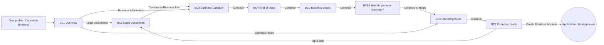

# 21 · Convert to Business (a person becomes a host)

The full spec of the **Convert to Business** page in the Business conversion design canvas. A signed-in person turns their account into a business (a host) in three steps:
1. **Legal Documents**: the CUI (tax ID) and a photo of the company certificate;
2. **Business Information**: the category, the kind of place, the business details, then how bookings are taken;
3. **Business Hours**: when the place is open.

An **overview** is the home of the flow. It shows the three steps, the two agreements and **Create Business Account**. Each step opens as one question per screen, and the business details are one form. Create Business Account sends an application that the platform team approves in the admin's **Host Approval** (`19-admin.md` §6).

Read `01`–`07` first; this file only adds what is specific to these screens.

> Design canvas (private, owner access): https://claude.ai/artifact/Vwih7Qv5GPRzwhYsL6zS6x, page **Business conversion**. The handoff matches the screens to the app's components and tokens; the differences from the canvas are listed in §12.

References for every screen at three sizes:
`../screenshots/{small,medium,large}/<id>.png` (what it must look like) and `../screens/{small,medium,large}/<id>.html` (exact values, clickable).

| Step | Screen id | Canvas board |
|---|---|---|
| Overview, start | `BC1-overview` | Overview — start |
| Step 1 · Legal Documents | `BC2-legal` | 1 · Legal Documents |
| Step 2 · Business Category | `BC3-category` (Accommodation picked) | 2.1 · Business Category — Accommodation |
| | `BC3F-category-fnb` (Food & Beverage picked) | 2.1 · Business Category — Food & Beverage |
| | `BC3S-category-entertainment` (Entertainment picked) | 2.1 · Business Category — Entertainment |
| Step 2 · Kind of place | `BC4-place-type` (Accommodation) | 2.2 · Kind of place — Accommodation |
| | `BC4F-place-type-fnb` (Food & Beverage, drawn taller) | 2.2 · Kind of place — Food & Beverage (full scroll) |
| | `BC4S-place-type-entertainment` (Entertainment) | 2.2 · Kind of place — Entertainment |
| Step 2 · Business details | `BC5-details` (long form, drawn taller) | 2.3 · Business details (full scroll) |
| Step 2 · How do you take bookings? | `BC5B-bookings` (In-app picked, drawn taller) | 2.4 · How you take bookings — In-app (full scroll) |
| | `BC5BP-bookings-phone` (By phone picked, drawn taller) | 2.4 · How you take bookings — By phone (full scroll) |
| Step 3 · Operating hours | `BC6-hours` | 3 · Operating hours |
| Overview, ready to submit | `BC7-ready` | Overview — ready to submit |

Ids with an **F** or **S** suffix are states of the screen before them: the category picked on step 2 (**F** = Food & Beverage, **S** = Entertainment, whose business type is `SERVICES`). They are not separate destinations. In the same way, `BC5BP` is `BC5B` with **By phone** picked.

**Every element of the owner's sketch is kept, with its text:**
- the header **Convert to Business** with the step counter **1/3**, **2/3**, **3/3**;
- the three steps with their lines: **Legal Documents** "Step 1 of 3 • Quick check first", "Verify your business is registered"; **Business Information** "Step 2 of 3 • Quick & Easy", "Tell us about your business"; **Business Hours** "Step 3 of 3 • Almost done!", "When are you open for customers?";
- **CUI (Tax ID)** ("e.g., 12345678 or RO12345678"), **Company Certificate** with "Before you upload" and its four rules, "Tap to upload a photo of your certificate", **Continue to Business Info**;
- **Business Category** "What type of business?" with **Food & Beverage**, **Entertainment**, **Accommodation**;
- "What kind of place is it?" "Pick one — this also sets your booking defaults" with every place type of the three categories, and "What do you offer?" "Optional · pick up to 6" with its options;
- **How do you take bookings?** "You can change this anytime from booking settings" (**In-app**, **By phone**), now on its own step (BC5B, §6a);
- **Business Name** ("e.g., Bella's Cafe"), **Phone Number** (🇷🇴 +40), **Price Range** ("Select price range"), **Business Address** ("Tap map icon to select location", "Tap the map icon to select your business location"), **Max Capacity per Reservation** ("e.g., 8"), **Venue capacity** ("e.g., 40", "How many people fit in your place at once."), **Services Offered** ("Describe the services you offer", "Minimum 10 characters required • What can customers expect from your business?", "0 / 1000"), **Continue to Hours**;
- "When are you open for customers?" "Select your operating hours", the seven days with 09:00 "to" 17:00 and a switch;
- the two agreements ("We will notify you once your application will be processed" and the Terms of Service text), **Read the Terms of Service**, **Create Business Account**.

The only texts added on the canvas are **Continue** on the in-between steps and the explanations on BC5B (§6a).

Decisions, so they are not undone:
- **The overview is home.** Every step is reachable from it, also to change something later. There is no long scroll of every field.
- **One thing at a time.** Legal Documents is one screen. Business Information is three screens: Business Category, then Kind of place, then one form for the details. Business Hours is one screen.
- **"How do you take bookings?" is its own step (BC5B)**, right after the details form, for every category. It shows what each option covers before the person picks (§6a). In the sketch it was only on Entertainment, and Entertainment does not ask it twice.
- **BC5 no longer asks it.** The BC5 reference still shows the two In-app / By phone cards and **Continue to Hours**: build BC5 without the cards, with **Continue** (→ BC5B).
- **Single choices grey out** the other options at 0.4 and keep them tappable (`01-principles.md` §5): Business Category, Kind of place, How do you take bookings?
- **The place types use one tile design for every category**: 3 per row, emoji above the name. Long names wrap inside the tile; they never change the layout.
- **"What do you offer?" uses small tiles, 5 per row,** the same size in every category.
- **Create Business Account turns on** only when the three steps are done and both boxes are ticked.
- **The emoji of the owner's sketch are kept** on the categories, place types, offers and the country code: an exception to `01` §6 for these options only.

---

## 1. Flow

Rules:
1. **Entry.** Convert to Business opens from the person's own profile. That entry is not in the canvas; the prototype's back on BC1 goes to HP. Back on BC1 / BC7 leaves the flow.
2. **The overview (BC1 / BC7)** lists the three steps in order (C74). The step to do next has the ink border and the ink icon tile; a finished step shows the green check. Every card opens its step, also after it is done. The counter (n/3) and the progress bar (C32, three segments) show the step being worked on.
3. **Step 1 · Legal Documents (BC2)** asks the CUI and a photo of the company certificate on one screen. **Continue to Business Info** goes straight to step 2 (BC3), as in the sketch. Back goes to the overview.
4. **Step 2 · Business Information** is three screens:
   - **BC3 Business Category**: one of Food & Beverage, Entertainment, Accommodation. The category decides the list on BC4. Changing it later clears the place type and the offers.
   - **BC4 Kind of place**: one place type, and for Food & Beverage and Accommodation "What do you offer?" (optional, up to 6). Back goes to BC3.
   - **BC5 Business details**: one form (§6). **Continue** opens BC5B. Back goes to BC4.
   - **BC5B How do you take bookings?**: In-app or By phone, with what each one covers (§6a). **Continue to Hours** opens step 3. Back goes to BC5.
5. **Step 3 · Operating hours (BC6)**: the seven days, each with an opening and a closing time and a switch. **Continue** goes to the overview, which shows every step done (BC7). Back goes to the overview.
6. **The answers are kept** while the person moves between the overview and the steps.
7. **Create Business Account** is disabled (0.4) until the three steps are done and both boxes are ticked. Then it sends the application (§11). It shows up in the admin's Host Approval as **Pending**. What the person sees after sending is not designed.
8. **Continue** is always enabled in the designs.

## 2. BC1 / BC7 · Overview (C74, C75)

- C1 top bar: back · "Convert to Business" · counter "1/3" (BC7: "3/3"). C32 progress bar under it, three segments.
- Content padding `16 16 16`, gap 12:
  - three **step cards** (C74), in order: Legal Documents · Business Information · Business Hours;
  - the **agreements card** (C75): "We will notify you once your application will be processed" · the Terms of Service text · **Read the Terms of Service**.
- Bottom bar: **Create Business Account** (C17 primary). On BC1 it is disabled (0.4, as AU5). On BC7 the three steps are done, both boxes are ticked, and it is on.
- BC1 states: Legal Documents is the next step (ink border, ink tile, ink chevron), the other two are upcoming (`bg.soft` tile, `text.tertiary` chevron), both boxes are empty.
- BC7: every card has the green check, both boxes are ticked.
- The two boxes start empty and the person ticks them. "Read the Terms of Service" opens the Terms (the app's existing page; not designed here).

## 3. BC2 · Legal Documents

- Title block (C76): "Step 1 of 3 • Quick check first" · **Legal Documents** · "Verify your business is registered".
- **CUI (Tax ID)** * (C79): numeric keyboard, placeholder "e.g., 12345678 or RO12345678". "RO" can be typed (Romanian VAT prefix).
- **Company Certificate** *:
  - "Before you upload" card with the four rules: "Document must not be expired" · "Photo must be clear and in full colour" · "Business legal name must be visible" · "All required registration details must be readable";
  - the **upload box** (C80) "Tap to upload a photo of your certificate": opens the platform's choice of camera or photo library.
- Bottom bar: **Continue to Business Info** (→ BC3).
- After a photo is picked, the box shows the photo with a **Change** action. That state is not drawn; use the C65 Change pill on the photo.

## 4. BC3 · Business Category (C71)

- Title block: "**Business Information** · Step 2 of 3 • Quick & Easy" · **Business Category** * · "What type of business?".
- Three C71 option cards, gap 10, in the sketch's order: 🍴 **Food & Beverage** · 💆 **Entertainment** · 🏨 **Accommodation**. The emoji sits in the 36 `bg.soft` circle; there is no explaining line.
- The picked card has the radio dot, the selection ring and a 600 title. The others are at 0.4 and stay tappable (`01` §5).
- Bottom bar: **Continue** (→ BC4 for the picked category).
- `BC3`, `BC3F`, `BC3S` show each category picked. In the prototype, tapping a card switches between them.

## 5. BC4 · Kind of place (C77, C78)

- Title block: "<category emoji> **<category>** · Step 2 of 3 • Quick & Easy" · **What kind of place is it?** * · "Pick one — this also sets your booking defaults".
- **Place types** (C77), 3 per row, gap 8, one picked (the first in the samples):

| Category | Place types (in this order) |
|---|---|
| Food & Beverage | ☕ Cafe · 🍺 Bar · 🍸 Cocktail Bar · 🇮🇹 Italian · 🍜 Asian · 🍔 Fast Food · 🥂 Fine Dining · 🍝 Casual Dining · 🥐 Bakery · 🇫🇷 French · 🍲 Traditional · 🌍 International · 🫒 Mediterranean · 🍷 Wine Bar · 🥞 Brunch · 🦐 Seafood |
| Entertainment | 💇 Salon · 🧖 Spa · 💆 Massage · 💅 Nails · 💈 Barber · 🏋️ Gym · 🧘 Yoga · 🧖‍♂️ Sauna · 💄 Makeup · 🖋️ Tattoo · ✂️ Haircut · 🛠️ Other Service |
| Accommodation | 🏨 Hotel · 🏢 Apartment · 🏠 House · 🏔️ Cabin · 🛏️ Flat · 🏖️ Resort · 🏡 Boutique · 🏘️ Villa · 🛌 Hostel |

- **What do you offer?** (17/600) "Optional · pick up to 6" (13 `text.secondary`), then the offer tiles (C78), 5 per row, any number from 0 to 6 picked:

| Category | Offers |
|---|---|
| Food & Beverage | 🥗 Vegan · 🐾 Pet Friendly · 👶 Child Friendly · ☀️ Terrace · 🌳 Outdoor Dining |
| Accommodation | 🐾 Pet Friendly · 👨‍👩‍👧 Family · ❤️ Romantic |
| Entertainment | — (the section is not shown) |

- Offer tiles keep the same width in every category. Accommodation's three sit on the left of the row; they do not stretch.
- Bottom bar: **Continue** (→ BC5). On BC4F the screen scrolls under the bottom bar at every size; its board is drawn taller (921 / 967 / 967).

## 6. BC5 · Business details (C79, C81, C71)

One form, gap 24 (20 on small), that scrolls under the pinned bottom bar. Its board is drawn taller to show the whole form (1421 / 1485 / 1485).

1. Title block: "**Business Information** · Step 2 of 3 • Quick & Easy" · **Tell us about your business** (no line under it).
2. **Business Name** * (C79), placeholder "e.g., Bella's Cafe".
3. **Phone Number** (C79):
   - a country button 52 (`bg.soft`, radius 14) "🇷🇴 +40" + `chevron-down` 16 that opens the country code list;
   - the number input beside it.
4. **How do you take bookings?** is now its own step, BC5B (§6a). The reference still shows it here, under the phone number. Leave it out of BC5.
5. **Price Range** *: a picker field 52 "Select price range" (placeholder colour) + `chevron-down` 20. It opens a list of the price levels (`BusinessProfile.priceLevel`).
6. **Business Address** * (C81): the map preview with the pin and the row "Tap map icon to select location" with `map-pin` and `map`. The whole card opens the map picker (OpenStreetMap, as `07`). Under it: "Tap the map icon to select your business location".
7. **Max Capacity per Reservation** * (C79, numeric), placeholder "e.g., 8".
8. **Venue capacity** * (C79, numeric), placeholder "e.g., 40", helper "How many people fit in your place at once."
9. **Services Offered** *: textarea 144 (120 on small), placeholder "Describe the services you offer". Under it, the helper "Minimum 10 characters required • What can customers expect from your business?" and the counter "n / 1000" on the right. Typing stops at 1000.

Bottom bar: **Continue** (→ BC5B). The reference still reads Continue to Hours.

## 6a. BC5B / BC5BP · How do you take bookings? (C87, C88)

Its own step after the details form: the person sees what each option covers before picking. Drawn taller; it scrolls under the pinned bottom bar (BC5B 1340 / 1284 / 1230, BC5BP 1477 / 1421 / 1367 at small / medium / large).

1. **Title block (C76):** "**Business Information** · Step 2 of 3 • Quick & Easy" · **How do you take bookings?** * · "Pick how people reserve with you. Here is what each one covers."
2. **Two booking choice cards (C87),** gap 12, in a radio group. One is picked; the other card is at 0.4 and stays tappable.
   - **In-app** (`smartphone`), "People book in Merg. You answer in Reservations.":
     - label "MERG DOES IT FOR YOU", then six covered rows (C88), in the order of the table below;
     - "**You:** answer each request within 24 hours."
   - **By phone** (`phone`), "People call you. You keep your own agenda.":
     - label "INCLUDED", then three covered rows;
     - label "NOT INCLUDED", then three not-covered rows;
     - "**You:** answer calls and note each booking yourself."
3. **By phone picked (BC5BP).** The card also shows **Phone number people will call** * (C79 with the 🇷🇴 +40 country button):
   - placeholder "e.g., 722 123 456";
   - helper "Shown on your profile, videos and events. Filled in from Business details if you added it there."

   It is required with By phone. The number from BC5 fills it, and it is the same `phone` field, so changing it here changes it on BC5.
4. **Bottom bar:** "You can change this anytime from booking settings" (13 `text.secondary`, centred, gap 8) above **Continue to Hours** (→ BC6). Back goes to BC5.
5. **Nothing is picked** when the step opens (no default, `06`). The references show each option picked. The step counts as done when one is picked, and, for By phone, a number is filled.

What each row stands for, so the copy stays true to the app:

| Row | In the app |
|---|---|
| A **Book** button on your profile and videos | the booking flows: services (R1–R3, F1–F4) and tables (TB1–TB4) |
| Requests in Reservations: accept or decline in one tap | RV1–RV4, answered within 24 hours (RV2) |
| Confirmations and cancellations sent for you | RV5: "Elena got a confirmation", "If you cancel, Elena gets a message right away" |
| Today's reservations in one list | RV1 |
| Visits counted: see your regulars and send them rewards | RV6 "Did Mihai come?" → visit counts → Customers (CR1 groups) and rewards (CR2–CR10) |
| Coupons and rewards taken off the price | the coupon strip on booking (F4C, TB2C, RV3) and a reward picked at the last step (MA6) |
| A **Call** button on your profile and videos | as on an accommodation profile: Call opens the phone dialer (flow A) |
| Your number on your events | an event with Booking channel **Phone** shows the business phone (OF10) |
| Not included: requests, confirmations, visits, rewards and coupons at booking | these only exist for bookings made in the app |

## 7. BC6 · Operating hours (C82)

- Title block: "**Business Hours** · Step 3 of 3 • Almost done!" · **When are you open for customers?** · "Select your operating hours".
- The hours card (C82) with the seven days, Monday to Sunday. Each row has:
  - the day;
  - **09:00** "to" **17:00** (two time buttons);
  - a C30 switch.
- A time button opens the platform time picker, 24-hour.
- Switching a day off greys its times (0.4) and the day (`text.tertiary`); the day is **closed**. The sample shows Sunday closed.
- Every day starts open, 09:00–17:00 (the sketch shows 09:00 to 17:00).
- Bottom bar: **Continue** (→ the overview, BC7 when every step is done).

## 8. New components

| # | Component | Spec |
|---|---|---|
| C74 | **Step card** | §2 — white card min 84, radius 18, `line.card`; icon tile 44 (radius 12); "Step n of 3 • …" 12.5/500 `text.secondary`, the step 16/600, its line 13.5 `text.body`; `chevron-right` 20. Next step: 2px ink border, ink tile with a white icon, ink chevron. Done: green check circle 26 (`status.success`). Icons: `file-text`, `building-2`, `clock` |
| C75 | **Agreements card** | §2 — white card radius 18, padding 16, gap 12; rows with a round box 26 (empty: 2px `line.strong`; ticked: ink with a white check 15) and the text 14/1.45 `text.body`, the whole row tappable (min 44); "Read the Terms of Service" `file-text` 16 + 13.5/500 ink, underlined, 44 tall, lined up with the text |
| C76 | **Step title block** | "<step name> · Step n of 3 • …" 13/18 500 `text.secondary` with the step name 600 `text.primary` · the question 28/34 700, letter spacing −0.02em (`font.size.stepTitle`; 24/30 on small) · a line 15/1.45 `text.body`. Required: a red " *" (`status.danger`) after the question |
| C77 | **Place type tile** | §5 — 3 per row, gap 8; 80 tall (72 on small), radius 16, white, `line.card`, padding 6; emoji 26 (24 on small) above the name 13/16 500 (12 on small). Picked: 1px ink border + `elevation.selectionRing`, name 600. The others at 0.4. Names wrap to two even lines (`text-wrap: balance`); one long word breaks with a hyphen. They never overflow |
| C78 | **Offer tile** | §5 — 5 per row, gap 6; 68 tall (64 on small), radius 14, padding `6 2`; `bg.soft` with ink text, picked: ink fill with white text; emoji 20 above the name 11/13 600 (`font.size.micro`), up to two even lines. Multi-select, no greying |
| C79 | **Field with a label** | label 14/20 600 (+ red " *" when required) · gap 8 · input 52, radius 14, `bg.soft`, padding `0 16`, 16; placeholder `text.placeholder` · optional helper 12.5 `text.secondary` |
| C80 | **Upload box** | §3 — dashed 1.5 `line.strong`, radius 16, white, 112 tall (96 on small): `camera` 22 in a 44 `bg.soft` circle + the label 15/500. Above it, the "Before you upload" card: white, radius 16, `line.card`, padding `14 16`; title 14/600; rules with `circle-check` 18 `text.secondary` + 14 `text.body`, gap 8 |
| C81 | **Address picker field** | §6 — `bg.soft` card, radius 16: map preview 100 tall (`bg.map`, white roads, `bg.mapRoadMinor` blocks, ink pin with a 12 % ink halo) + a row 52: `map-pin` 20 ink · "Tap map icon to select location" 16 placeholder colour (1 line, ellipsis) · `map` 20 ink. One tap target |
| C82 | **Opening hours card** | §7 — white card radius 18, `line.card`; seven rows min 56 (52 on small), separators `line.rowSeparator`, padding `0 4 0 14`; day 15/500; two time buttons 44 tall, `bg.soft`, radius 12 (`radius.timeSlot`), 15/500 tabular figures, "to" 13 `text.secondary`; C30 switch. Closed: the day `text.tertiary`, the times at 0.4 |
| C87 | **Booking choice card** | §6a — white card, radius 18, 1px `line.card`, clipped. **Header** (the whole header is one radio): the C71 row with radio 22 · icon circle 44 (picked: ink with a white icon; else `bg.soft` with an ink icon) · the option 16/22 600 and its line 13.5/1.4 `text.body`, padding 14 (12 on small), gap 12. **Body** (same padding, gap 14): a `line.rowSeparator` line, section labels 12/16 600 capitals +0.06em `text.secondary`, C88 rows, and the "You:" row (`bg.page`, radius 12, padding `10 12`, `user` 18 `text.secondary`, "You:" 600). Picked: 1px ink border + `elevation.selectionRing`. Not picked: the whole card at 0.4 |
| C88 | **Covered row** | §6a — circle 22: covered = ink with a white `check` 13 (stroke 3); not covered = `bg.soft` with a `text.tertiary` `minus` 13. Text 14/20, `text.primary` (covered) or `text.secondary` (not covered), gap 10; rows gap 10 |

Reused:
- C1 top bar (back, "Convert to Business", the counter on the right, 14 `text.secondary`);
- C32 step progress bar with **three** segments (done + current ink);
- C17 primary button in the bottom bar (white, top border `line.card`, padding `12 16 28`); disabled at 0.4 as AU5;
- C71 option card (Business Category with an emoji in the circle); its row is the header of C87 on BC5B;
- C79 field for the phone number on BC5BP;
- C30 switch (on = `status.success`).

## 9. Copy (EN)

| Where | Copy |
|---|---|
| Every step | "Convert to Business" · "1/3" / "2/3" / "3/3" · **Continue** |
| BC1 / BC7 | "Step 1 of 3 • Quick check first" · "Legal Documents" · "Verify your business is registered" · "Step 2 of 3 • Quick & Easy" · "Business Information" · "Tell us about your business" · "Step 3 of 3 • Almost done!" · "Business Hours" · "When are you open for customers?" · "We will notify you once your application will be processed" · "I agree to the business rules in the Terms of Service. If Merg suspends my account for any length of time, or disables it, my businesses are hidden and every upcoming booking, including those assigned to my team, is cancelled and the customers are told. Cancelled bookings are not restored." · "Read the Terms of Service" · **Create Business Account** |
| BC2 | "CUI (Tax ID)" · "e.g., 12345678 or RO12345678" · "Company Certificate" · "Before you upload" · "Document must not be expired" · "Photo must be clear and in full colour" · "Business legal name must be visible" · "All required registration details must be readable" · "Tap to upload a photo of your certificate" · **Continue to Business Info** |
| BC3 | "Business Category" · "What type of business?" · "Food & Beverage" · "Entertainment" · "Accommodation" |
| BC4 | "What kind of place is it?" · "Pick one — this also sets your booking defaults" · the place types and offers in §5 · "What do you offer?" · "Optional · pick up to 6" |
| BC5 | "Business Name" · "e.g., Bella's Cafe" · "Phone Number" · "+40" · "How do you take bookings?" · "You can change this anytime from booking settings" · "In-app" · "By phone" · "Price Range" · "Select price range" · "Business Address" · "Tap map icon to select location" · "Tap the map icon to select your business location" · "Max Capacity per Reservation" · "e.g., 8" · "Venue capacity" · "e.g., 40" · "How many people fit in your place at once." · "Services Offered" · "Describe the services you offer" · "Minimum 10 characters required • What can customers expect from your business?" · "n / 1000" · **Continue to Hours** |
| BC5B | "How do you take bookings?" · "Pick how people reserve with you. Here is what each one covers." · "In-app" · "People book in Merg. You answer in Reservations." · "Merg does it for you" · "A Book button on your profile and videos" · "Requests in Reservations: accept or decline in one tap" · "Confirmations and cancellations sent for you" · "Today's reservations in one list" · "Visits counted: see your regulars and send them rewards" · "Coupons and rewards taken off the price" · "You: answer each request within 24 hours." · "By phone" · "People call you. You keep your own agenda." · "Included" · "A Call button on your profile and videos" · "Your number on your events" · "Nothing to answer in the app" · "Not included" · "Requests, confirmations and the day's list" · "Visit counts, regulars and automatic rewards" · "Coupons and rewards taken off at booking" · "You: answer calls and note each booking yourself." · "Phone number people will call" · "e.g., 722 123 456" · "Shown on your profile, videos and events. Filled in from Business details if you added it there." · "You can change this anytime from booking settings" · **Continue to Hours** |
| BC6 | "When are you open for customers?" · "Select your operating hours" · the weekday names · "09:00" · "to" · "17:00" |

- The owner's texts are kept word for word. "once your application will be processed" is kept as written.
- Weekday names and times (24-hour) go through the localisation system.
- The place types and offers are a fixed list: translate the names, keep the emoji.
- Use "people" or "customers" (no gendered pronouns).

## 10. Small / large phones

- **Small (360 × 640)** uses the small-screen compactions:
  - the question 24/30, content padding top 20, gaps 16;
  - step cards 76 tall with padding 12;
  - place type tiles 72 tall (emoji 24, name 12), offer tiles 64;
  - hours rows 52, the Services Offered box 120, the upload box 96.
- **Small, scrolling:** BC1 and BC7 scroll under the pinned Create Business Account (the Terms text is long). BC2, BC4 and BC6 also scroll under their bottom bar. BC3 and BC4S fit, and BC4F, BC5 and BC5B / BC5BP are long by design.
- **"Mediterranean"** fits in its tile at 360. Offer names wrap to two lines on small ("Pet / Friendly").
- **Large (430 × 932)**: the medium values (side padding 16, the question 28) with more room. Everything fits without scrolling except BC4F, BC5 and BC5B / BC5BP.
- **Nothing is cut:**
  - "Tap map icon to select location" ellipsizes;
  - day names never wrap;
  - tiles keep their size, and their names wrap inside them.

## 11. Data

See `06-data-model.md` → *Convert to Business (host application)*:
- `BusinessApplicationRequest`, built from the three steps;
- how it becomes a `HostApplication` (Pending) in the admin's Host Approval and, once approved, a `BusinessProfile`;
- the checks the server runs.

`bookingChannel` comes from BC5B. When it is `PHONE`, `phone` is required (BC5BP); with `IN_APP` it stays optional.

## 12. Matched to the app (differences from the canvas)

The screens use the app's existing components and tokens, as decided for this handoff:

| On the canvas | In the handoff |
|---|---|
| Ink `#141414`, fills `#F4F4F7`, slate accent `#43557D`, red `#D93025`, white page | `text.primary` / `action.primary` `#1D1B22`, `bg.soft` `#ECE9F2`, `bg.page` `#F7F5FB`, `status.danger`; no slate (the step name is ink, the progress bar is ink) |
| Pill buttons (52, radius 26) | C17 primary, 52, radius 16; disabled at 0.4 (as AU5); no check icon on Create Business Account |
| Header 44 with a chevron, title 17/600, status-bar space | C1 top bar 56 with `arrow-left`, title 18/500; references start at the top bar, like every other screen |
| Progress: three slate segments, the current one partly filled | C32: three segments, done + current ink |
| Greyed out: grey names and grey emoji | `01` §5: the whole option at 0.4 |
| Category: tall tiles with a big emoji disc; booking: two side-by-side cards | C71 option cards (radio, icon circle, title) |
| BC5B: the radio on the right of each card; only the lists of the card not picked are greyed; checks in `#141414` on `#F4F4F7` | C87: the radio on the left as in C71, the whole card not picked at 0.4 (`01` §5); `text.primary` checks, `bg.soft` for not covered; the hint sits above Continue to Hours in the bottom bar |
| Black switches | C30 switch, green when on |
| Square-ish checkboxes and done checks in ink | Round 26 boxes (as CR1) and the green done check (as C73) |
| Hours as a plain list, every day open | the hours in a white card; Sunday closed in the sample to show the state |
| Boards at 375 × 667, 393 × 852, 440 × 956; Large with side padding 20 and a 30 question | References at 360 × 640, 390 × 844, 430 × 932 (`07`); Large keeps the medium values, Small uses the compactions of §10 |

## 13. Definition of done for this page

- [ ] BC1–BC7 (with the BC3F / BC3S and BC4F / BC4S states) match their screenshots at small, medium and large (overlay at 50 %: no shifted or resized elements).
- [ ] Convert to Business opens the overview. The three step cards open their steps at any time; the next step has the ink border and tile, a done step the green check; the counter and the progress bar follow the step.
- [ ] BC2 asks the CUI (numeric, "RO" allowed) and the certificate photo (camera or library) under "Before you upload"; Continue to Business Info opens BC3.
- [ ] BC3 picks one category; BC4 shows that category's place types (3 per row) and, for Food & Beverage and Accommodation, "What do you offer?" (5 per row, 0–6 picked). Changing the category clears the place type and the offers.
- [ ] Single choices grey the other options at 0.4 and stay tappable (BC3, BC4 place types, How do you take bookings?).
- [ ] Place type names never overflow: "Mediterranean" fits at 360; longer names wrap to two lines inside the tile.
- [ ] BC5 is one form in the order of §6, scrolls under Continue to Hours, counts "n / 1000" and stops typing at 1000; the address card opens the map picker; Price Range opens the price levels.
- [ ] BC5B / BC5BP match their screenshots: two C87 cards with what each option covers, one picked and the other at 0.4; nothing picked when the step opens.
- [ ] By phone shows Phone number people will call (required, filled from BC5); Continue to Hours opens BC6; BC5 no longer asks the question and its button reads Continue (→ BC5B).
- [ ] BC6: seven days, 24-hour time pickers, a switch per day; a closed day greys its times.
- [ ] Create Business Account is disabled until the three steps are done and both boxes are ticked, then sends `BusinessApplicationRequest`; the application appears in Host Approval as Pending.
- [ ] Every owner's text in §9 is shown exactly as written.
