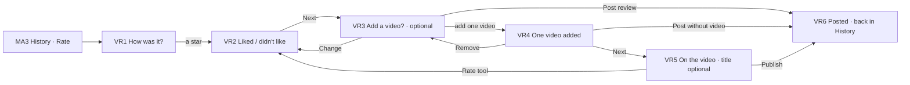

# 23 · Video review (customer)

The full spec of the **Customer · Video review** page in the design canvas. A customer reviews a place they visited, from **Rate** in My activity › History, in this order:
1. **how many stars** (required);
2. **what you liked / what you didn't like** (optional);
3. **one video** (optional);
4. with a video, a **title and description** on it (optional).

The video is never pushed: a review can be only the stars and the +/−, posted in two taps.

Read `01`–`07` first; this file only adds what is specific to these screens.

References for every screen at three sizes:
`../screenshots/{small,medium,large}/<id>.png` (what it must look like) and `../screens/{small,medium,large}/<id>.html` (exact values, clickable).

| Step | Screen id | Canvas board |
|---|---|---|
| 1 · Stars | `VR1-stars` | 1 · Rate from My activity: how many stars |
| 2 · Liked / didn't like | `VR2-details` | 2 · After the stars: what you liked / didn't like (optional) |
| 3 · Video, nothing added | `VR3-add-video` | 3 · Add one video? (optional) Nothing added → Post review |
| 3 · Video added | `VR4-video-added` | 3 · One video added (Change / Remove) → Next, or Post without video |
| 4 · On the video | `VR5-on-video` | 4 · On the video: title and description (optional), Publish |
| Posted | `VR6-posted` | 5 · Posted, with or without a video |

Decisions, so they are not undone:
- **Full screens, not sheets.** A sheet over My activity was compared and dropped.
- **The order is fixed:** stars → liked / didn't like → video → title.
- **One video at most.** There is never a list or a grid of clips to pick from: one empty slot, or the one video with **Change** and **Remove**.
- **The video is optional and not pushed.** **Post review** is the main button until a video is added.
- **The place card stays at the top** of steps 1–3, at the same position. The other cards are centred in the space below it.
- **Only the stars are required.**

---

## 1. Flow

Rules:
1. **Rate** shows on a DONE visit that is not rated yet (`15-my-activity.md`). It opens VR1 for that visit. **X** on VR1 / VR2 closes without saving and goes back to History.
2. **Stars (VR1).**
   - Five stars, each with its word: 1 Bad, 2 Not great, 3 OK, 4 Good, 5 Great.
   - **Next** stays disabled (0.4) until a star is picked.
3. **Liked / didn't like (VR2).** Picking a star shows the details card on the same screen (VR2 is VR1 after the tap; the stars can still be changed).
   - Two groups of six aspects: **What you liked** and **What you didn't like**. The aspects follow the place's category (§7).
   - Both groups are optional, and as many chips as wanted can be picked.
   - An aspect picked in one group is disabled (0.4) in the other.
4. **One video, optional (VR3 / VR4).**
   - **The empty slot** opens the phone's picker for **one** clip, up to 100 MB, as in New post.
   - **Once added (VR4):** the clip shows with **Change** (pick another one) and **Remove** (back to VR3).
   - **The buttons:**
     - with no video: **Post review**;
     - with a video: **Next** and **Post without video**.
   - **Back:** the back arrow on VR3 / VR4 goes back to VR2 with the answers kept. **Change** on the summary line does the same.
5. **On the video (VR5).**
   - This is the New post editor (`17-new-post.md`) with the stars and the +/− shown on the video.
   - Title (max 30) and description (max 100) are **optional**, so **Publish** is enabled right away.
   - The **Rate** tool on the side rail (where New post has Tag) shows "4 / 5" and opens VR2 to change the answers.
6. **Posted (VR6).**
   - Posting goes back to My activity › History.
   - The visit shows **★ N** instead of **Rate** (`myRating`), and "Review posted" shows briefly.
   - A visit can be reviewed once.

## 2. The screens (VR1–VR4)

| Part | Spec |
|---|---|
| Screen | `bg.page`, `text.primary` |
| Top bar | 56: **X** 24 on VR1 / VR2 (→ MA3), back `arrow-left` 24 on VR3 / VR4 (→ VR2) · "Review" 18/500 |
| Content | padding `0 16`, scrolls if needed. **The place card is pinned at the top**, 12 below the top bar (6 on small). The other cards are centred in the space left, gap 14 (small 10, large 16). |
| **Place card** (C89) | white, 1px `line.card`, radius 18, padding `14 16` (small `12 14`, large `16 18`): avatar 44 (initial on the place's `avatarColor`, 17/600) · name 15/600 · "<what> · <date>" 12.5 `text.secondary` ("Table · 20 Oct") |
| Bottom bar | pinned, white, 1px `line.card` top, padding `12 16 28`: the buttons of each step, 52 tall |

**Buttons:** **Next** / **Post review** are ink, radius 16, white 16/500, and fill the width; disabled at 0.4. **Post without video** is a text button, 16/500 `text.secondary`, beside **Next**.

## 3. VR1 / VR2 · Stars and details (C90, C91)

| Part | Spec |
|---|---|
| **Stars card** (C90) | white card as above, padding `16 16 12`: "How was it?" 21/600 centred (small 19, large 22) · 5 star buttons, each a square of the star + 6 with a gap of 2 · the word under them, 15/600 ("Tap a star" in `text.secondary` while empty) |
| Star | 42 (small 34, large 46), Lucide `star`, stroke 1.6. Picked: `status.warning` fill and stroke. Not picked: `text.tertiary` stroke. Each is a `radio` of a `radiogroup` "Stars", named "4 stars, Good". |
| **Details card** (C91) | white card, padding `2 16 16`, two groups, then "Optional. Then you add a video." 12.5 `text.secondary` |
| Group | 16 above it: `thumbs-up` 18 `status.success` + "What you liked" 14/600, or `thumbs-down` 18 `action.danger` + "What you didn't like"; chips 10 below, wrapping, gap 8 |
| Chip | 38 tall, radius 19, padding `0 14`, 14 (a `checkbox`). Not picked: white, 1px `line.outline`, 500. **Liked:** `status.successBg`, 1.5px `status.success`, `status.successText` 600, `check` 15 in front (padding `0 14 0 10`). **Didn't like:** white, 1.5px `action.danger`, `action.danger` 600, `check` 15. **Taken by the other group:** 0.4, `aria-disabled`. |

## 4. VR3 / VR4 · One video, optional (C92)

| Part | Spec |
|---|---|
| Place card + **summary** | The place card gains, 12 below the place, the summary of what will be posted: a link, min 44, radius 14, `bg.page`, padding `8 12`. It shows the stars 14 (`status.warning` / `text.tertiary`), then `thumbs-up` 13 + the liked aspects and `thumbs-down` 13 + the other aspects, 12.5 `text.secondary` joined by " · ". Each group stays on one line; the groups wrap to a second line when needed. **Change** 13/500 sits on the right (→ VR2). |
| **Video card** | white card, padding 16. "Add a video?" 21/600 + **Optional** pill (22, radius 11, `bg.soft`, 12/600 `text.secondary`), centred · "People see it with your stars." 13.5 `text.secondary`, centred · the slot, 14 below · the note 12.5 `text.secondary`, centred, 10 below |
| **Empty slot** (VR3) | full width, **height = preview height + 52** so the card keeps its size when a video is added: 318 (small 222, large 336). Radius 16, 1.5px dashed `text.tertiary`, `bg.page`. Centred inside: white circle 48 with 1px `line.outline` and `video` 24 · "Add a video" 15/600 · "One video · up to 100 MB" 12.5. The whole slot is the button. Note: "Add one video, or post your review now." |
| **Video added** (VR4) | the clip's poster, portrait **150 × 266** (small 96 × 170, large 160 × 284), radius 12, with a play circle 34 (`rgba(0,0,0,.45)`, 1.5px white .8 border), centred · 12 below, **Change** (40, radius 12, `bg.soft`, `refresh-cw` 16 + 14/500) and **Remove** (40, radius 12, 1px `line.outline`, `trash-2` 16 + 14/500), gap 8. No video length. Note: "Next: write a title on your video (optional)." |
| Bottom bar | VR3: **Post review** · VR4: **Post without video** + **Next** |

## 5. VR5 · On the video (C93)

The New post editor (C57, `17-new-post.md` §3) with these differences:

| Part | Spec |
|---|---|
| Top | back `arrow-left` (→ VR4) · **Change video** pill (→ VR4) |
| Side rail | **Rate** tool instead of Tag: white circle 44 with a filled `star` 21 in `status.warning`, label "4 / 5" 12/500 (→ VR2) |
| Poster | avatar 36 · name 14/600 · "Review · <place> · <what>" 12 white .85 |
| **Rating on the video** (C93) | above the caption panel, gap 10: the **stars pill** (30 tall, radius 15, `rgba(20,18,24,.6)`, 1px `rgba(255,255,255,.22)`): 5 stars 16 + the word 13/600. Then the **opinion pills** (28 tall, radius 14, the same glass): `thumbs-up` 15 `status.successOnDark` + the liked aspects, and `thumbs-down` 15 `status.dangerOnDark` + the others, 13/500 joined by " · ". A pill with nothing picked is not shown. |
| Caption panel | C58: "Add a title (optional)" (0–30, "n / 30"), "Add a description (optional)" (0–100, "n / 100") |
| Bottom | "Title and description are optional" 13 white .85 · **Publish** (white pill 52, `upload` 20 + 16/500), enabled |

## 6. VR6 · Posted

- MA3 (`15-my-activity.md`): the visit shows "★ 4" like the other rated rows, instead of **Rate**.
- **Snackbar**: left / right 16, bottom 28, min 52, radius 14, ink, white 15/500, `check` 20 `status.successOnDark` + "Review posted". It has `role=status` and goes away after a few seconds.

## 7. Aspects per category

| Category | The six aspects (in this order) |
|---|---|
| Food & Beverage | Food · Service · Price · Atmosphere · Clean place · Waiting time |
| Services | Result · Staff · Price · Clean place · On time · Atmosphere |
| Accommodation | Room · Clean place · Staff · Location · Price · Quiet |

The designs show Food & Beverage (Maestro Bistro, a table on 20 Oct).

## 8. New components

| # | Component | Spec |
|---|---|---|
| C89 | **Review place card** | §2 / §4 — avatar 44, place, what · date; on VR3 / VR4 the summary line with **Change** |
| C90 | **Star picker** | §3 — "How was it?", five stars with their word, radio group |
| C91 | **Liked / didn't like chips** | §3 — two groups with thumbs icons; green picked, red picked, taken by the other group at 0.4 |
| C92 | **One-video slot** | §4 — dashed empty slot the size of the added state; the added video with Change / Remove |
| C93 | **Rating on the video** | §5 — stars pill, opinion pills, **Rate** tool "N / 5" on the side rail |

Reused as they are:
- the C57 editor and the C58 caption panel;
- the New post picker (one clip, up to 100 MB);
- C17 buttons;
- MA3.

## 9. Copy (EN)

| Where | Copy |
|---|---|
| All | "Review" · "<place>" · "<what> · <date>" |
| VR1 / VR2 | "How was it?" · "Tap a star" · "Bad" · "Not great" · "OK" · "Good" · "Great" · "What you liked" · "What you didn't like" · the aspects (§7) · "Optional. Then you add a video." · **Next** |
| VR3 / VR4 | **Change** · "Add a video?" · "Optional" · "People see it with your stars." · "Add a video" · "One video · up to 100 MB" · "Add one video, or post your review now." · **Change** · **Remove** · "Next: write a title on your video (optional)." · **Post review** · **Post without video** · **Next** |
| VR5 | **Change video** · "<n> / 5" · "Review · <place> · <what>" · "Add a title (optional)" · "Add a description (optional)" · "n / 30" · "n / 100" · "Title and description are optional" · **Publish** |
| VR6 | "Review posted" |

The star words, the aspects and the date go through the localisation system. Use "you" or the first name (no gendered pronouns).

## 10. Small / large phones

- **Small (360 × 640)**:
  - VR1, VR3 and VR4 fit without scrolling, with the smaller stars (34) and preview (96 × 170);
  - **VR2 scrolls** (the stars card and both chip groups are about 120 taller than the space): the content scrolls, the place card included, and **Next** stays pinned;
  - VR5 and VR6 fit.
- **Large (430 × 932)**: the same layout with more space, stars 46 and preview 160 × 284.
- The place card is always at the same position (68 from the top on medium and large, 62 on small).

## 11. Data

See `06-data-model.md` → *Review*: `ReviewCreateRequest`, the aspects per category and the rules. Posting sets the visit's `myRating`.

## 12. Definition of done for this page

- [ ] VR1–VR6 match their screenshots at small, medium and large (overlay at 50 %: no shifted or resized elements).
- [ ] Rate on an unrated done visit opens VR1. X closes without saving. Next waits for a star; each star shows its word.
- [ ] After a star, the liked / didn't like chips show on the same screen. They are optional, and an aspect can't be both liked and disliked.
- [ ] Step 3 is one slot for **one** video. Nothing added: **Post review**. A video added: Change / Remove, **Next**, **Post without video**. The card keeps its size between the two.
- [ ] VR5: the stars and +/− on the video, the Rate tool "N / 5" on the rail, the title and description optional, **Publish** enabled.
- [ ] After posting, History shows ★ N on the visit and "Review posted". A visit is reviewed once.
- [ ] The place card is at the same position on VR1–VR4, and the other cards are centred below it.
