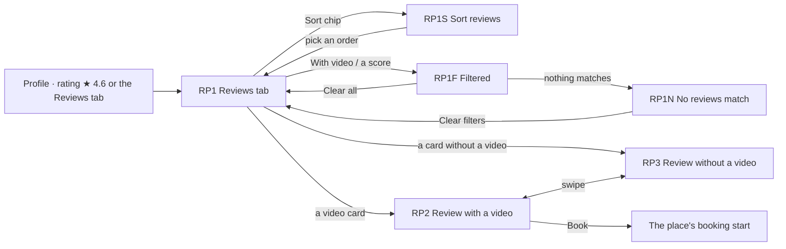

# 24 · Profile reviews (public)

The full spec of the **Public · Profile reviews** page in the design canvas: how the reviews a place received show on its profile, with and without a video. Reviews are written in the video review (`23-video-review.md`); this page shows them to everyone who opens the profile, and to the place itself.

Read `01`–`07` first; this file only adds what is specific to these screens.

References for every screen at three sizes:
`../screenshots/{small,medium,large}/<id>.png` (what it must look like) and `../screens/{small,medium,large}/<id>.html` (exact values, clickable).

| Step | Screen id | Canvas board |
|---|---|---|
| Reviews tab | `RP1-reviews-tab` (drawn at its full scroll length) | 1 · Reviews tab |
| Sort reviews (sheet) | `RP1S-sort` (state of RP1) | 1a · Sort reviews (sheet) |
| Filtered | `RP1F-filtered` (state of RP1) | 1b · Highest score + With video |
| No reviews match | `RP1N-no-match` (state of RP1) | 1c · No reviews match |
| Open a review with a video | `RP2-video-review` | 2 · Open a review with a video |
| Open a review without a video | `RP3-review-no-video` | 3 · Open a review without a video |

`RP1S`, `RP1F` and `RP1N` are states of RP1 (the profile scrolled to its reviews: the top bar and the tabs stay at the top), not separate destinations.

Decisions, so they are not undone:
- **The rating shows once, in the profile header** (★ 4.6 · 38 reviews). The Reviews tab has no score card and no "liked most" summary: that would repeat it.
- **Every review is a card of the same size**, two per row, like the Videos tab. A review with a video is a video card; a review without one is a white card. Neither is second-class.
- **Any review opens full screen** in one viewer that swipes through the reviews, with or without a video.
- **Sort and filter are one row of chips:** the Sort chip (one order at a time) and the filters (With video, one score at a time).
- **No counts on the score chips**, and no star bars.

---

## 1. Flow

Rules:
1. **The rating in the profile header** is the average of the stars, with one decimal, plus the number of reviews: "★ 4.6" over "38 reviews". Tapping it opens the Reviews tab. With no reviews it shows "–" and "No reviews yet" (as on PF1), and the tab says "No reviews yet" (§4).
2. **The Reviews tab** is the last profile tab:
   - Food & Beverage: Videos · Coupons · Reviews;
   - Services: Videos · Services · Coupons · Reviews;
   - Accommodation: Videos · Rooms · Coupons · Reviews.

   The place's own profile shows the same list.
3. **Sort (RP1S).**
   - The **Sort chip** always shows the current order: **Newest** (the default), **Oldest**, **Highest score** or **Lowest score**.
   - It opens a sheet with the four choices. Picking one applies it and closes the sheet; there is no Done.
   - Reviews with the same score keep the newest first.
4. **Filters.**
   - **With video**: a toggle, only reviews with a video.
   - **★ 5 … ★ 1**: one score at a time. Tapping the active one clears it, and picking another switches to it.
   - An active score chip moves to the front of the row, right after With video, so it is always in view.
   - Filters and sort combine. Changing them keeps the tab where it is and reloads the list.
5. **When any filter is on (RP1F)**, a line under the chips shows how many reviews match ("12 reviews with a video", or "<n> reviews") and **Clear all**, which clears the filters and keeps the sort.
6. **Nothing matches (RP1N):** "0 reviews" and a card "No reviews match · Try another score, or show all reviews." with **Clear filters**.
7. **The list keeps loading** as you scroll, as in Search (`16-search.md`).
8. **Opening a review (RP2 / RP3).**
   - Any card opens the full-screen viewer.
   - Swiping up shows the next review in the same order and with the same filters, with or without a video.
   - Back returns to the tab, at the same place in the list.
   - A video plays when it is on screen; a review without a video shows as a card.
9. **The side rail of the viewer.**
   - **Book** is the profile's main action: Food & Beverage → TB1, Services → the booking start of PS1 (Book now), Accommodation → **Call**.
   - **Report** (three vertical dots) asks to confirm in the platform's dialog ("Report this review?" · Cancel · Report), then sends the report. The review stays visible.

## 2. RP1 · The Reviews tab (C94–C97)

| Part | Spec |
|---|---|
| Profile header | PF1 with the **rating stat** (C94) in the third column: `star` 16 `status.warning` + "4.6" 17/500, "38 reviews" 12 `text.secondary`; a link to the Reviews tab |
| Tabs | C4 profile tabs, 60 tall: icon 20 + 12; Reviews selected (ink, 500, 2px ink underline); 1px `line.divider` under the row |
| Content | padding `16 16 24`, gap 12: the filter row, the count line when a filter is on, then the grid |
| **Filter row** (C95) | one row that scrolls sideways (edge to edge, padding 16), gap 8: the **Sort chip** · a 1 × 24 `line.divider` · **With video** · **★ 5 ★ 4 ★ 3 ★ 2 ★ 1** |
| Sort chip | 36 tall, radius 18, white, 1px `line.outline`, padding `0 10 0 12`: `arrow-up-down` 16 + the order 14/600 + `chevron-down` 16 |
| Filter chip | 36 tall, radius 18, padding `0 12`, 14/500, a toggle (`aria-pressed`). Off: white, 1px `line.outline`. On: ink with white text. With video has `video` 16; a score chip has a filled `star` 14 + the number. |
| Count line | only with a filter on: "<n> reviews" 13 `text.secondary` (`role=status`) · **Clear all** 13.5/600, right |
| **Grid** (C97) | 2 columns, gap 12; card height as the public video card: **265 / 290 / 324** at small / medium / large, radius 22 |

**Review card with a video (C97):**
- full-bleed poster;
- top scrim 110 (`rgba(0,0,0,.55)` → 0) and bottom scrim 60 % (0 → .85);
- top-left, 12 in:
  - the stars pill: 26 tall, radius 13, `rgba(20,18,24,.6)`, stars 12 (`status.warning`, not picked white .6);
  - under it, the reviewer: avatar 22 + name 12.5/600;
- play 44, centred;
- bottom, 12 in:
  - the title, 15/600, at most 2 lines;
  - `thumbs-up` 13 `status.successOnDark` + the liked aspects, 12/500, one line;
  - `thumbs-down` 13 `status.dangerOnDark` + the others.

**Review card without a video (C97):**
- white, 1px `line.card`, padding 14;
- the reviewer: avatar 22 + name 12.5/600;
- the stars, centred: 22 + the word 17/700 (Bad · Not great · OK · Good · Great);
- one row per aspect:
  - liked: `thumbs-up` 14 `status.success` + the aspect 13/500 `status.successText`;
  - didn't like: `thumbs-down` 14 `action.danger` + the aspect;
- at the bottom, "<what> · <date>" 12 `text.secondary` ("Table · 18 Oct").

Both cards are links named "<name>, <n> stars, …".

## 3. RP1S · Sort reviews (C96)

| Part | Spec |
|---|---|
| Sheet | the C42 sheet shell: dim `overlay.sheetDim`, white, radius `24 24 0 0`, padding `0 16 28`, handle, "Sort reviews" 19/600 + X |
| Choices | a radio group, rows min 56, `line.rowSeparator` between: "Newest first" · "Oldest first" · "Highest score first" · "Lowest score first" 16 (600 when picked) + radio 22 on the right (picked: ink ring and dot) |

## 4. RP1F / RP1N · Filtered, nothing matches

- **RP1F**: Sort "Highest score" + **With video** on (ink): "12 reviews with a video" · Clear all, then the matching cards.
- **RP1N**: With video + ★ 1 on, with the active score chip moved to the front. "0 reviews" · Clear all, then a white card (radius 18, padding `28 20`, centred):
  - a circle 56 in `bg.soft` with `star` 26 `text.secondary`;
  - "No reviews match" 17/600;
  - "Try another score, or show all reviews." 14 `text.secondary`;
  - **Clear filters** (44, radius 14, white, 1px `line.outline`, 15/500).
- **A place with no reviews**: the same card with "No reviews yet" and no button; no filter row.

## 5. RP2 / RP3 · The review viewer (C98)

| Part | Spec |
|---|---|
| Screen | full screen; top 40: back 24 (→ RP1) + "<place> · Reviews" 15/500 white |
| **RP2 · with a video** | the video full-bleed: scrims top 150, bottom 480; play 60, centred, while paused. Bottom-left (left 12, right 80, bottom 64, gap 10): the reviewer (avatar 36 · name 14/600 · "Review · <what> · <date>" 12 white .85) · the C93 stars pill · the C93 opinion pills · the title 17/600 + the description 14 / 1.4 white .92 |
| **RP3 · without a video** | the same dark viewer with a white card: left / right 20, centred (small: top 96), radius 24, padding `24 20`. Inside, centred: the reviewer (avatar 40 · name 15/600 · "<what> · <date>") · stars 34 + the word 20/700 · the chips (36, radius 18, 14/600): liked on `status.successBg` / `status.successText`, didn't like on `bg.soft` / `action.danger`, wrapping. |
| **Side rail** | right 8, bottom 120, 60 wide: **Book**, a white circle 48 with `calendar` 22 and the label "Book" 12/600 (Accommodation: `phone` "Call"). 14 below it, **Report**: a circle 44 `rgba(0,0,0,.4)` with `more-vertical` 22 and the label "Report" 12/600, named "More: report this review". |
| Hint | "Swipe up for the next review" 12.5 white .75, bottom 26 |

## 6. New components

| # | Component | Spec |
|---|---|---|
| C94 | **Rating stat** | §2 — the third profile stat: ★ + the average (one decimal) over "<n> reviews"; "–" + "No reviews yet" without reviews; opens the Reviews tab |
| C95 | **Review filter row** | §2 — the Sort chip, a divider, With video, the score chips; scrolls sideways; active chips ink; an active score moves to the front; the count line with Clear all |
| C96 | **Sort sheet** | §3 — four radio rows, picking applies |
| C97 | **Review card** | §2 — the same size as the public video card; with a video (poster, stars pill, reviewer, play, title, +/-) or without (stars and word, +/- rows, what · date) |
| C98 | **Review viewer** | §5 — full screen, swipes through the list; the video with the rating on it, or the review card; Book and Report on the side rail |

Reused:
- the PF1 / PS1 / PA1 profile and the C4 tabs;
- C93 (the stars pill and opinion pills);
- the C42 sheet shell;
- the public video card size (C7).

## 7. Copy (EN)

| Where | Copy |
|---|---|
| Header | "<rating>" · "<n> reviews" · "–" · "No reviews yet" |
| RP1 | "Reviews" · "Newest" · "Oldest" · "Highest score" · "Lowest score" · "With video" · "<n> reviews" · "<n> reviews with a video" · **Clear all** · the star words · the aspects (`23-video-review.md` §7) · "<what> · <date>" |
| RP1S | "Sort reviews" · "Newest first" · "Oldest first" · "Highest score first" · "Lowest score first" |
| RP1N | "0 reviews" · "No reviews match" · "Try another score, or show all reviews." · **Clear filters** · "No reviews yet" |
| RP2 / RP3 | "<place> · Reviews" · "Review · <what> · <date>" · **Book** / **Call** · **Report** · "Report this review?" · **Cancel** · **Report** · "Swipe up for the next review" |

The titles and descriptions are the reviewers' own text. The rating (with a decimal point or comma) and the dates are localised.

## 8. Small / large phones

- **The Reviews tab (RP1)** is drawn at its full scroll length: 360 × 1579, 390 × 1654, 430 × 1756. The cards are 265 / 290 / 324 tall.
- **The filter row** scrolls sideways at every size. On small and medium ★ 3–★ 1 are off-screen to the right; on large, ★ 2–★ 1.
- **RP1S, RP1F and RP1N** show the profile scrolled to its reviews, with the top bar and the tabs at the top.
- **RP3 on small:** the card sits under the top bar (top 96), clear of the side rail. On medium and large it is centred.
- Nothing is cut at any size: the chip row scrolls instead of wrapping, and the card text clamps (title 2 lines, +/- one line each).

## 9. Data

See `06-data-model.md` → *Reviews on a profile*: `ReviewsQuery` (sort, with video, stars, cursor), `ReviewView`, `ReportReview`, and the rating in `BusinessProfile.stats`.

## 10. Definition of done for this page

- [ ] RP1–RP3 match their screenshots at small, medium and large (overlay at 50 %: no shifted or resized elements).
- [ ] The profile header shows ★ <average> · <n> reviews (or "No reviews yet"), and tapping it opens the Reviews tab.
- [ ] The Reviews tab has no score card. It shows the Sort chip, With video and ★ 5–★ 1 in one row, then the reviews two per row, every card the same size with or without a video, newest first by default.
- [ ] Sort: the sheet has four choices and picking one applies it. Filters: With video toggles; one score at a time, and the active score moves to the front; filters and sort combine; the count line and Clear all show when a filter is on; Clear filters on no match.
- [ ] Any card opens the full-screen viewer, which swipes through the same filtered, sorted list. With a video, the video plays with the rating on it; without one, the review card shows.
- [ ] The side rail has Book (the profile's main action, Call for accommodation) and Report (three vertical dots, confirm, then sent).
