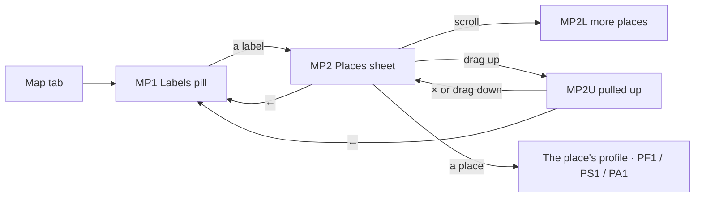

# 25 · Map: labels and places (public)

The full spec of the **Public · Map** page in the design canvas: the pill of labels that floats over the map (**Food & Drinks**, **Accommodations**, **Entertainment**) and the sheet that lists the places of one label.

**Only these two components are in this handoff.** The map itself, its pins, the "you are here" dot, the location button, the map credit and the bottom navigation bar belong to the app's existing Map tab. They are not drawn here, so the references show the pill and the sheet on a plain background.

Read `01`–`07` first; this file only adds what is specific to these components.

References for every component at three sizes:
`../screenshots/{small,medium,large}/<id>.png` (what it must look like) and `../screens/{small,medium,large}/<id>.html` (exact values, clickable).

| Component | Screen id | Canvas board |
|---|---|---|
| Labels pill, three labels | `MP1-pill` | B1 · The pill: three labels with how many places are around |
| Labels pill, one label | `MP1O-pill-one` (state of MP1) | B1 · One label: only Food & Drinks around |
| Labels pill, two labels | `MP1T-pill-two` (state of MP1) | B1 · Two labels: Food & Drinks and Entertainment around |
| Places sheet | `MP2-places` | B2 · Food & Drinks: every place as an avatar |
| Places sheet, 20 places | `MP2L-places-20` (state of MP2) | B2 · 20 places: the sheet scrolls, nearest first |
| Places sheet, pulled up | `MP2U-places-up` (state of MP2) | B2 · 20 places, pulled up |

`MP1O` and `MP1T` are the same pill with fewer labels. `MP2L` and `MP2U` are the same sheet with a longer list and dragged up. None of them are separate destinations.

Decisions, so they are not undone:
- **Only the labels that have places in view show**, in a fixed order: Food & Drinks · Accommodations · Entertainment. A label is never shown greyed out with a 0. The pill hugs its labels, so one label makes a small pill.
- **Every label has its icon, its name and a count.** The count is how many places of that label are in the visible part of the map. It sits at the icon's top-right corner, with a small gap so it never covers the icon.
- **A place is a round avatar**, 3 per row, nearest first. There is no card, video or button per place, and the place's profile has everything else.
- **The sheet keeps its height** however many places there are. It scrolls, and dragging it up covers the map. **×** in the top-right corner (on the same line as ←) drops it back down. There is no floating Map button, because it covered a place.

---

## 1. Flow

Rules:
1. **The labels and the business categories.**

   | Label (map) | Business category | Icon | Colour |
   |---|---|---|---|
   | Food & Drinks | `FOOD_BEVERAGE` (sign-up: Food & Beverage) | `utensils` | `category.food` |
   | Accommodations | `ACCOMMODATION` (sign-up: Accommodation) | `bed-double` | `category.stay` |
   | Entertainment | `SERVICES` (sign-up: Entertainment; salons, spa, massage, gym…) | `sparkles` | `category.fun` |

   The map uses these names. Convert to Business (`21-business-conversion.md`) keeps the owner's own words.
2. **The pill (MP1)** floats over the map, centred, 24 above the bottom navigation.
   - It shows a label only when at least one place of it is in view, in the order above. With places of only one category it shows one label (MP1O); with two, two labels and one divider (MP1T).
   - With no places in view, the pill is hidden.
3. **Counts.** The number of places of that label in the visible part of the map. Counts update when the map stops moving, and from 100 they show "99+".
4. **Picking a label** opens the places sheet for it. While the sheet is open:
   - the pill is hidden;
   - the map shows only the pins of that label.
5. **The places sheet (MP2).**
   - Header: ← · the label's icon in its tinted circle · the label's name.
   - Then the places as avatars, 3 per row, nearest first. The distance is measured from the person's location, or from the centre of the map when the location is off.
   - The sheet opens at a fixed height: two rows of places. With more places it scrolls inside, and the top of the next row shows under the second one (MP2L). The list keeps loading as you scroll, as in Search (`16-search.md`).
6. **Pulled up (MP2U).** Dragging the sheet up covers the map up to 44 below the top of the screen. The header gets **×** at the top right, on the same line as ←.
   - **×**, or dragging the sheet down, drops it back to its first height, with the same label still picked.
   - **←** (at either height) closes the sheet and shows the pill again with every label.
7. **A place** opens its public profile: PF1 for Food & Drinks, PS1 for Entertainment, PA1 for Accommodations.
8. **Moving the map** while the sheet is open reloads the list for the new area when the map stops moving.

## 2. MP1 · The labels pill (C99)

| Part | Spec |
|---|---|
| Pill | 72 tall, radius 36, `bg.surface`, padding `0 6`, shadow `0 6 22 rgba(29,27,34,0.2)`. As wide as its labels, centred, 24 above the bottom navigation. |
| Label | 104 wide, the icon 24 (stroke 2, the label's colour) over the name 12/500 `text.primary` (gap 5, one line). The whole label is the touch target (104 × 72). |
| Count | At the icon's top-right corner: top −12, right −25 from the icon. Min 18 × 18, radius 9, padding `0 5`, `text.primary` fill, white 10.5/700. "99+" from 100. |
| Divider | 1 wide, 12 from the top and bottom, `line.card`, between two labels. |

## 3. MP2 · The places sheet (C100, C101)

| Part | Spec |
|---|---|
| Sheet | `bg.surface`, radius `24 24 0 0`, shadow `0 -6 24 rgba(29,27,34,0.14)`. It sits on the bottom navigation. First height 368 (392 with a third row peeking, MP2L). Pulled up: from 44 below the top of the screen to the bottom navigation. |
| Handle | 40 × 5, radius 3, `line.strong`, 8 from the top, 4 above the header. |
| Header | 56 tall, padding `0 12 0 4` (`0 4` when × shows), gap 8: **←** (`arrow-left` 24 in a 44 box) · the label in a 36 circle (`category.*Tint` fill, icon 19 in `category.*`) · the name 17/600 (one line, ellipsis) · **×** (`x` 24 in a 44 box, pulled up only). |
| Grid | Padding `10 16 24`, 3 columns of equal width, 22 between rows, 8 between columns. |
| Place (C101) | Centred column, gap 8: the avatar 72, round, with a 2.5 white ring and a 2 ring in the label's colour, showing the place's photo, or else its initials 26/700 white on `avatarColor`. Centred over the avatar's top edge (its top 12 above the avatar, so it overlaps the avatar by 8), the sticker: a coupon "<n>% OFF" (`offer.coupon`, 20 tall, radius 6, padding `0 6`, 10.5/800 white) or an event (`offer.event`, `ticket` 13 + "Event" 10.5/700). Under it: the name 13.5/600 (one line, ellipsis), then ★ (`star` 13 filled `status.warning`) + the rating 12/600, and the distance 12 `text.secondary`, gap 6. The whole place is one touch target. |

The sticker shows one offer per place: an active coupon (the biggest discount) before an event. A place without reviews shows only its distance.

## 4. New components

| # | Component | Spec |
|---|---|---|
| C99 | **Labels pill** | §2 — the map's floating pill: only the labels with places in view, in the fixed order; each with its icon, name and count; one divider between labels |
| C100 | **Places sheet** | §3 — the bottom sheet of one label: handle, header (← · label · name · × when pulled up), a 3-column grid that scrolls; opens at a fixed height and can be dragged up to 44 below the top |
| C101 | **Place avatar** | §3 — round avatar 72 with the label's ring, the offer sticker on its top edge, the name, the rating and the distance; opens the profile |

Reused:
- the C42 sheet shell (radius, handle);
- the coupon and event stickers' colours (`offer.*`);
- the rating star of C94.

## 5. Copy (EN)

| Where | Copy |
|---|---|
| MP1 | "Food & Drinks" · "Accommodations" · "Entertainment" · "<n>" · "99+" |
| MP2 | the label's name · "<n>% OFF" · "Event" · "<rating>" · "<distance>" (for example "350 m", "1.2 km") |
| Names for screen readers | each label: "<label>, <n> places"; ← "Back to the map"; × "Close the list"; a place: "<name>, <rating> stars, <distance>" |

The place names are the places' own. Distances use metres up to 999 m, then kilometres with one decimal, in the local format (1.2 km / 1,2 km). The rating keeps one decimal.

## 6. Small / large phones

- **The pill** keeps its size at every width and stays centred. With three labels it is 326 wide, so it fits at 360.
- **The sheet's first height** (368, or 392 with a row peeking) is the same at every size. The 3 columns stretch with the width (104 / 114 / 127 wide at 360 / 390 / 430), and the avatars and text keep their size.
- **Pulled up**, the sheet ends 44 below the top of the screen. That makes it 524 / 728 / 816 tall at small / medium / large: 3, 4 and 5 full rows of places, with the top of the next row showing. A row is 141 tall, avatar to avatar.
- Nothing is cut at any size: names end with an ellipsis, and the stickers, ratings and distances never wrap.

## 7. Data

See `06-data-model.md` → *Map: labels and places*: `MapLabelsQuery` (the counts in view), `MapPlacesQuery` (one label, nearest first, with a cursor) and `MapPlace`.

## 8. Definition of done for this page

- [ ] MP1–MP2U match their screenshots at small, medium and large (overlay at 50 %: no shifted or resized elements).
- [ ] The pill shows only the labels with places in view, in the order Food & Drinks · Accommodations · Entertainment, and hugs them. With none in view, it is hidden.
- [ ] Each label has its icon, its name and the count at the icon's top-right corner, clear of the icon; "99+" from 100.
- [ ] A label opens its sheet. While the sheet is open, the pill is hidden and the map shows only that label's pins.
- [ ] The sheet lists the places as avatars, 3 per row, nearest first, with one sticker at most, the name, the rating and the distance. It opens at the same height whatever the number of places, scrolls, and keeps loading.
- [ ] Dragged up, it stops 44 below the top. × (top right, on the same line as ←) and dragging down bring it back to its first height. ← shows the pill again.
- [ ] A place opens its profile (PF1 / PS1 / PA1).
