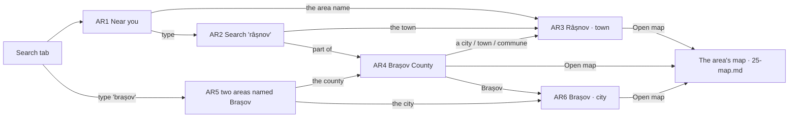

# 26 · Areas in Search (public)

The full spec of the **Public · Areas** page in the design canvas. People find **areas** in Search the same way they find places: a county, city, town, commune or village. Every area has one profile with the places inside it, and **Open map** opens the map of that area. This replaces browsing a free map from a Map tab, so the page also has two options for the **bottom bar without Map**.

Read `01`–`07` first, and `25-map.md` for the labels and the places sheet; this file only adds what is specific to these screens.

References for every screen at three sizes:
`../screenshots/{small,medium,large}/<id>.png` (what it must look like) and `../screens/{small,medium,large}/<id>.html` (exact values, clickable).

| Step | Screen id | Canvas board |
|---|---|---|
| Search with Near you | `AR1-near-you` | 1 · Search: Near you (Râșnov) opens its profile |
| Search "râșnov" | `AR2-search-town` | 2 · Search "râșnov": the town, then the county it is part of |
| Town profile | `AR3-town` | 3 · Râșnov (town): its places, Open map |
| County profile | `AR4-county` | 4 · Brașov County: its areas by kind, each opens its profile; Open map |
| Search "brașov" (one name, two areas) | `AR5-search-same-name` | 5 · Search "brașov": two areas with one name, the smaller first |
| City profile | `AR6-city` | 6 · Brașov (city): its places, Open map |
| Bottom bar without Map · A | `NB1-bar-activity` | Bar A · Activity instead of Map |
| Bottom bar without Map · B | `NB2-bar-reservations` | Bar B · Reservations instead of Map |

The sample story is Brașov County: you are in Râșnov, you search Râșnov, and you go up to the county or across to Brașov. Every count adds up across the screens.

Decisions, so they are not undone:
- **One profile for every area**, at every level and in every country. Only the kind word changes (County, City, Town, Commune, Village).
- **No Follow** on an area. The one button is **Open map**, in the black primary style.
- **Search decides the level.** There is no City / County switch on the profiles; a county lists the areas inside it, and an area names the one it is part of.
- **Near you is a picture** of the map around the person, not a live map. The live map loads only after **Open map**.
- **The bottom bar has no Map.** Two options are in this handoff, A (Activity) and B (Reservations). Choose one before building.

---

## 1. Flow

Rules:
1. **Areas form a tree** of any depth. Each country decides its kinds:

   | Country | Top | Inside it | Inside those |
   |---|---|---|---|
   | Romania | County (Județ) | City (Municipiu), Town (Oraș), Commune (Comună) | Village (Sat), inside a commune |
   | Spain | County (Provincia) | City (Municipio) | — |

   The screens only show the kind word, so they never assume a fixed depth.
2. **Near you (AR1)** is the smallest area with places that contains the person. It shows that area's name and the area it is in, a picture of the map around the person, the three labels with that area's counts, and **Open map**. The area name opens the area's profile. Without location permission, Search shows no Near you card.
3. **Searching an area (AR2)**: in the All tab, matching areas come before places. Each area result shows:
   - its picture;
   - its name, kind and the area it is in;
   - its three label counts.

   Under it, "<area> is part of" shows the area one level up. Only areas with at least one place are shown.
4. **One name, several areas (AR5).** Areas with the same name are grouped in one card, "<n> areas named <name>", the smaller first. Each row says its kind, the area it is in and how many places it has.
5. **The area profile (AR3, AR4, AR6)** is the same screen at every level:
   - a picture with the kind badge;
   - the name, and "<Kind> · <the area it is in>";
   - the three labels added up over everything inside;
   - **Open map**;
   - the tabs.
6. **Tabs.**
   - An area with areas inside: **Inside** · Videos · Places · Deals, with Inside open.
   - The smallest areas: Videos · **Places** · Deals, with Places open.
   - Places lists the places in the area as the Search place rows (`16-search.md`), and keeps loading as you scroll.
7. **Inside** groups the areas one level down by kind: "Cities · 4", "Towns · 6", "Communes · 48". Each section shows the two with the most places, then "See all <n> <kinds>", which opens the full list of that kind sorted by places. With only one kind inside (a commune's villages), it is one plain list. Any area opens its profile.
8. **Open map** opens the map of that exact area: fitted to its border, showing only what is inside it, with the labels pill and the places sheet from `25-map.md`. The map view itself is not drawn in this handoff.
9. **Back** goes back the way you came (Search, or the area above).

## 2. AR1 · Near you (C102)

| Part | Spec |
|---|---|
| Card | `bg.surface`, 1 `line.card`, radius 18, under the search field (14 below it), side margins 16. |
| Head | 52 tall, padding `0 8 0 14`: "Near you" 15/600 · the kind icon 15 + "<area> · <area it is in>" 13 `text.secondary` · `chevron-right` 20 `text.tertiary`. The whole head opens the area's profile. |
| Picture | 140 tall, full card width: a static image of the map around the person (streets and coloured dots for places, no labels), the person's dot in the middle (18, `#2F7BEA`, 3 white border, 8 halo at 18 %). Top right: **Open map**, a white pill 34 tall, radius 17, `map` 16 + 13.5/600, shadow `0 1 6 rgba(0,0,0,.16)`. |
| Labels | A row of three equal cells under a `line.rowSeparator` line, separated by the same line: the label's icon 22 (stroke 2, `category.*`), the count 15/600, the name 11.5 `text.secondary`. A cell opens the area's map with that label picked. |

Under the card: Recent (C52), as in SR1.

## 3. AR2 / AR5 · Areas in the search results (C103)

| Part | Spec |
|---|---|
| Area card | `bg.surface`, 1 `line.card`, radius 18. The area's picture 96 tall on top. |
| Area row | Min 68 tall, padding `10 8 10 14`, gap 12: a 44 circle in the kind's colour (`area.*`) with the kind icon 20 white · the name 15/600 over "<Kind> · <area it is in>" 12.5 `text.secondary` (one line, ellipsis) · `chevron-right` 20. |
| Label counts | As in C102, under the row (AR2). |
| Part of | A second card: "<area> is part of" 12/500 `text.secondary` (padding `10 14 0`), then the area row of the area one level up, with "<Kind> · <n> areas inside · <n> places". |
| Same name (AR5) | One card: the picture, "<n> areas named <name>" 12/500 `text.secondary`, then one area row per area, the smaller first, each with "<Kind> · in <area> · <n> places" or "<Kind> · <n> areas inside · <n> places", rows separated by `line.rowSeparator`. |

Then the places that match, as place result rows (C54).

## 4. AR3 / AR4 / AR6 · The area profile (C104, C105)

| Part | Spec |
|---|---|
| Top bar | 56: ← (44) · the area's name 15/500, centred · `more-vertical` (44). |
| Picture | 76, round, the area's picture, 1 `line.divider` ring. The kind badge sits on its bottom right: 28, round, the kind's colour, the kind icon 15 white, a 2.5 `bg.page` border. |
| Name | 21/700, 12 under the picture; under it "<Kind> · <area it is in>" (a county: "County · <country> · <n> areas inside") 13 `text.secondary`. |
| Labels | Three equal columns, 14 below: the label icon 15 (`category.*`) + the count 17/500, over the label name 12 `text.secondary`. |
| Open map | 16 below, full width, 48 tall, radius 14, `action.primary`, `map` 20 + "Open map" 15/500 white. |
| Tabs | 12 below, the tab style of C4 / C51 (56 tall, icon 20 over the name 12, the open one 500 with a 2 ink underline, the others at 0.4): Inside (`layout-grid`) · Videos · Places · Deals, or Videos · Places · Deals. |
| Inside (C105) | Per kind: the header "<Kinds> · <n>" 15/600 (padding `16 16 8`), then a card with the two areas with the most places (area rows) and "See all <n> <kinds>" 14/600 with `chevron-right` (48 tall, a `line.rowSeparator` line above). |
| Places | The Search place result rows (C54) in one card. |

## 5. Bottom bar without Map (C106)

The bottom bar loses Map. Its slot goes to one of two options, so the **+** stays in the middle:

| Option | Slots | The new slot |
|---|---|---|
| **A · Activity** (`NB1-bar-activity`) | Home · Search · + · **Activity** · Profile | My activity (`15-my-activity.md`): bookings and rewards. Icon `calendar-check`. |
| **B · Reservations** (`NB2-bar-reservations`) | Home · Search · + · **Reservations** · Profile | Reservations. Icon `calendar` with day dots (the SVG path in the HTML). |

Both keep the bar of C9 as it is: 72 tall, `dark.navBar`, five equal columns, icons 24 over labels 10.5 (`dark.navInactive`; the open one white and 500), the + a 44 circle `dark.navCreate`. **A dot** on the new slot's icon (8, `status.warning`, 2 ring in the bar colour, at its top right) shows when something waits: a booking to see (A) or a reservation to answer (B).

When one option is chosen, the Map slot changes in every screen's bar; the other screens keep their bar as drawn until then.

## 6. New components

| # | Component | Spec |
|---|---|---|
| C102 | **Near you card** | §2 — the area you are in: head (opens its profile), a picture of the map with your dot and Open map, the three labels with counts |
| C103 | **Area result** | §3 — the area card in search: picture, area row, label counts; "part of" row; the same-name group |
| C104 | **Area profile header** | §4 — picture with the kind badge, name, kind · parent, labels added up, Open map (black, full width) |
| C105 | **Inside sections** | §4 — one section per kind: "<Kinds> · <n>", the two biggest, See all |
| C106 | **Bottom bar without Map** | §5 — option A (Activity) or B (Reservations) in the Map slot, with the waiting dot |

Reused:
- the search field (C50), the greyed tabs (C51), the recent rows (C52) and the place result rows (C54) from `16-search.md`;
- the profile tabs (C4);
- the label icons and `category.*` colours, and the labels pill and places sheet of the area's map (`25-map.md`);
- the bottom navigation (C9).

## 7. Copy (EN)

| Where | Copy |
|---|---|
| AR1 | "Near you" · "<area> · <area it is in>" · "Open map" · "Food & Drinks" · "Accommodations" · "Entertainment" |
| AR2 / AR5 | "<Kind> · <area it is in>" · "<area> is part of" · "<n> areas named <name>" · "<Kind> · in <area> · <n> places" · "<Kind> · <n> areas inside · <n> places" |
| Profiles | "<Kind> · <area it is in>" · "County · <country> · <n> areas inside" · "Open map" · "Inside" · "Videos" · "Places" · "Deals" · "<Kinds> · <n>" · "See all <n> <kinds>" · "<Kind> · <n> places" |
| Kinds | County / Counties · City / Cities · Town / Towns · Commune / Communes · Village / Villages (RO: Județ, Municipiu, Oraș, Comună, Sat) |
| Bars | "Home" · "Search" · "Activity" or "Reservations" · "Profile" |

Area names are the official names, with their diacritics. Counts use the local thousands separator (2,140 / 2.140).

## 8. Small / large phones

- Only widths change: cards, rows, the label cells and the tabs stretch; text, icons, the picture (76) and the buttons keep their size. The Near you picture fills the card at every width.
- On small phones the lists scroll under the bottom bar: AR1 shows the Near you card and the start of Recent; the profiles show the header, Open map, the tabs and the first rows.
- The bars keep five equal columns at 360, 390 and 430; "Reservations" fits under its icon at 360.
- Nothing is cut at any size: names and lines end with an ellipsis; counts never wrap.

## 9. Data

See `06-data-model.md` → *Areas*: `Area` (the tree, kinds, counts), the area results in `SearchPage`, `NearYouQuery`, `AreaInsideQuery`, `AreaPlacesQuery`, and the area of each business.

## 10. Definition of done for this page

- [ ] AR1–AR6, NB1 and NB2 match their screenshots at small, medium and large (overlay at 50 %: no shifted or resized elements).
- [ ] Near you shows the area the person is in, as a picture with the labels and counts; its name opens the area's profile; Open map loads the live map only then.
- [ ] Searching an area shows it before places, with the area it is part of; areas with the same name are grouped, the smaller first; only areas with places show.
- [ ] Every area uses the same profile: kind badge, kind · parent, labels added up, Open map (black), no Follow; Inside (sections by kind, two biggest, See all) when it has areas inside, Places when it is the smallest.
- [ ] Open map opens the map of that exact area, fitted to its border, with the labels pill and places sheet of `25-map.md`.
- [ ] The bottom bar has no Map; the chosen option (A Activity or B Reservations) takes its slot, the + stays in the middle, and the dot shows when something waits.
